Table of Contents
- [Where the last article left off](#recap)
- [The setup](#setup)
- [How I profile](#how)
- [Round 0: profile the baseline](#round0)
- [Round 1: tile sizes, `num_warps` and `num_stages`](#round1)
  - [The shared-memory budget for an Ada SM](#budget)
  - [The sweep](#sweep)
  - [The heatmaps](#heatmaps)
  - [The winner, through the unchanged harness and tests](#winner)
- [Round 2: profile the tuned kernel](#round2)
- [Round 3: wrap the winner in `@triton.autotune`, and what it costs](#round3)
- [Round 4: inside the inner loop](#round4)
  - [Causal tile-skipping](#skip)
  - [`exp2`](#exp2)
  - [The P cast](#pcast)
- [Round 5: re-tune, then the final profile](#round5)
- [What to look for, as a checklist](#checklist)
- [Results](#results)
- [Future articles](#future)

In my [previous article](https://dev.to/lewis_won/flashattention-2-from-pytorch-to-triton-4ein), I wrote a FlashAttention-2 (FA2) kernel which achieved about 22 TFLOP/s, 32% of PyTorch's `scaled_dot_product_attention` (SDPA) at N = 4096, and 18% for causal attention. 

In this article, I will optimise my kernel with the following loop:

1. **Profile** the kernel to identify bottlenecks.
2. **Change one thing** to address a bottleneck.
3. **Measure** the performance of the amended kernel against the original kernel.
4. **Profile again**, to confirm the change, and identify the next bottleneck.

In this article, I first optimise the outer loop of FA2 by changing the tile sizes, `num_warps` and `num_stages`, working through the shared-memory budget of an Ada SM, sweeping the configuration space, drawing the heatmap, and wrapping the winner in `@triton.autotune` and measuring the compile time. 

I then optimise the inner loop by skipping the tiles that causal masking throws away, switching `exp` to `exp2`, and looking at what the cast of `P` to bf16 compiles to. I will also include screenshots of Nsight Systems and Nsight Compute and analysis of the roofline chart.

 
 `P` is the kernel's `P_ij`, i.e. the tile of unnormalised attention probabilities, i.e. the softmax numerators before they are divided by the row sum. For query tile `i` and key tile `j`:
- S = Q_i K_jᵀ · scale is the tile of scores.
- P = exp(S − m), where m is the running maximum of each row.

```python
S_ij = tl.dot(Q_i, tl.trans(K_j))                    # scores, fp32
m_new = tl.maximum(m_acc, tl.max(S_ij, axis=1, keep_dims=True) * qk_scale)
P_ij = tl.math.exp2(S_ij * qk_scale - m_new)         # P, in fp32
# ...
l_acc = alpha * l_acc + tl.sum(P_ij, axis=1, keep_dims=True)   # row sums of P go into l
P_ij = P_ij.to(V_j.dtype)                            # "the cast of P to bf16"
O_acc = tl.dot(P_ij, V_j, acc=O_acc)                 # P V goes into O
```


I did not change the benchmark harness [`bench_flashattention.py`](https://github.com/searlion/cs336-2026-assignment2-systems/blob/main/flash_forward/2026_10_03_followup/bench_flashattention.py) and the test file [`test_flashattention_triton.py`](https://github.com/searlion/cs336-2026-assignment2-systems/blob/main/flash_forward/2026_10_03_followup/test_flashattention_triton.py) from the previous article, so every number here can be compared with the numbers there. 

In summary, below is how the optimised FA2 in this article compare to the FA2 in SDPA and the previous article's kernel (median of ten runs):

| | Previous article's kernel | This article's kernel | SDPA |
|---|---|---|---|
| Non-causal | 6.39 ms, 21.5 TFLOP/s, 32% of SDPA | 1.95 ms, 70.3 TFLOP/s, 103% of SDPA | 2.01 ms, 68.4 TFLOP/s |
| Causal | 6.38 ms, 10.8 TFLOP/s, 18% of SDPA | 1.08 ms, 63.8 TFLOP/s, 104% of SDPA | 1.12 ms, 61.5 TFLOP/s |

The improvment in kernel performance came from:
- Tuning of tile size and warp count;
- Not wasting TFLOPs on computing the tiles covered by causal masking; and 
- Switching `exp` to `exp2`, and re-tuning with autotune. 

Using Nsight Compute, I profiled my optimised non-causal kernel at 92% of the tensor cores' peak, and SDPA at 89%. 

All numbers are from the same RTX 4070 SUPER under Ubuntu. This article assumes you have read my [previous article](https://dev.to/lewis_won/flashattention-2-from-pytorch-to-triton-4ein), am comfortable with [FlashAttention-2](https://dev.to/lewis_won/flashattention-by-hand-34im) forward pass and basic Triton. 

This article was written with the assistance of AI. If you spot any mistakes, please let me know.

<a id="recap">
## Where the last article left off
</a>

In my previous article, my unoptimised kernel gives each program one tile of 16 query rows and loops over all keys in tiles of 16, keeps the running max `m`, the running sum `l` and the unnormalised output `O` in fp32. My unoptimised kernel used Triton's defaults of 4 warps per program and 3 pipeline stages. 

I listed the following problems in my previous article:
1. No profile.
2. The tiles are too small.
3. Causal attention computes every tile and masks half of them away.
4. `tl.exp` instead of `tl.math.exp2`.
6. The mask is computed on every tile.

<a id="setup">
## The setup
</a>

### The GPU

The goal of kernel optimisation here is to keep the GPU cores fully utilised. Below are the properties of RTX 4070 SUPER. These properties are derived from  `torch.cuda.get_device_properties`, Triton's `driver.active.utils.get_device_properties()` and NVIDIA's documentation for compute capability 8.9. The last three rows are measured.

| | RTX 4070 SUPER |
|---|---|
| Architecture | Ada Lovelace (AD104), compute capability 8.9, `sm_89` |
| Streaming multiprocessors (SMs) | 56 |
| Registers per SM | 65,536 32-bit registers, at most 255 per thread |
| Resident threads per SM | up to 1,536 (48 warps) in up to 24 blocks |
| L1 + shared memory per SM | 128 KB, of which up to 100 KB (102,400 bytes) can be shared memory |
| Shared memory per block (program) | up to 99 KB (101,376 bytes), plus 1 KB the driver reserves for every block |
| L2 cache | 48 MB |
| DRAM | 12 GB GDDR6X, 504 GB/s peak |
| Tensor-core peak, bf16 inputs with fp32 accumulation (measured) | 512 FLOP per clock per SM: 72.2 TFLOP/s at the 2.52 GHz Nsight Compute locks the clock to, 75 to 77 TFLOP/s at the 2.61 to 2.68 GHz at which the final kernel and SDPA ran during a harness run at N = 4096 |
| cuBLAS bf16 matmul, 8192 × 8192 × 8192 (measured) | 69.4 TFLOP/s; 70.9 TFLOP/s in a later 12-second run at 2.66 GHz, 93% of the peak at that clock |
| Device-to-device copy (measured) | 414 to 427 GB/s, counting the bytes read and the bytes written |

I would like to highlight the following details:
- **Tensor core peak:** On GeForce Ada cards, the tensor cores' peak for fp16 inputs is twice as high with fp16 accumulation as with fp32 accumulation. Nsight Compute lists 1,024 operations per clock per SM for "fp16 in, fp16 out" against 512 for "fp16 in, fp32 out". bf16 inputs accumulating in fp32 also has 512 operations per clock per SM. Because the attention kernel takes bf16 inputs and needs fp32 accumulation, so the ceiling for this article is 512 operations per clock per SM.
- **TFLOP/s ceiling changes with clock speed:** This is why Nsight Compute locks the clock at 2.52 GHz, where the ceiling is 72.2 TFLOP/s. During actual runs outside of Nsight Compute, the optimised kernel and SDPA ran at 2.61 to 2.68 GHz at N = 4096, where the ceiling is 75 to 77 TFLOP/s. SDPA, for example, ran at 2.62 GHz and reached 66.7 TFLOP/s, 88.6% of the ceiling at that clock. 
- **Size of shared memory:** Ada has 100KB per SM and 99KB per program, compared to an A100 which has 164 KB of shared memory per SM and an H100 228 KB. The size of shared memory influences the tuning parameters of the optimised kernel.

### Software and files

These are the software versions I used:
- PyTorch 2.11 (CUDA 13.0)
- Triton 3.6.0
- Nsight Systems 2026.1.3
- Nsight Compute 2026.2.1
- Nvidia driver 595.91. 

Each version of the kernel lives in its own folder with the same file name, `flashattention_autograd_function_triton.py`, so the unchanged harness and the unchanged test file can import whichever one is on the path:

```bash
PYTHONPATH=kernels/v1_tiles python bench_flashattention.py
PYTHONPATH=kernels/v1_tiles python -m pytest -q test_flashattention_triton.py
```

| Folder | What changes |
|---|---|
| [`kernels/v0_baseline`](https://github.com/searlion/cs336-2026-assignment2-systems/tree/main/flash_forward/2026_10_03_followup/kernels/v0_baseline) | the kernel from the previous article, unchanged |
| [`kernels/v1_tiles`](https://github.com/searlion/cs336-2026-assignment2-systems/tree/main/flash_forward/2026_10_03_followup/kernels/v1_tiles) | the same kernel body, with the tile sizes, `num_warps` and `num_stages` from the sweep |
| [`kernels/v2_autotune`](https://github.com/searlion/cs336-2026-assignment2-systems/tree/main/flash_forward/2026_10_03_followup/kernels/v2_autotune) | v1 wrapped in `@triton.autotune` |
| [`kernels/v3_causal_skip`](https://github.com/searlion/cs336-2026-assignment2-systems/tree/main/flash_forward/2026_10_03_followup/kernels/v3_causal_skip) | the key loop split into unmasked tiles, diagonal tiles, and nothing above the diagonal |
| [`kernels/v4_exp2`](https://github.com/searlion/cs336-2026-assignment2-systems/tree/main/flash_forward/2026_10_03_followup/kernels/v4_exp2) | v3 with the softmax scale and log₂e folded into one multiply-add, and `exp2` |
| [`kernels/v5_final`](https://github.com/searlion/cs336-2026-assignment2-systems/tree/main/flash_forward/2026_10_03_followup/kernels/v5_final) | v4 wrapped in `@triton.autotune`, with configurations from a second sweep |

All other artifacts including the sweep, profiling drivers, compile-cost measurements, plotting scripts and raw results are in [`2026_10_03_followup/`](https://github.com/searlion/cs336-2026-assignment2-systems/tree/main/flash_forward/2026_10_03_followup). 

### The baseline, re-measured

Before changing anything, I re-ran the unchanged harness on the unchanged kernel, to check that today's GPU gives the same numbers as the day the previous article was written. Each result is the median of ten runs. We can see that today's measurement and the previous article's agree to within ~5%.

| N | causal | previous article (ms) | today (ms) | 
|---|---|---|---|
| 512 | no | 0.107 | 0.114 | 
| 1024 | no | 0.386 | 0.387 | 
| 2048 | no | 1.534 | 1.540 |
| 4096 | no | 6.195 | 6.386 | 
| 4096 | yes | 6.155 | 6.383 | 

<a id="how">
## How I profile
</a>

There are two NVIDIA profilers, and they answer different questions.

- **Nsight Systems** (`nsys`) records a timeline of the whole program. This involves tracking Python threads, CUDA API calls, and every kernel on the GPU. It answers "where does the time go, and is the GPU busy?". It is cheap to run and rarely changes the program's behaviour.
- **Nsight Compute** (`ncu`) profiles individual kernel launches. It replays each launch dozens of times, reading a different set of hardware counters on each pass, and turns them into utilisation, stall and memory-traffic numbers. It answers "why is this kernel as slow as it is?".

I will run Nsight Systems first to identify kernels with bottlenecks, then Nsight Compute on a specific kernel.

A third tool is the compiler itself. Every compiled Triton kernel keeps its intermediate representations, so I can see what the compiler did with my code without a profiler, and this include looking at register count, spills, shared memory, the layout it chose for each tensor, and the final machine code.

### A small program to profile

Profiling the benchmark harness directly is possible, but it launches each kernel hundreds of times between cache-flushing kernels. I profile a short driver instead. It compiles the kernel outside the region of interest, then runs it three times inside NVTX ranges (named regions that show up on the timeline), next to SDPA on the same inputs:

```python
# profile_driver.py (abridged)
# B = 4 sequences in a batch, H = 8 attention heads, and D = 64 numbers per head per token
B, H, D = 4, 8, 64  # the harness shape.
# Three random tensors of shape (B·H, N, D) = (32, N, 64).
# The (... for _ in range(3)) part calls torch.randn three times, so q, k and v hold different values. 
q, k, v = (torch.randn(B * H, args.N, D, device="cuda", dtype=torch.bfloat16) for _ in range(3))
# The same memory, relabelled as (4, 8, N, 64). .view copies nothing, and it only changes the shape and strides. 
q4, k4, v4 = (t.view(B, H, args.N, D) for t in (q, k, v))

# Warm-up: compile (and autotune, if the version autotunes) outside the ranges, then keep
# the GPU busy for about a second so its clocks have ramped up before the capture starts.
t0 = time.perf_counter()
while time.perf_counter() - t0 < 1.0:
    FlashAttentionTriton.apply(q, k, v, causal)
    F.scaled_dot_product_attention(q4, k4, v4, is_causal=causal)
    torch.cuda.synchronize()

# nsys --capture-range=cudaProfilerApi records only what runs between start and stop.
torch.cuda.cudart().cudaProfilerStart()
for _ in range(args.iters):
    torch.cuda.nvtx.range_push(f"ours N={args.N} causal={causal}")
    FlashAttentionTriton.apply(q, k, v, causal)
    torch.cuda.nvtx.range_pop()
    torch.cuda.nvtx.range_push(f"sdpa N={args.N} causal={causal}")
    F.scaled_dot_product_attention(q4, k4, v4, is_causal=causal)
    torch.cuda.nvtx.range_pop()
torch.cuda.synchronize()
torch.cuda.cudart().cudaProfilerStop()
```

[`compare_driver.py`](https://github.com/searlion/cs336-2026-assignment2-systems/blob/main/flash_forward/2026_10_03_followup/compare_driver.py) does the same for several kernel versions in one process, so one timeline or one Nsight Compute report can hold all of them side by side.

### The commands

```bash
# Timeline: only the region between cudaProfilerStart and cudaProfilerStop.
nsys profile --trace=cuda,nvtx --capture-range=cudaProfilerApi --capture-range-end=stop \
    -o results/nsys/round0 python profile_driver.py kernels/v0_baseline --N 4096 --causal 0

# Counters: every kernel in the same region, with the full set of sections.
ncu --set full --import-source yes --profile-from-start off \
    -o results/ncu/v0_N4096_nc python profile_driver.py kernels/v0_baseline --N 4096 --causal 0 --iters 1 --sdpa 0
```

Then open the `.nsys-rep` file in `nsys-ui` and the `.ncu-rep` file in `ncu-ui`. `--set full` collects nearly every section, including the roofline charts. `--import-source yes` copies the Python source into the report, so the Source page can show which line of the kernel each instruction came from.

Three points to take note:
1. **Nsight Compute changes the conditions it measures.** (`--clock-control boost`) locks the GPU clock speed, which on my card means 2.52 GHz, below the 2.6 to 2.7 GHz the card runs the harness at. It also flushes the caches before every replay pass, and runs the kernel about 45 times. 
2. **Triton's cache can point the profiler at the wrong file.** To ensure Triton is pointing at the correct file, point `TRITON_CACHE_DIR` at an empty directory before profiling. Otherwise, Triton may reuse the cached binary, and the binary's line information may still be pointing at the old file path.
3. **Nsight Compute's suggestions are hypotheses, not diagnoses.** The Summary page ranks "optimisation opportunities" with estimated speedups. For the baseline below, the top two were "theoretical occupancy" (20%) and "shared store bank conflicts" (9%), which may not necessarily be the actual bottlenecks.

### What the compiler did

[`inspect_kernel.py`](https://github.com/searlion/cs336-2026-assignment2-systems/blob/main/flash_forward/2026_10_03_followup/inspect_kernel.py) compiles one configuration without launching it and prints what the compiler produced. The TTGIR (Triton GPU IR) is the last stage where the program still looks like the Python, but every tensor now carries a layout that says which thread and which warp holds which element, and most trips through shared memory are explicit operations.

```python
compiled = flash_fwd_kernel.warmup(q, k, v, o, L, *strides, N, N, scale,
                                   D=64, Q_TILE_SIZE=16, K_TILE_SIZE=16, is_causal=False,
                                   num_warps=4, num_stages=3, grid=(N // 16, B))
compiled._init_handles()                  # loads the module, which fills in n_regs and n_spills
print(compiled.n_regs, compiled.n_spills, compiled.metadata.shared)
print(compiled.asm["ttgir"])              # Triton GPU IR: layouts and shared-memory buffers
print(compiled.asm["ptx"])                # PTX
cubin = compiled.asm["cubin"]             # SASS via: nvdisasm -c -g kernel.cubin
```

<a id="round0">
## Round 0: profile the baseline
</a>

By profling the baseline unoptimised kernel from the previous article, we can find out why was the kernel so slow. Everything here is at N = 4096, non-causal, bf16 input.

### Step 1: the timeline

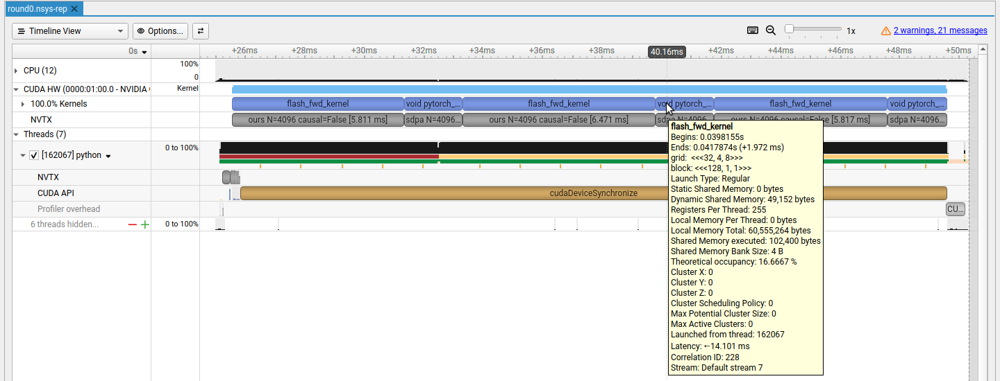

What I look for in a timeline, in this order:

1. **Gaps in the GPU row.** The row labelled CUDA HW shows when the GPU is running a kernel. If it is idle between kernels, the bottleneck is outside of the kernel, e.g. Python, the launcher, synchronisation.
2. **How many kernels each call launches**, and which of them takes the time.
3. **The kernel's duration next to a reference** that does the same work on the same inputs.

What the timeline above shows:

- **No gaps.** The GPU row is solid from the first kernel to the last. On the CPU thread, the NVTX ranges are tiny ticks at the very start, followed by one long `cudaDeviceSynchronize`: Python queued all six launches under a millisecond and then waited for the GPU. Hovering a kernel shows its launch latency, the time between the launch call and the kernel starting. For the SDPA kernel under the cursor it is 14.1 ms. The timeline shows this is a GPU-bound program, so the kernel is the target for optimisation.
- **One kernel per call.** `flash_fwd_kernel` is the only thing the Triton version launches (for both the unoptimised baseline kernel and the SDPA's FA2), so there is nothing else to look at.
- **3× slower than the reference.** Each of my baseline unoptimised kernels takes 5.8 to 6.5 ms, as compared to each of SDPA's FA2 which takes about 2.0 ms on the same inputs.

Hovering the mouse over the SDPA kernel shows a tooltip with its launch configuration: 128 threads per block (4 warps), 49,152 bytes of shared memory, 255 registers per thread and a theoretical occupancy of 16.7%. Its grid, 32 × 4 × 8, is FA2's query blocks × batch × heads, so each block takes 4,096 / 32 = 128 queries. The tooltip names the kernel `flash_fwd_kernel`, the same name as my Triton kernel. The full name, from nsys stats --report cuda_gpu_kern_sum, says what SDPA runs on this GPU: pytorch_flash::flash_fwd_kernel<Flash_fwd_kernel_traits<64, 128, 128, 4, false, false, cutlass::bfloat16_t, ...>>. That is PyTorch's implementation of the FlashAttention-2 kernel for head dimension 64, with 128 × 128 tiles and 4 warps. 


The three runs of my kernel above differ by up to 11%, and my first capture of this timeline, without the one-second warm-up in the driver, showed SDPA at 3.4 ms. Nsight Systems can show whether the GPU's clock is to blame: `nsys profile --gpu-metrics-devices=0` samples it alongside the kernels. Here are two short captures of the same work, one taken straight after 3 seconds idle, the other after the driver's one-second warm-up:

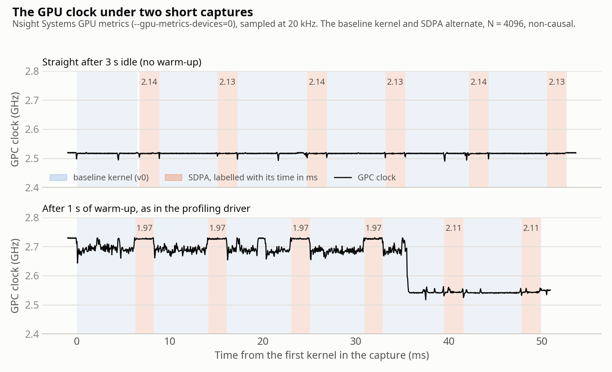

Straight after idle, the GPU ran at 2.52 GHz for the whole capture, and SDPA took 2.13 to 2.14 ms. After the warm-up it ran at 2.69 to 2.73 GHz and SDPA took 1.97 ms, until the clock dropped to 2.54 GHz for the last two calls and SDPA took 2.11 ms. That looks like a warm-up worth 7 to 8%, but longer captures tell a different story:

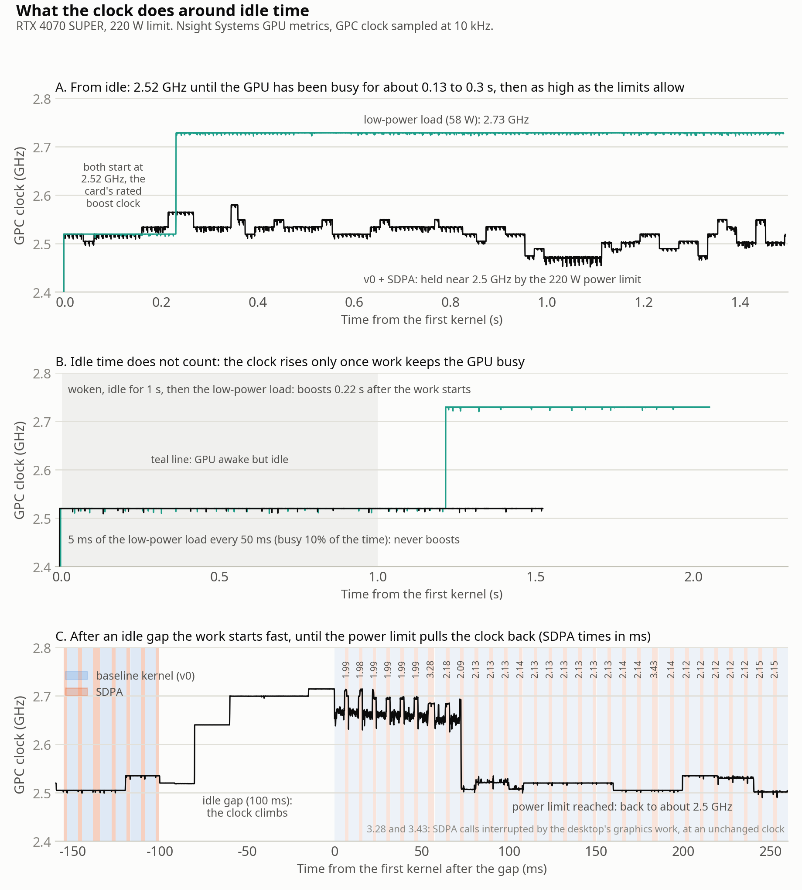

- **The clock waits for sustained work (A, B).** From the idle clock, the first kernel takes the GPU straight to 2.52 GHz, the rated boost clock of this factory-overclocked ASUS card (NVIDIA specifies 2.48 GHz). The clock stays there until the GPU has been kept busy, more or less without a break, for 0.13 to 0.3 s. Idle time does not count, and short bursts do not add up. Woken and then left idle for a second, the GPU was still at 2.52 GHz, and it boosted 0.22 s after the work began. Work in 5 ms bursts every 50 ms, 0.15 s of work in all, did not move the clock in 1.5 s.
- **Then the clock goes as high as the limits allow (A).** A low-power load holds 2.73 GHz. v0 and SDPA together reach the card's 220 W power limit, which holds the clock near 2.5 GHz.
- **Once boosted, the clock rises while the GPU idles (C).** Within 40 to 80 ms of idle it is at about 2.7 GHz. It stays there until the GPU has been idle for about 1.8 s, then falls back to 2.52 GHz. Work that starts inside that window runs fast until the power limit pulls the clock down again, 30 to 130 ms later for v0 and SDPA. After 16 to 17 s of idle the clock heads down to the idle clock, which it reaches 19 to 25 s after the work ended.

The warm capture caught the last of these. To start a capture, Nsight Systems holds the program in `cudaProfilerStart` for about 0.4 s, or 0.6 s with GPU metrics on. So the GPU sat idle after the warm-up, and its clock climbed to 2.73 GHz. The drop to 2.54 GHz 35 ms into the work was the power limit catching up: in sustained runs of this work, the driver reports its power cap as active throughout. The cold capture had the same pause, but no sustained work before it, so its clock stayed at 2.52 GHz. Sustained, this work runs near 2.5 GHz whether the GPU starts cold or warm, and SDPA takes 2.12 to 2.15 ms either way. The Round 0 timeline above was almost certainly taken in the fast window too. Its six kernels ran within the first 24 ms after the pause, and SDPA's 1.97 ms there matches the fast start, about 8% faster than it sustains. The 3× between my kernel and SDPA holds either way, because both ran in the same window.

The clock does not explain the 3.4 ms. Calls like it recur: with no profiler attached, up to 1 SDPA call in 20 took 3.0 to 3.6 ms, though the rate varies widely from run to run. In the longer captures, the SMs sit almost idle for 1.3 to 1.9 ms inside each of these calls, at an unchanged clock, while Nsight Systems shows graphics work (vertex and pixel warps) on the GPU. This card also drives my desktop, and its drawing interrupts the kernels. The SDPA calls that overlapped graphics work took 2.3 to 3.9 ms, and their duration tracks how long the graphics work ran (a correlation of 0.97 to 0.98). No other call took more than 2.37 ms. The 11% spread in the Round 0 timeline above may have the same cause, but that capture has no GPU metrics to check. A single kernel in a timeline is not a benchmark. The timeline is for the shape of the program; the harness is for the time.



### Step 2: the Speed of Light section

Opening the Nsight Compute report on the Details page, the first section is GPU Speed Of Light Throughput. "Speed of light" is NVIDIA's name for the theoretical maximum of each hardware unit, and every number in the section is a percentage of it. The two headline numbers are Compute (SM) Throughput and Memory Throughput. Each is the *maximum* over many sub-units, so the headline alone does not say which unit is busy. The drop-down on the right of the section title switches the chart to GPU Throughput Breakdown, which lists the sub-units:

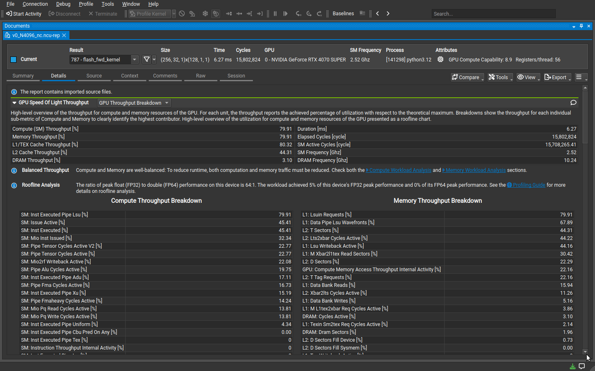

Both headline numbers read 79.9%, and the rule underneath says "Compute and Memory are well-balanced". That sounds healthy. The breakdown says otherwise:

- The top compute entry is `SM: Inst Executed Pipe Lsu` at 79.9%. The LSU (load/store unit) pipe issues memory instructions, and inside an SM that mostly means shared-memory loads and stores. The tensor pipe, which does the matrix multiplies, is at 22.8%.
- The top memory entry is `L1: Lsuin Requests` at 79.9%: the same LSU traffic, seen from the memory side. `DRAM: Cycles Active` is at 3.1%.

So the kernel is busy, but busy moving data around inside each SM, not multiplying it. 

### Step 3: which instructions keep the LSU busy

Further down the Details page, the Compute Workload Analysis section names the busiest pipeline and, under "Most frequently executed instructions for pipeline LSU", the source lines responsible are listed.

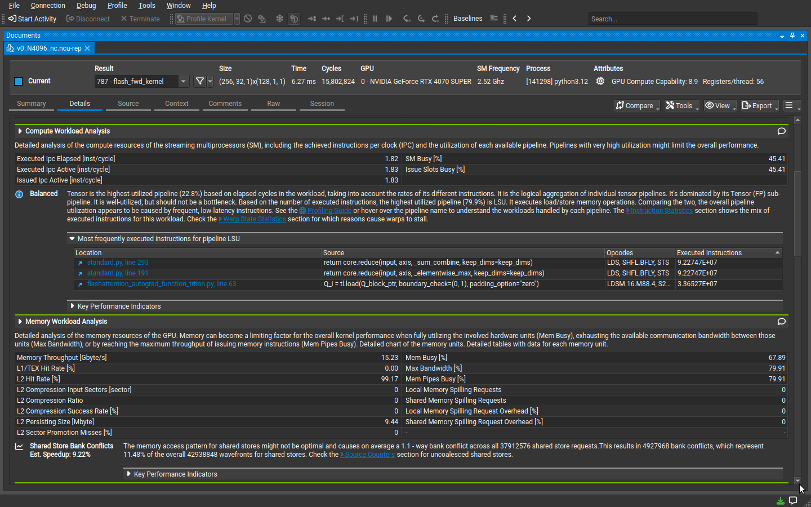

The top two lines are `standard.py` lines 293 and 191. These are Triton's own implementations of `tl.sum` and `tl.max`, which the kernel calls for the running row sum and the row maximum. Their opcodes, `LDS`, `SHFL.BFLY` and `STS`, are shared-memory loads, warp shuffles and shared-memory stores, and each of the two lines executed 92 million of them. A row reduction that stays inside one warp needs only shuffles. One that needs shared memory is combining partial results across warps, which means the rows of the score tile are split across warps. The third line is the load of `Q`, as `LDSM` (load from shared memory into the matrix-multiply registers), 34 million times.

### Step 4: why the warps wait

The Warp State Statistics section shows, for every instruction issued, how many cycles a warp spent waiting and why:

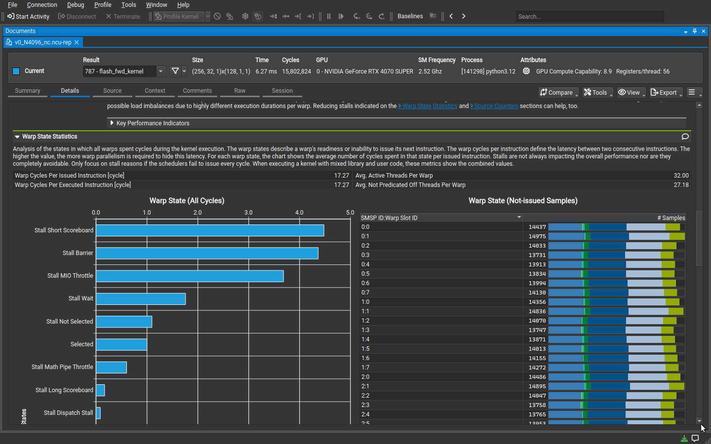

The longest waits, per issued instruction:

| Stall reason | Cycles | What it means |
|---|---|---|
| Short scoreboard | 4.5 | waiting for the result of a shared-memory access (or a special-function op like `exp`) |
| Barrier | 4.4 | waiting at a `__syncthreads()` for the other warps of the program |
| MIO throttle | 3.7 | the queue for shared-memory instructions is full |
| Wait | 1.8 | a fixed-latency dependency between two instructions |
| Math pipe throttle | 0.6 | the target math pipe (here mostly the tensor pipe) is busy |

For comparison, the same section for SDPA's kernel has one dominant reason, math pipe throttle at 6.8 cycles. That is what a healthy compute-bound kernel looks like, i.e. its warps wait because the tensor cores are busy. The baseline unoptimised kernel's warps spend most time waiting on shared memory and on each other.

### Step 5: the roofline

The same drop-down on the Speed Of Light section offers several roofline charts. For a kernel built on `tl.dot` with bf16 inputs, the one that matters is Roofline Tensor Core:

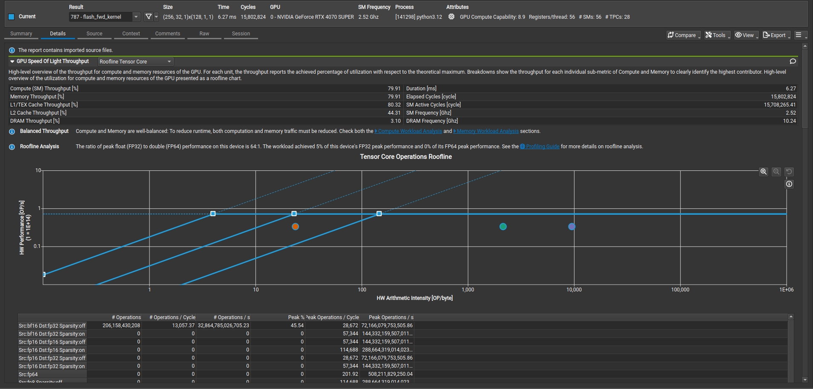

How to read it:

- The horizontal axis is **arithmetic intensity**: operations per byte moved. The vertical axis is achieved operations per second. Both are logarithmic.
- The flat line is the tensor-core peak, 72.2 TOP/s at the locked 2.52 GHz. The three sloped lines are bandwidth limits for L1, L2 and DRAM, from left to right: at a given intensity, no kernel can be faster than bandwidth × intensity. The corner where each sloped line meets the flat line is that level's **ridge point**.
- Each dot is the kernel measured against one level of the memory hierarchy: the same operation count, divided by the bytes that moved through L1, L2 or DRAM. Hovering a dot names its level. Here the orange dot is L2, the green one DRAM and the purple one L1.
- A dot sitting on a sloped line is bound by that level's bandwidth. A dot on the flat line is compute-bound. A dot below both lines, like these, is limited by something else, usually latency or instruction issue, which is what Steps 2 to 4 found.

Two numbers that are key to diagnosing the problem:
1. **The number of operations**. Working from first principle, the algorithm needs 4 × (B·H) × N² × D = 4 × 32 × 4096² × 64 = 137.4 G. However, the table under the chart says the tensor cores did 206G operations. This means the hardware did 1.5 times the work the algorithm needs, which is what happens if one of the two multiplies is done twince. Step 6 below shows that this is what happens in the unoptimised basline kernel. In fact, SDPA's report shows exactly 137.4 G number of operations. Therefore, a third of this kernel's tensor work is discarded. 

2. **The bytes**. A dot's position on the horizontal axis is operations divided by bytes. The L2 dot is at 23.9 operations per byte, so the kernel moved 206 G / 23.9 = 8.6 GB from L2 into the SMs. That is 8.6 GB / 6.27 ms = 1.37 TB/s, which is well within the 3.1 TB/s maximum throughput of the L2 cache, hence transfer from L2 cache is not a bottleneck at this point. DRAM is also not a bottleneck because it only needs to transfer about 71 MB of data into the L2 cache (reads), and 23.9 MB out (writes, mostly the output `O`), hence 95.5 MB in total. Time to move 95.5 MB at DRAM's 504 GB/s means 95.5 MB / 504 GB/s = 0.19 ms, which is well under the 6.27 ms time which the kernel took.

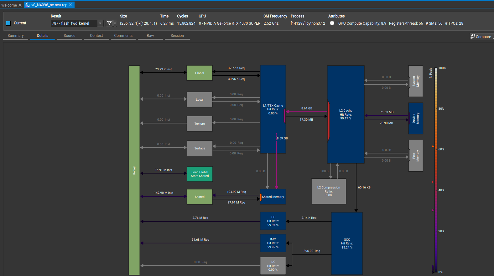

 
The L2 cache is split into 24 slices. Each slice can send 64 bytes to the SMs per clock, and under Nsight Compute the L2 clock runs at 2.02 GHz. That gives at most 24 × 64 × 2.02 G = 3.1 TB/s.


 
Without L2, every program's 1.05 MB of K and V would come from DRAM: 8.6 GB / 504 GB/s = 17 ms. That is almost three times slower than the kernel runs today, and DRAM would then be the bottleneck. Because the 256 programs of a head run together, each byte of K and V comes from DRAM once and is then served from L2 another 255 times. That reuse is what turns 8.6 GB of reads into 50 MB from DRAM.


 
DRAM's minimum traffic is reading `Q`, `K` and `V` and writing `O`, once each: 4 × 32 heads × N × 64 × 2 bytes. The useful work is 4 × 32 × N² × 64 operations. Dividing one by the other gives `N / 2` useful operations per DRAM byte: 2,048 at `N` = 4,096. DRAM's ridge is 72.2 T / 504 G = 143 operations per byte, so DRAM would only become the limit below about N = 290. The work grows with `N²`, while the DRAM traffic grows only with `N`.

One correction to the "71 MB": only 50.3 MB of the reads are the kernel's own `Q`, `K` and `V` (the L2 misses). The other ~21 MB doesn't come from the kernel's loads. L2 also saw 21.5 MB of traffic from units other than the SMs.


### Step 6: ask the compiler why

Steps 2 to 5 left two symptoms unexplained:

1. **Too much tensor-core work.** The tensor cores did 206.2 G operations where the algorithm needs 137.4 G, 1.5 times too many (Step 5).
2. **Too much shared-memory traffic.** The LSU pipe is at 79.9%, `tl.max` and `tl.sum` each execute 92 million shuffle and shared-memory instructions, and the warps stall on short scoreboard, memory input/output (MIO) throttle and barriers (Steps 2 to 4).

 
The warp needs the result of an earlier shared-memory load, shuffle or special-function op (like exp), and it has not arrived yet. Specifically, that earlier instruction went through the MIO path: shared memory, special-function math or shuffles.


 
The warp’s next instruction is a shared-memory access, shuffle or special-function op, and the queue that feeds those units is full, so the instruction cannot issue yet.


Both come from one decision the compiler made: **with a 16 × 16 tile and 4 warps, Triton places the warps side by side along the key axis, so no warp owns a whole row of the tile.** Three problems follow from that one decision, and each one matches a symptom:

| Problem | Where it showed up | Size |
|---|---|---|
| 1. Two of the four warps compute `Q Kᵀ` a second time | roofline operation count (Step 5) | 206.2 G operations instead of 137.4 G |
| 2. Every row maximum and row sum has to combine values from two warps | LSU pipe, the `tl.max` and `tl.sum` lines (Steps 2 and 3) | 92 million instructions per line |
| 3. `P` has to move between warps before `P V` | shared-memory and barrier stalls (Step 4) | 512 bytes stored and reloaded on every iteration |

The rest of this step shows where that layout comes from and then counts each problem, using what the compiler printed.

#### Five facts to start from

**1. The sizes.** The baseline uses `Q_TILE_SIZE` = 16 and `K_TILE_SIZE` = 16, and the head dimension is D = 64. Each iteration of the loop over the keys works on:

| Tensor | What it holds | Shape |
|---|---|---|
| `Q_i` | 16 queries, 64 numbers each | 16 × 64 |
| `K_j`, `V_j` | 16 keys and their 16 values, 64 numbers each | 16 × 64 |
| `S` = `Q_i K_jᵀ` | the scores: one row per query, one column per key | 16 × 16 |
| `P` | `S` after the exponential | 16 × 16 |
| `O` = `O` + `P V_j` | the output: one row per query, 64 numbers each | 16 × 64 |

**2. A program has 4 warps.** A warp is 32 threads that execute the same instruction together. The baseline uses Triton's default `num_warps` = 4, so one program is 128 threads.

**3. The tiles live in registers.** `S`, `P` and `O` are not stored in memory. Their elements are spread over the registers of the 128 threads, a few per thread, and a thread can read only its own registers.

**4. Sharing inside a warp is cheap; sharing between warps is not.** Two threads in the same warp exchange a value register to register with one shuffle (`SHFL`). Two threads in different warps must go through shared memory: one thread stores (`STS`), all the warps of the program wait at a barrier (`BAR.SYNC`, CUDA's `__syncthreads()`) until the slowest arrives, then the other thread loads (`LDS`).

**5. One tensor-core instruction produces one 16 × 8 block.** The instruction is `HMMA.16816`, run by a whole warp. It multiplies a 16 × 16 piece of the left matrix by a 16 × 8 piece of the right one and adds the result into a 16 × 8 block of the output: 16 × 8 × 16 = 2,048 multiplies and 16 × 8 × 16 = 2,048 adds, hence the roofline counts as 2 x 2,048 = 4,096 operations. Each output element is a sum of products, and one `HMMA` adds 16 terms of that sum, so **a block whose sum has K terms needs K / 16 `HMMA`s.**

 
That is simply how matrix multiplication is defined. To get one number in the result, you take one row of the left matrix and one column of the right matrix, multiply them pair by pair, and add up the products.

A tiny example, C = A × B:
```
A = [ 1  2  3 ]      B = [ 7 ]
                         [ 8 ]
                         [ 9 ]

C[0][0] = 1·7 + 2·8 + 3·9 = 7 + 16 + 27 = 50
```

The row of `A` has 3 numbers and the column of `B` has 3 numbers, so you get 3 products, and `C[0][0]` is their sum. Every element of a matrix product is built this way. The number of terms in the sum equals the length of the “shared” dimension, the one that disappears in the multiplication. People usually call it `K`.

In the attention kernel:

* `S = Q Kᵀ`: one score is one query (64 numbers) paired with one key (64 numbers). That gives 64 products, so the sum has 64 terms (`K` = 64, the head dimension).
* `O = P V`: one output number pairs a row of `P` (16 values, one for each key in the tile) with a column of `V` (16 values). That gives 16 terms (`K` = 16, the key tile size).


 
Because the tensor core is a fixed-size circuit, and 16 is the size Nvidia built it for. The name says so where `HMMA.16816` means `M` = 16, `N` = 8, `K` = 16.

`M` = 16: it produces 16 rows of output.
`N` = 8: it produces 8 columns of output.
`K` = 16: for each output element, it handles 16 terms of the sum.

Think of it as a cookie cutter of a fixed shape. One instruction does this:
```
 left piece        right piece         output block
 16 rows ×      ×  16 rows ×       →   16 rows × 8 cols
 16 cols           8 cols              (added onto what's already there)
     ↑                ↑
     └── these 16 are the 16 terms of the sum ──┘
```

For each of the 16 × 8 = 128 output elements, the hardware takes 16 numbers from a row of the left piece and 16 numbers from a column of the right piece. It multiplies them pair by pair, adds the 16 products, and adds that total onto the running value in the output. That is 128 elements × 16 multiply-adds = **2,048 multiply-adds**. Counting each multiply and each add as one operation gives **4,096 operations**.


#### What the compiler chose

The TTGIR gives every tensor a *layout*: which warp, and which thread in that warp, holds each element (fact 3). This is the layout of `S`, the result of the first `tl.dot`:

```
#mma = #ttg.nvidia_mma<{versionMajor = 2, versionMinor = 0, warpsPerCTA = [1, 4], instrShape = [16, 8]}>
```

- `instrShape = [16, 8]` is fact 5: each warp builds its share of the result out of 16 × 8 blocks.
- `warpsPerCTA = [1, 4]` places the 4 warps over the tile: 1 along the rows, 4 along the columns. The warps sit **side by side**, each taking different columns. (CTA, cooperative thread array, is CUDA's name for a thread block; one Triton program runs as one block.)

Why side by side? The two `tl.dot`s are chained: `S` feeds `P`, and `P` is the left input of the second `tl.dot`. For chained dots, Triton 3.6 puts all the warps along one axis and uses the same placement for both (`warpsPerTileV2` in [`AccelerateMatmul.cpp`](https://github.com/triton-lang/triton/blob/v3.6.0/lib/Dialect/TritonGPU/Transforms/AccelerateMatmul.cpp)). Here the axis follows the shape of `O`:

- at least as many rows as columns: warps **stacked**, each taking different rows;
- fewer rows than columns: warps **side by side**, each taking different columns.

`O` is 16 × 64, so the warps go side by side. Stacking would not have helped anyway because the tile is 16 rows and a block is 16 rows, so there is only one row of blocks to share out.

#### How the 4 warps divide each tile

Counting 16 × 8 blocks:

- `S` is 16 × 16: 1 block tall and 2 wide, so **2 blocks for 4 warps**.
- `O` is 16 × 64: 1 block tall and 8 wide, so **8 blocks, 2 per warp**.

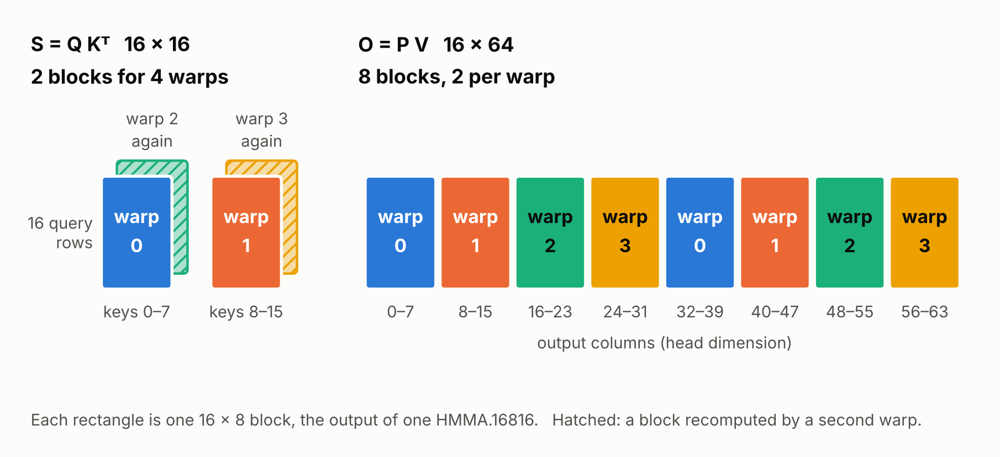

Warps 0 and 1 take the two blocks of `S`. There is nothing left for warps 2 and 3, but all four warps run the same instruction stream, so a warp cannot sit out. The layout wraps around and gives warps 2 and 3 the same two blocks again: they compute them a second time. For `O`, warp *w* takes columns 8*w* to 8*w* + 7 and, wrapping around, columns 32 + 8*w* to 32 + 8*w* + 7.

There are three problems with the above setup that affects the kernel's efficiency.

#### Problem 1: the first multiply is done twice

Using the rule from fact 5:

- `S = Q Kᵀ`: each score sums over the 64 numbers of a query and a key, so 64 / 16 = **4 `HMMA`s per block**. Two blocks need 8.
- `O = P V`: each output number sums over the 16 keys of the tile, so 16 / 16 = **1 `HMMA` per block**. Eight blocks need 8.

| Multiply | Blocks | `HMMA`s per block | `HMMA`s needed | `HMMA`s each warp runs | `HMMA`s all 4 warps run |
|---|---|---|---|---|---|
| `Q Kᵀ` | 2 | 4 | 8 | 1 block × 4 = 4 | 16 |
| `P V` | 8 | 1 | 8 | 2 blocks × 1 = 2 | 8 |
| Both | | | **16** | 6 | **24** |

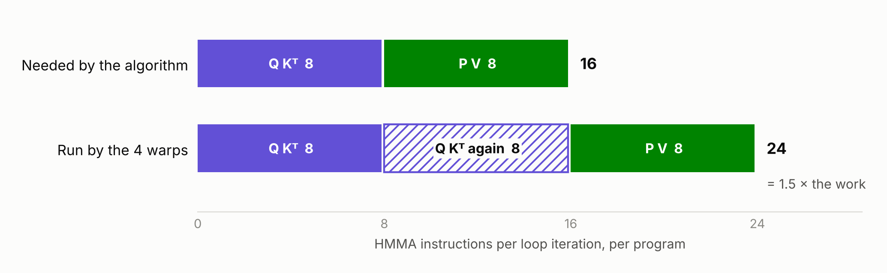

24 / 16 = 1.5, the ratio from the roofline. The Source page of Nsight Compute agrees: per warp and per iteration, the `Q Kᵀ` line executes 4 `HMMA`s and the `P V` line 2.


- Each program runs 4,096 / 16 = 256 iterations, one per key tile.
- There are 4,096 / 16 = 256 programs per head and 32 heads: 8,192 programs.
- So 8,192 × 256 = 2,097,152 iterations in total.
- Needed: 2,097,152 × 16 `HMMA`s × 4,096 operations = **137.4 G** operations.
- Executed: 2,097,152 × 24 `HMMA`s × 4,096 operations = **206.2 G** operations.

The extra 68.7 G operations are warps 2 and 3 computing `S` a second time.


#### Problem 2: every row maximum and row sum goes through shared memory

`tl.max(S, axis=1)` needs the largest of each row's 16 scores, and `tl.sum(P, axis=1)` the total of each row's 16 values of `P`. With the warps side by side, every row is cut in two: warp 0 holds keys 0–7 and warp 1 holds keys 8–15 (warps 2 and 3 hold copies). Joining the halves means crossing between warps, so it means shared memory and barriers (fact 4):

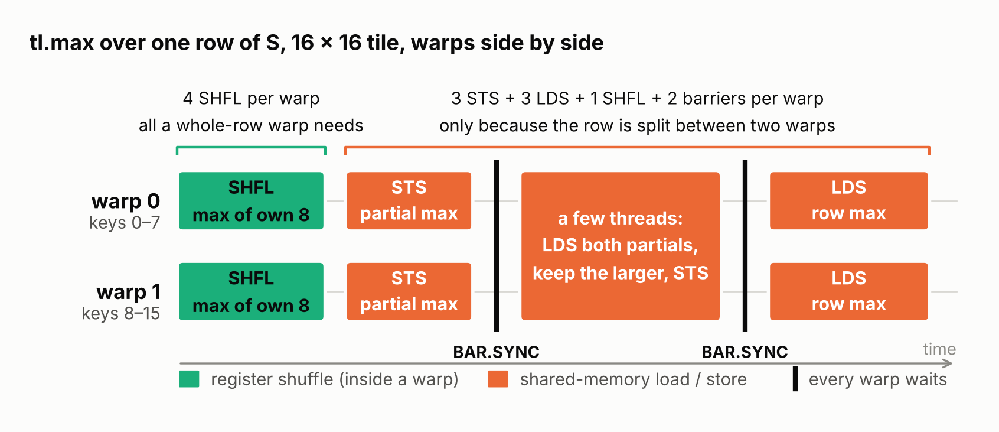

Only the first step, 4 shuffles per warp, would be needed if one warp held the whole row. Everything after it exists only because the row is split. `tl.sum` does the same with an add in place of the max.

The counts match Step 3 exactly. Per warp and per iteration, each of `tl.max` and `tl.sum` executes 11 shuffle and shared-memory instructions (4 `SHFL`, then 3 `STS`, 3 `LDS` and 1 `SHFL`). Over the whole run that is 11 × 4 warps × 2,097,152 iterations = **92.3 million**, the "92 million" that Compute Workload Analysis reported for each line.

#### Problem 3: `P` also goes through shared memory

`P` is the left input of `P V`, and each output number sums over all 16 keys of the tile: `O[i][c] = P[i][0]·V[0][c] + … + P[i][15]·V[15][c]`. So every warp needs `P` for all 16 keys, but each warp only computed `P` for 8 of them. The other 8 are in another warp's registers.

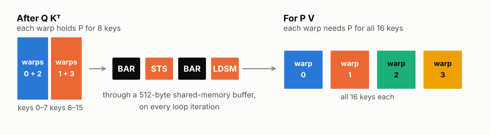

In the TTGIR this is a `ttg.local_alloc` of `P` in the `#mma` layout followed by a `ttg.local_load` into the operand layout of the second `tl.dot`. On every iteration the warps store all of `P` (16 × 16 bf16 values, 512 bytes) and every warp loads all of it back, with a barrier before the store and one after. I return to this in [the P cast](#pcast).



These are **SASS** instructions, the GPU's actual machine code (what Triton's output finally becomes). All three deal with **shared memory**, a small, fast scratch area inside each SM that all the warps of a program can read and write.

Each thread keeps its working values in its own **registers**, which no other thread can see. When one warp needs a value that another warp holds, the value has to go through shared memory. These three instructions are how that happens.

## STS: Store to Shared memory

A thread copies a value **from its registers into shared memory**, so other warps can get at it.

```
thread's registers ──STS──► shared memory
```

## BAR.SYNC: Barrier (synchronise)

A **"wait for everyone" point**. When a warp reaches it, the warp stops until *every* warp in the program has also reached it. It is CUDA's `__syncthreads()`.

It is needed because warps run at slightly different speeds. Without a barrier, warp 1 might try to read a value before warp 0 has finished storing it, and get garbage.

```
warp 0  ───STS──────►│
warp 1  ──────STS───►│ BAR.SYNC: nobody continues until all 4 arrive
warp 2  ─STS────────►│
warp 3  ────────STS─►│──► now it is safe to read
```

The cost is that the fastest warp sits idle waiting for the slowest one.

## LDSM: Load from Shared memory, as a Matrix

A thread copies data **from shared memory back into its registers**, specifically in the arrangement the tensor cores want for an `HMMA` input. It is CUDA's `ldmatrix`. A whole warp runs it together, and each thread ends up holding exactly the pieces of the matrix it needs to feed the next `HMMA`.

```
shared memory ──LDSM──► registers, arranged ready for HMMA
```

Its plain cousin is **LDS** (Load from Shared memory). LDS loads ordinary values, as in the `tl.max` and `tl.sum` reductions, while LDSM loads matrix pieces for the tensor cores.

## How they fit together: P's round trip in the baseline

This is exactly what Problem 3 in the article describes. Each warp holds only half of each row of P, but the second `tl.dot` needs whole rows, so every loop iteration does:

```
1. BAR.SYNC   wait until everyone is done with the old contents of the buffer
2. STS        each warp writes its half of P into shared memory
3. BAR.SYNC   wait until every half has been written
4. LDSM       each warp reads back all of P, ready for the P V multiply
```

That is four steps of shuffling data that does no arithmetic. With 64-row tiles, each warp already owns whole rows of P, so all four steps disappear and P goes straight from one `HMMA` into the next.



#### Counting the barriers

Each iteration has nine `BAR.SYNC`s, and at each one all 4 warps stop and wait for the slowest:

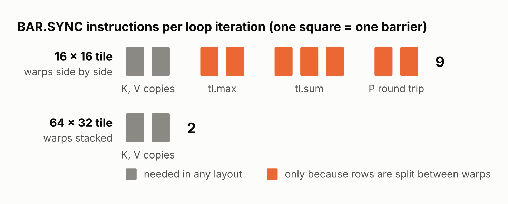

| Where | `BAR.SYNC`s per iteration | Why |
|---|---|---|
| Copying the next K and V tiles into shared memory | 2 | they guard the shared-memory buffers the asynchronous copies write into |
| `tl.max` | 2 | the two in the row-maximum figure |
| `tl.sum` | 3 | the same two, plus one before it starts, because it reuses the shared memory `tl.max` has just read |
| `P`'s trip through shared memory | 2 | one before the store, one after |
| **Total** | **9** | |

Only the first 2 are needed in any layout. A program runs 256 iterations, so it stops at 256 × 9 = 2,304 barriers to produce 16 rows of output.

#### What a bigger tile changes

All three problems come from the tile being one block tall. With `Q_TILE_SIZE` = 64, the tile is 64 / 16 = 4 blocks tall, one row of blocks per warp. `O` becomes 64 × 64, with as many rows as columns, so Triton stacks the warps (`warpsPerCTA = [4, 1]`):

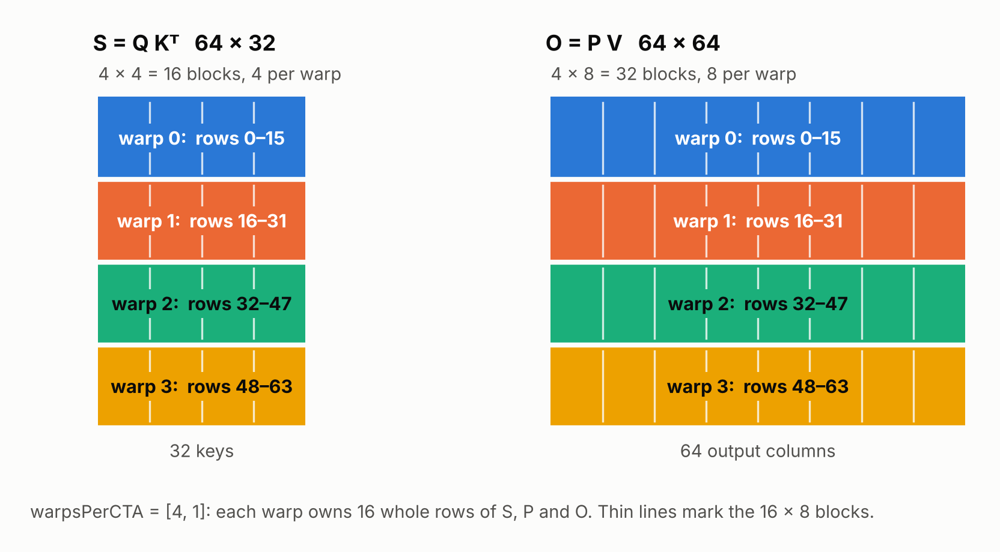

Each warp now owns 16 whole rows of `S`, `P` and `O`, and each problem disappears:

- **Problem 1:** every warp has its own rows, so no warp repeats another's blocks.
- **Problem 2:** a whole row sits in one warp, so the row maximum and row sum need only shuffles.
- **Problem 3:** the warp that computes a row of `P` is the warp that uses it, so `P` stays in registers.

By compiling the same kernel with 64 × 32 tiles (64 queries, 32 keys) and 4 warps, one iteration now covers 64 × 32 = 2,048 scores, 8 times the 256 of the baseline, so it should need 8 × 16 = 128 `HMMA`s:

| In one loop iteration | 16 × 16 tile, warps side by side | 64 × 32 tile, warps stacked |
|---|---|---|
| `HMMA`s needed | 16 | 128 |
| `HMMA`s all 4 warps run | 24 | **128** |
| `STS` instructions (stores to shared memory) | 8 | **0** |
| `BAR.SYNC` instructions | 9 | **2** |

Nothing is computed twice, nothing is stored to shared memory, and the 2 remaining barriers are the ones for the K and V copies. Round 1 finds this configuration with a sweep.

### The diagnosis

Everything points to one cause: **a 16 × 16 tile is too small for 4 warps**. The 4 warps cannot each get their own rows, so they duplicate tensor-core work and synchronise through shared memory on every row reduction. On top of that, 16-row tiles make every program re-read 1 MB of K and V from L2 for 16 rows of output.

Nsight Compute's own top suggestion, theoretical occupancy (the 66.7% limit from shared memory), would not have helped: more resident warps of a kernel that is limited by its own shared-memory instructions would only queue more shared-memory instructions. The tuned kernel in Round 1 runs at half that occupancy and three times the speed.



## What resident warps are

An SM (one of the 56 processing units on the GPU) can hold several warps at once. A warp is **resident** when it has been loaded onto the SM: its registers and shared memory are reserved, and it is ready to run as soon as the SM picks it.

On Nvidia RTX 4070 SUPER an SM can hold at most **48 warps**. **Occupancy** is how many it actually holds, as a share of that maximum.

In the baseline, each program is 4 warps, and shared memory limits each SM to 8 programs at a time:

```
8 programs × 4 warps = 32 resident warps
32 ÷ 48 = 66.7% occupancy
```

## Why more warps usually help

An SM can issue an instruction from only a few warps per clock cycle. When a warp is stuck waiting (for data to arrive, say), the SM simply switches to another resident warp that is ready. More resident warps means more candidates to switch to, so the SM is less likely to sit idle. This is called **hiding latency**.

```
warp A: ██ wait........... ██
warp B:    ██ wait......... ██
warp C:       ██ wait....... ██     ← while A waits, B and C keep the SM busy
```

This works when warps are waiting on something slow but **not overloaded**, like DRAM. The waiting is just time passing, and other warps can fill it.

## Why it would not help here

The baseline's warps were not waiting on something slow. They were waiting on something **full**. Round 0 found that:

- the load/store unit (which handles shared memory) was already **80% busy**;
- the top stalls were **MIO throttle** (the queue for shared-memory instructions is full), **short scoreboard** (waiting for shared-memory results) and **barrier** (waiting for other warps in the same program).

Every warp in this kernel does the same thing: lots of shared-memory traffic for `tl.max`, `tl.sum` and P's round trip. Adding more warps adds more shared-memory requests to a queue that is already full.

Think of a kitchen with one sink. If the cooks are slow because they all queue at the sink, hiring more cooks just makes the queue longer. What helps is needing the sink less.

That is what Round 1 did. Bigger tiles let each warp own whole rows, which removed almost all the shared-memory traffic. The tuned kernel runs at **33.3% occupancy**, half the baseline's, and is **three times faster**, because its warps now wait on the tensor cores, which is useful work.

## Why Nsight Compute suggested it anyway

Nsight Compute's suggestions come from **general rules**, not an understanding of your kernel. The occupancy rule goes roughly like this:

1. Warps spend a lot of time stalled, so the SM often has nothing ready to issue.
2. Occupancy is below the maximum.
3. Therefore more warps might fill the gaps, worth an estimated ~20%.

That reasoning is right for many kernels. But the rule does not check *what* the warps are waiting for. It cannot tell "waiting on a slow unit that has spare capacity" from "waiting on a unit that is already saturated." So it named a symptom (lots of stalling, low occupancy) instead of the cause (too much shared-memory work from tiles that are too small).

This is why the article treats the suggestions as **hypotheses to check, not diagnoses**. The breakdown and the stall reasons showed what was actually busy, and that pointed to the real fix.



<a id="round1">
## Round 1: tile sizes, `num_warps` and `num_stages`
</a>

Round 0 says the tile is too small for its warps. Before sweeping, it helps to know what each knob changes, and what limits how far each one can go.

- **`Q_TILE_SIZE`**: query rows per program. Every program streams all of K and V through the SM once, so the L2 traffic is proportional to N² / `Q_TILE_SIZE`. Bigger is better for traffic, but the fp32 output accumulator `O_acc` (`Q_TILE_SIZE` × D) and the score tile (`Q_TILE_SIZE` × `K_TILE_SIZE`) live in registers, and the program count drops, which matters at small N.
- **`K_TILE_SIZE`**: keys per step of the inner loop. Bigger tiles mean fewer loop iterations and bigger matrix multiplies, at the cost of registers for the score tile and shared memory for each K and V buffer.
- **`num_warps`**: how many warps (groups of 32 threads) share one program's tile. Round 0 showed what happens when the tile cannot give each warp its own rows.
- **`num_stages`**: the depth of the software pipeline for the K and V loads. Triton's software pipeliner turns the loads in the loop into asynchronous copies into shared memory, issued `num_stages - 1` iterations ahead, so the next tiles arrive while the current one is being multiplied. More stages hide more latency and cost more shared memory.





**Why more stages isn't always better.** Each stage adds one K buffer and one V buffer in shared memory. For the article's 64 × 32 tile that's 8 KB per stage per program, on top of the 8 KB Q tile. An Ada SM has only about 100 KB of shared memory, and every program running on it takes its share. More stages per program means fewer programs fit on the SM at once:

- **3 stages:** 24 KB each, so 4 programs fit side by side.
- **5 stages:** 40 KB each, so only 2 fit.

Fewer resident programs means fewer warps to switch to when one stalls. Once the pipeline is deep enough to keep the tensor cores fed, adding more stages costs memory and occupancy without speeding anything up.

That's why the sweep found 3 stages best (63.5 TFLOP/s, against 57.9 with 1 stage), and 4 and 5 slightly slower again. The article's padding experiment shows that about half of that slowdown is the lost occupancy, and the rest is the deeper pipeline itself.

**Why the best number changes.** The ideal depth depends on how long a fetch takes compared with a multiply:

- **Long fetch, short multiply:** you need more tiles in flight to cover the wait.
- **Bigger key tile (more work per iteration):** fewer stages suffice. That's why Round 5's 64 × 128 tile was happy with just 2 stages, since each multiply is long enough to hide most of the next fetch.

**Two caveats about the toy model:**

- The 4 : 2 ratio between fetch and multiply time is made up to make the picture clear. Real latencies vary, which is why you sweep rather than calculate.
- On the real GPU, the 1-stage kernel isn't as bad as the toy suggests (57.9 vs 63.5 TFLOP/s, not 3× slower). Each SM runs several programs at once, so while one waits for its fetch, another can use the tensor cores. Stages hide latency *within* a program; occupancy hides it *across* programs. That's the same trade-off the shared-memory budget forces you to balance.



<a id="budget">
### The shared-memory budget for an Ada SM
</a>

Shared memory is what decides which configurations can launch at all, so it is worth knowing exactly what the kernel keeps there. The TTGIR of the configuration that eventually wins (64 × 32 tiles, 4 warps, 3 stages) allocates three buffers:

```
%Q_i = ttg.local_alloc %Q_i_53 : (tensor<64x64xbf16, #blocked>) -> !ttg.memdesc<64x64xbf16, #shared, #smem>
%K_j = ttg.local_alloc : () -> !ttg.memdesc<2x32x64xbf16, #shared, #smem, mutable>
%V_j = ttg.local_alloc : () -> !ttg.memdesc<2x32x64xbf16, #shared, #smem, mutable>
```

- **The Q tile**, `Q_TILE_SIZE` × D bf16 values. The kernel loads `Q_i` once, but Triton parks it in shared memory and re-reads it in every iteration (`ttg.local_load`, `LDSM` in the machine code) as the left-hand operand of `Q Kᵀ`, rather than holding it in registers for the whole loop.
- **The K and V buffers**, `num_stages - 1` of each, `K_TILE_SIZE` × D bf16 values per buffer. `2x32x64` is two buffers of a 32 × 64 tile: three stages means two tiles in flight while the third is in registers being multiplied. The copies into them are `ttg.async_copy_global_to_local`, which becomes `LDGSTS` (load global, store shared, without passing through registers).
- **Nothing for `S`, `P`, `O`, `m` or `l`**: those live in registers, provided the warps own whole rows. When they do not, `P` makes a round trip through shared memory, which is the extra `ttg.local_alloc ... #mma` from Round 0.

For bf16 inputs (2 bytes) and D = 64, that gives a budget equation:


\text{shared bytes} = \underbrace{2 \cdot D \cdot Q_{\text{tile}}}_{Q} + (\text{stages} - 1) \cdot \underbrace{2 \cdot 2 \cdot D \cdot K_{\text{tile}}}_{K\ \text{and}\ V} = 128 \cdot \big(Q_{\text{tile}} + 2(\text{stages} - 1) K_{\text{tile}}\big)


and two limits from the table at the top:

- **One program must fit**: shared bytes ≤ 101,376. Triton checks this when it loads the kernel and raises `OutOfResources` if not.
- **Programs per SM**: the 102,400 bytes of an SM are shared by every resident program, and each also costs 1,024 bytes of driver reservation, so at most ⌊102,400 / (shared bytes + 1,024)⌋ programs fit at once.



Shared memory is one of the scarcest resources on this GPU. Every program (thread block) needs some to hold its Q tile and its K and V pipeline buffers. On this Ada card there isn't much to go around: about 100 KB per SM, against 164 KB on an A100 and 228 KB on an H100.

The equation lets you work out **before compiling anything** how much shared memory a given choice of tile sizes and stages will need. From that one number you can answer two practical questions:

1. **Will this configuration run at all?** If it asks for too much, Triton refuses to launch it (`OutOfResources`). This is why 128 × 128 tiles with 4 stages, the textbook FlashAttention-2 choice, simply doesn't work on this card.
2. **How many programs can share one SM at a time?** More programs per SM means that while one program waits for data, another can use the tensor cores. The winning configuration is fast partly because it is small: at 24,576 bytes, four programs fit on each SM at once.

It also explains the trade-offs the sweep found. Each extra pipeline stage hides more memory latency but adds 8 KB. That can push the count from 4 programs per SM down to 3 or 2, which is part of why 4 and 5 stages ran slower than 3.

## The two numbers

They are two different limits, one for the whole SM and one for a single program.

- **102,400 bytes (100 KB): the SM's total pool.** Each SM has 128 KB of on-chip memory, split between L1 cache and shared memory. At most 100 KB of that can be used as shared memory. All the programs running on that SM share this pool.
- **101,376 bytes (99 KB): the most any single program may ask for.** On top of what it asks for, the driver reserves **1,024 bytes (1 KB)** for every program for its own bookkeeping.

The two numbers fit together exactly: one program at the maximum (101,376) plus its 1 KB reservation is 102,400, the whole pool. That's why a single program can't ask for the full 100 KB. The last 1 KB is always taken by the driver.

An analogy: the SM is a building with 100 rooms. Each tenant (program) can rent at most 99 rooms, and every tenant is also charged 1 room for the lobby.

## Using both limits

The first limit decides whether a configuration launches. The second decides how many copies of it fit on one SM.

| Configuration | Shared memory | Fits one program? (≤ 101,376) | Programs per SM: ⌊102,400 / (shared + 1,024)⌋ |
|---|---|---|---|
| 64 × 32, 3 stages | 24,576 | yes | 102,400 / 25,600 = **4** |
| 64 × 32, 5 stages | 40,960 | yes | 102,400 / 41,984 = **2** |
| 256 × 64, 5 stages | 98,304 | yes | 102,400 / 99,328 = **1** |
| 128 × 128, 4 stages | 114,688 | **no** | doesn't launch |

Shared memory is only one of the two limits on programs per SM. Registers can bind first: 128 × 64 tiles with 8 warps would fit two programs by shared memory, but needs too many registers for more than one. The article covers this right after the budget equation.



Registers give a second, independent limit. Each SM has 65,536 registers, handed out in blocks of 8 per thread, so at most ⌊65,536 / (registers rounded up to a multiple of 8 × 32 × `num_warps`)⌋ programs fit. The registers a configuration needs are only known after compiling. The largest single block of them holds the two fp32 accumulators, (`Q_TILE_SIZE` × `K_TILE_SIZE` + `Q_TILE_SIZE` × D) values spread over 32 × `num_warps` threads, 18 to 63% of the total in the table below. When that alone passes 255 per thread, the compiler always spills to local memory (which lives in DRAM, behind the caches), and the kernel slows down sharply; wide key tiles can spill well before that.


These three lines are Triton telling you **what it keeps in shared memory** for the winning configuration (64 × 32 tiles, 4 warps, 3 stages). Shared memory is the small, fast scratchpad inside each SM that all warps of a program can see. Each line creates one buffer there.

## How to read the notation

A TTGIR line has the form `result = operation input : (input type) -> output type`.

- **`%Q_i`, `%K_j`, `%V_j`** are names for the results. Triton reuses your Python variable names. Suffixes like `_53` are just the compiler's numbering of intermediate values.
- **`ttg.local_alloc`** means "allocate a buffer in shared memory". "Local" means local to one program (thread block). It is not about per-thread local memory.
- **`tensor<...>`** is a value held **in registers**, spread across the threads.
- **`!ttg.memdesc<...>`** ("memory descriptor") is not a value. It is a handle to a region of **shared memory**, something like a typed pointer.
- **`64x64xbf16`** is the shape and element type.
- **`#blocked`, `#shared`** are layouts: rules for which thread or which address holds which element.
  - `#blocked` is a simple register layout that Triton uses for loading from global memory.
  - `#shared` describes how the data is arranged in shared memory. This arrangement is usually swizzled so that threads reading together don't collide on the same memory bank.
- **`#smem`** says the memory space is shared memory.
- **`mutable`** means the buffer will be overwritten repeatedly.

## Line 1: the Q tile

```
%Q_i = ttg.local_alloc %Q_i_53 : (tensor<64x64xbf16, #blocked>) -> !ttg.memdesc<64x64xbf16, #shared, #smem>
```

In plain English: "Take the Q tile that was just loaded into registers (`%Q_i_53`, 64 query rows × 64 head-dim values in bf16), copy it into a new shared-memory buffer of the same shape, and call that buffer `%Q_i`."

- Because it has an input, this allocation is **created and filled in one step**.
- It has no `mutable`, so it is written once and only read afterwards.
- Size: 64 × 64 × 2 bytes = **8,192 bytes**.

Why it matters: Python loads `Q_i` once, before the loop. Instead of staying in registers. Triton parks it in shared memory and re-reads it on every loop iteration (`ttg.local_load`, which becomes `LDSM` in machine code) to feed the tensor cores for `Q Kᵀ`. So Q costs shared memory for the whole kernel, and the budget formula has to include it.

## Line 2: the K buffers

```
%K_j = ttg.local_alloc : () -> !ttg.memdesc<2x32x64xbf16, #shared, #smem, mutable>
```

In plain English: "Reserve an empty shared-memory buffer with room for **2 K tiles**, each 32 keys × 64 values in bf16. Its contents will change over time."

- **`()`** means there is no input, so the buffer starts empty and is filled later. The filling is done by asynchronous copies (`ttg.async_copy_global_to_local`, which becomes `LDGSTS`). These copy straight from GPU memory into shared memory without passing through registers.
- **`2`** = `num_stages − 1` = 3 − 1. This is the software pipeline: while the warps multiply the current tile, the next two tiles are already being copied into these two slots. The buffer is used as a ring, with each slot overwritten in turn, hence `mutable`.
- **`32`** = `K_TILE_SIZE` and **`64`** = D.
- Size: 2 × 32 × 64 × 2 bytes = **8,192 bytes**.

## Line 3: the V buffers

```
%V_j = ttg.local_alloc : () -> !ttg.memdesc<2x32x64xbf16, #shared, #smem, mutable>
```

This is identical to K, but for the V tiles: 2 slots of 32 × 64 bf16, another **8,192 bytes**.

## Significance of the three lines of code

**1. They justify the budget equation.** Adding the three buffers gives:

8,192 (Q) + 8,192 (K) + 8,192 (V) = **24,576 bytes**

That is exactly what the formula predicts: 128 × (64 + 2 × (3−1) × 32) = 24,576. It also matches `compiled.metadata.shared` byte for byte. So the formula isn't a guess. It is read straight off what the compiler allocates, and it can predict whether any configuration will launch before compiling it.

**2. Shared memory decides what can run, and how many copies at once.**

- **Fit limit:** one program may use at most 101,376 bytes. Configurations over that limit crash with `OutOfResources`, such as 128 × 128 with 4 stages, or the fp32/D = 128 test failure.
- **Programs per SM:** each SM has 102,400 bytes to share, plus 1,024 bytes reserved per program. That gives ⌊102,400 / (24,576 + 1,024)⌋ = **4 programs per SM**. This is part of why the winner wins: it uses only a quarter of the budget, so four programs share an SM and hide each other's waiting.
- **Why more stages hurt:** each extra stage adds one more 32 × 64 slot to both K and V, which is 8 KB. Four programs per SM then drops to 3, then 2, which is part of the slowdown seen at 4 and 5 stages.

**3. What's *missing* is as informative as what's there.** There is no buffer for `S`, `P` or `O`. Those stay in registers, which only happens when each warp owns whole rows of the tile. In the 16 × 16 baseline there was a **fourth** `local_alloc`, which put `P` into shared memory on every iteration. That cost 512 extra bytes, plus stores, loads and barriers. Seeing only these three allocations confirms the layout problem from Round 0 is gone. This is why the checklist (item 17) says to scan the TTGIR for extra `ttg.local_alloc`s inside the loop.

**4. They explain the remaining barriers.** Because the K and V buffers are `mutable` and reused as a ring, the warps must synchronise so that no slot is overwritten while another warp is still reading it. Those are the two `BAR.SYNC`s per iteration that Round 2 traced to the `tl.load` of K. Round 5 then cut their cost by using 128-key tiles, which means fewer iterations and therefore fewer barriers.



Here is the arithmetic for a few configurations, next to what Triton reported in `compiled.metadata.shared`, `n_regs` and `n_spills`, and the speed the sweep below measured at N = 4096:

| Q × K tile, warps, stages | Shared memory (formula) | Measured | Programs / SM (shared) | Registers / thread | Programs / SM (registers) | TFLOP/s |
|---|---|---|---|---|---|---|
| 16 × 16, 4, 3 (baseline) | 10,240 | 10,752 (+512 for `P`) | 8 | 56 | 9 | 21.8 |
| 64 × 32, 4, 3 | 24,576 | 24,576 | 4 | 127 | 4 | 63.5 |
| 64 × 32, 4, 5 | 40,960 | 40,960 | 2 | 127 | 4 | 61.9 |
| 128 × 64, 8, 4 | 65,536 | 65,536 | 1 | 146 | 1 | 61.9 |
| 128 × 128, 8, 3 | 81,920 | 81,920 | 1 | 207 | 1 | 60.5 |
| 128 × 128, 8, 4 | 114,688 | does not fit | 0 | | | |
| 256 × 64, 16, 5 | 98,304 | 98,304 | 1 | 128 (4 spilled) | 1 | 61.3 |
| 64 × 256, 4, 2 | 73,728 | 73,728 | 1 | 255 (152 spilled) | 2 | 33.4 |



The three columns come from two different sources. **Programs / SM (shared)** and **Programs / SM (registers)** are arithmetic. **Registers / thread** is not calculated at all: the compiler reports it.

## Programs / SM (shared)

An Ada SM has 102,400 bytes of shared memory. Every resident program uses its own shared memory plus 1,024 bytes that the driver reserves per block. So:

**programs per SM = ⌊102,400 / (shared bytes + 1,024)⌋**

The "shared bytes" here is the **Measured** column, which is `compiled.metadata.shared`. The formula column is only used to predict it.

| Config | Measured + 1,024 | 102,400 ÷ that | Programs |
|---|---|---|---|
| 16×16, 4, 3 | 11,776 | 8.70 | **8** |
| 64×32, 4, 3 | 25,600 | 4.00 | **4** |
| 64×32, 4, 5 | 41,984 | 2.44 | **2** |
| 128×64, 8, 4 | 66,560 | 1.54 | **1** |
| 128×128, 8, 3 | 82,944 | 1.23 | **1** |
| 256×64, 16, 5 | 99,328 | 1.03 | **1** |
| 64×256, 4, 2 | 74,752 | 1.37 | **1** |

The baseline row shows why the measured value matters. The formula's 10,240 bytes would give ⌊102,400 / 11,264⌋ = 9. The extra 512 bytes for the `P` buffer brings it down to 8.

For 128×128, 8, 4, the 114,688 bytes exceed the 101,376-byte limit for a single block. The program can't launch, so the value is 0.

The formula column itself is `128 · (Q_tile + 2·(stages − 1)·K_tile)`. For example, 64×32 with 3 stages gives 128 × (64 + 2·2·32) = 128 × 192 = 24,576.

## Registers / thread

This is `compiled.n_regs`, read after `compiled._init_handles()` (see [`inspect_kernel.py`](https://github.com/searlion/cs336-2026-assignment2-systems/blob/main/flash_forward/2026_10_03_followup/inspect_kernel.py)). The spill counts come from `compiled.n_spills`. These are calculated after compilation.

To estimate the lower bound, the two fp32 accumulators hold `Q×K + Q×D` values spread over `32 × num_warps` threads:

- **64×32, 4 warps:** (2,048 + 4,096) / 128 = 48 registers, out of 127 actual.
- **Baseline 16×16, 4 warps:** (256 + 1,024) / 128 = 10, out of 56. 
- **64×256, 4 warps:** (16,384 + 4,096) / 128 = 160, out of 255. That is the 63%. The rest of the kernel doesn't fit under the 255 cap, hence the 152 spilled registers.

The other registers hold pointers, `m`, `l`, loop state and temporaries. That's why the real number has to come from the compiler.

## Programs / SM (registers)

An SM has 65,536 registers. They are allocated per thread in multiples of 8, which is 256 per warp. So:

**programs per SM = ⌊65,536 / (round_up_8(regs) × 32 × num_warps)⌋**

| Config | Regs → rounded | × 32 × warps | 65,536 ÷ that | Programs |
|---|---|---|---|---|
| 16×16, 4 warps | 56 → 56 | 7,168 | 9.14 | **9** |
| 64×32, 4 warps | 127 → 128 | 16,384 | 4.00 | **4** |
| 128×64, 8 warps | 146 → 152 | 38,912 | 1.68 | **1** |
| 128×128, 8 warps | 207 → 208 | 53,248 | 1.23 | **1** |
| 256×64, 16 warps | 128 → 128 | 65,536 | 1.00 | **1** |
| 64×256, 4 warps | 255 → 256 | 32,768 | 2.00 | **2** |

The 64×32, 5-stage row has the same registers and warps as the 3-stage one, so it also gets 4.

## Putting them together

The number of programs that actually run on an SM at once is the **minimum** of the two columns. For example:

- **Baseline:** min(8, 9) = 8, so shared memory binds.
- **64×32, 4, 5:** min(2, 4) = 2, so shared memory binds. This is why extra stages cost occupancy.
- **64×256, 4, 2:** min(1, 2) = 1, so shared memory binds, though it is slow for a different reason (spills).

There is also a third cap of 48 warps and 24 blocks per SM. It never binds in this table: the most warps resident is the baseline's 8 × 4 = 32.





The 255 is only the per-thread ceiling. A second limit applies at the same time: all the threads of one program must fit in the SM's 65,536 registers together, otherwise the program could never launch. The compiler enforces whichever limit is lower.

**max registers per thread = min(255, 65,536 / threads per program)**

Triton tells the compiler the block size by putting `.maxntid` (`num_warps × 32` threads) in the PTX. `ptxas` then caps the register count so that one block fits:

| `num_warps` | Threads per program | 65,536 ÷ threads | Effective cap |
|---|---|---|---|
| 1, 2, 4 | 32, 64, 128 | 2,048, 1,024, 512 | 255 |
| 8 | 256 | 256 | 255 |
| **16** | **512** | **128** | **128** |
| 32 | 1,024 | 64 | 64 |

The 256×64 configuration uses 16 warps, so its cap is 128 registers per thread, not 255. It needed slightly more than 128, so the compiler kept the excess in local memory: the "4 spilled". (Triton's `n_spills` is the local-memory size divided by 4 bytes, so roughly four 32-bit values per thread.)

The accumulator estimate shows why it lands right at that edge:
- `S`: 256 × 64 = 16,384 values
- `O_acc`: 256 × 64 = 16,384 values
- 32,768 values ÷ 512 threads = **64 registers per thread** for the accumulators alone

That leaves 64 registers for pointers, `m`, `l`, operand fragments and temporaries. The kernel needed slightly more, hence a small spill.

This is also why the same row shows exactly 1 program per SM by registers: 128 × 512 = 65,536, the whole register file. This program has 512 threads, and each thread uses 128 slots. So the program takes 512 × 128 = 65,536 slots, which is the entire box. Nothing is left over, so a second program can’t run on that SM until the first one finishes. That’s why the table says only 1 program fits per SM.



Across the whole sweep, the formula matches `compiled.metadata.shared` byte for byte for every configuration with 2 to 5 stages whose warps own whole 16-row slices of the query tile. The exceptions are the ones where Triton spreads the warps along the key axis, and there the difference is the buffer for `P`. With 1 stage nothing is in flight, but Triton still passes each V tile through a shared-memory buffer of its own, so the formula comes out one tile short.



The formula is a **packing list** for shared memory. It assumes the kernel stores exactly three kinds of things there:

1. one Q tile, and
2. (stages − 1) K tiles, and
3. (stages − 1) V tiles.

For most configurations, that list is complete, so the predicted bytes match what Triton actually allocates. The paragraph names two cases where the list is wrong.

### Exception 1: the warps sit side by side, so `P` needs its own buffer

Usually each warp owns a horizontal strip of the tile: whole rows of 16 queries. A warp then computes its own rows of `P` and uses them in the second multiply (`P @ V`), so `P` never leaves the warp's registers.

If the query tile is short compared to the head dimension (for example 16 rows with D = 64), Triton places the warps **side by side** along the keys instead. Each warp then holds only part of every row of `P`. The second multiply needs whole rows, so the warps have to swap pieces, and the only place they can swap is shared memory.

That swap space is a buffer the formula doesn't count. The baseline shows it: the formula predicts 10,240 bytes, Triton allocates 10,752. The extra 512 bytes is one 16 × 16 tile of `P` in bf16 (16 × 16 × 2 bytes).

### Exception 2: one stage, but V still uses shared memory

With `num_stages = 1` there's no prefetching. Nothing is loaded ahead of time, so the formula's (stages − 1) term becomes zero and predicts that K and V use no shared memory at all.

In practice, Triton still routes each V tile through a shared-memory buffer on its way to the second multiply, even though no tile is being loaded early. The likely reason is that V has to be rearranged into the layout the tensor cores expect. So the real usage is the formula's number **plus one V tile**. For a 64 × 32 tile with D = 64, that's 8,192 predicted and 8,192 + 4,096 = 12,288 actual.



Three things stand out. First, the classic FlashAttention-2 choice of 128 × 128 tiles fits on Ada only up to 3 stages, and then a single program fills the SM. Second, the configurations that run fastest are not the ones that use the most shared memory: 64 × 32 with 3 stages uses a quarter of the budget, which lets four programs share each SM and hide each other's latency. Third, registers bind as often as shared memory does: 128 × 64 with 8 warps and 3 stages would fit two programs by shared memory (49,152 bytes each), but its 146 registers per thread allow only one, and a 256-key tile with 64 or more query rows spills no matter how much shared memory is left.

<a id="sweep">
### The sweep
</a>

The configuration space is small enough to measure exhaustively: 5 query tiles × 5 key tiles × 5 warp counts × 5 stage counts = 625 configurations, at each of the harness's 8 shapes (N = 512 to 4096, causal and not). `sweep.py` times each one exactly the way the harness does: `FlashAttentionTriton.apply` under `triton.testing.do_bench`, median, same inputs. Every configuration is also checked against SDPA once per shape, so a fast-but-wrong configuration cannot win.

```python
TILES = (16, 32, 64, 128, 256)
WARPS = (1, 2, 4, 8, 16)
STAGES = (1, 2, 3, 4, 5)
CONFIGS = list(itertools.product(TILES, TILES, WARPS, STAGES))

for causal in (False, True):
    for N in (512, 1024, 2048, 4096):
        q, k, v = (torch.randn(B * H, N, D, device="cuda", dtype=torch.bfloat16) for _ in range(3))
        ref = F.scaled_dot_product_attention(q, k, v, is_causal=causal)
        for bq, bk, nw, ns in CONFIGS:
            try:
                ck = launch(q, k, v, causal, bq, bk, nw, ns)     # returns the compiled kernel
            except triton.runtime.errors.OutOfResources:
                record("out_of_smem"); continue
            FlashAttentionTriton.Q_TILE_SIZE, FlashAttentionTriton.K_TILE_SIZE = bq, bk
            FlashAttentionTriton.NUM_WARPS, FlashAttentionTriton.NUM_STAGES = nw, ns
            o = FlashAttentionTriton.apply(q, k, v, causal)
            if not torch.allclose(o, ref, atol=2e-2, rtol=2e-2):
                record("wrong"); continue
            ms = triton.testing.do_bench(lambda: FlashAttentionTriton.apply(q, k, v, causal),
                                         return_mode="median")
            record("ok", ms, ck.n_regs, ck.n_spills, ck.metadata.shared)
```

For the sweep, the only change to the kernel file is that `forward` reads the four values from class attributes and passes `num_warps` and `num_stages` to the launch, which the previous version left at Triton's defaults of 4 and 3.

Two practical details to speed up the sweep:
1. Compilation dominates when every configuration is new, so `sweep.py` first compiles all of them in 6 worker processes with `flash_fwd_kernel.warmup(...)`, which compiles into Triton's on-disk cache without launching, and only then benchmarks them one at a time in a single process (90 seconds of compiling, then benchmarking). 2. Configurations whose accumulators alone would need more than 512 fp32 registers per thread are skipped without compiling. 

Per shape, 465 configurations ran, 100 did not fit in shared memory, and 60 were skipped by the register estimate. None produced a wrong answer.

<a id="heatmaps">
### The heatmaps
</a>

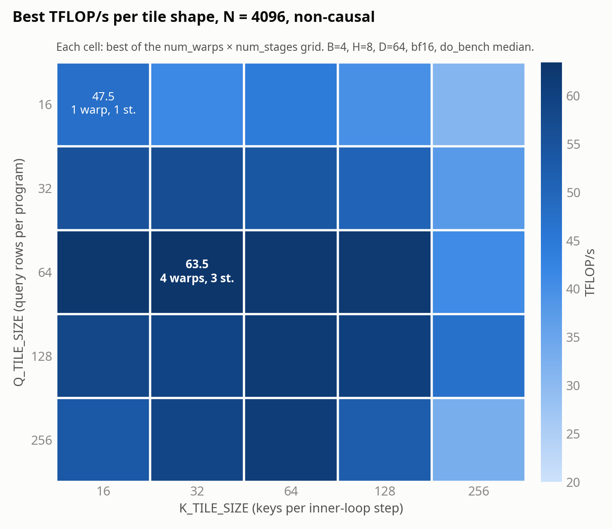

Each cell is the best of the 25 `num_warps` × `num_stages` combinations for that tile shape, at N = 4096, non-causal. The winner is 64 × 32 with 4 warps and 3 stages at 63.5 TFLOP/s, against 21.8 for the baseline configuration. The cell at the top-left is suprising because it has the same 16 × 16 tile as the baseline while reaching 47.5 TFLOP/s with 1 warp and 1 stage instead of 4 warps and 3 stages (1 warp alone, with the baseline's 3 stages, gives 37.7). More than half of the gap to SDPA was the launch configuration, not the tile size.

Taking the best result over key tiles and stages for each query tile and warp count:

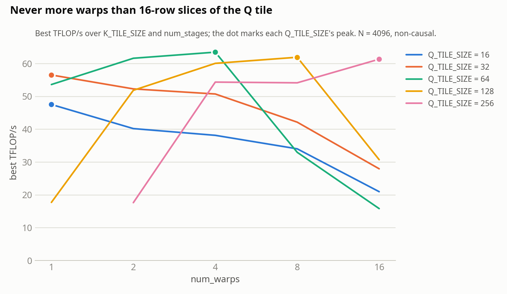

Every query tile is fastest with about one warp for every 16 rows: `num_warps` = `Q_TILE_SIZE` / 16, or one step below. That means 1 warp for 16 rows, 4 for 64, 8 for 128 and 16 for 256. The only tile that takes the step below is the 32-row one, which is fastest with 1 warp, not 2. Doubling the warps beyond this halves the speed of the larger tiles. 64-row tiles drop from 63.5 to 33.0 TFLOP/s with 8 warps, and 128-row tiles drop from 61.9 to 30.7 with 16.

The 16 comes from the tensor-core instruction. One `HMMA` makes a block 16 rows tall (Fact 5), so a query tile splits naturally into slices of 16 rows. The best split gives each warp slices of its own. A 64-row tile has four slices, so with 4 warps each one gets a slice:

```
64-row tile, 4 warps stacked: one warp per 16-row slice

              ┌──────────────┐
rows  0–15    │    warp 0    │
rows 16–31    │    warp 1    │
rows 32–47    │    warp 2    │
rows 48–63    │    warp 3    │
              └──────────────┘
```

Whether the warps actually land like this is up to Triton, which follows the rule from Round 0. If the tile has at least as many rows as the head dimension (64 here), Triton stacks the warps one under another, and each gets different query rows. If not, it puts them side by side, and each gets different columns. That rule held across the whole sweep and in every other case I compiled. It leads to three ways of losing speed.

**Extra warps on a short tile.** A 16- or 32-row tile is shorter than 64, so a second warp goes side by side, and each query's scores are split between two warps:

```
16-row tile, 2 warps side by side

               keys 0–7     keys 8–15
           ┌─────────────┬─────────────┐
 16 rows   │   warp 0    │   warp 1    │
           └─────────────┴─────────────┘

Each query row is cut in two: warp 0 holds its first 8 scores,
warp 1 the other 8.
```

The softmax needs the maximum and the sum of each whole row, so the two halves have to be combined through shared memory, behind a barrier (Fact 4). This is the Round 0 problem; with 4 warps on a 16 × 16 tile, the scores are also computed twice. A second warp costs 16- and 32-row tiles 7 to 15%. It is also why the 32-row tile prefers 1 warp, because its 2 warps would go side by side instead of being stacked.

**Too many warps on a tall tile.** A 64-row tile with 8 warps is tall enough to be stacked, and Triton stacks all 8 (`warpsPerCTA = [8, 1]`). But 8 stacked warps cover 8 × 16 = 128 rows, and the tile has only 64, so the extra warps wrap around onto rows that are already taken:

```
64-row tile, 8 warps stacked: two warps per 16-row slice

              ┌──────────────────────────────┐
rows  0–15    │   warp 0 + warp 4 (repeat)   │
rows 16–31    │   warp 1 + warp 5 (repeat)   │
rows 32–47    │   warp 2 + warp 6 (repeat)   │
rows 48–63    │   warp 3 + warp 7 (repeat)   │
              └──────────────────────────────┘
```

The tensor cores now do every multiply twice, and the speed halves. Round 2 confirms this with the operation counter.

**Too few warps.** With fewer warps than slices, each warp owns several slices and has to hold all of their results in its registers. The output `O` alone is (rows per warp) × 64 numbers, shared among the warp's 32 threads:

```
128-row tile = eight 16-row slices

                   8 warps       2 warps       1 warp
                ┌──────────┐  ┌──────────┐  ┌──────────┐
rows   0–15     │  warp 0  │  │  warp 0  │  │  warp 0  │
rows  16–31     │  warp 1  │  │  warp 0  │  │  warp 0  │
rows  32–47     │  warp 2  │  │  warp 0  │  │  warp 0  │
rows  48–63     │  warp 3  │  │  warp 0  │  │  warp 0  │
rows  64–79     │  warp 4  │  │  warp 1  │  │  warp 0  │
rows  80–95     │  warp 5  │  │  warp 1  │  │  warp 0  │
rows  96–111    │  warp 6  │  │  warp 1  │  │  warp 0  │
rows 112–127    │  warp 7  │  │  warp 1  │  │  warp 0  │
                └──────────┘  └──────────┘  └──────────┘

O registers          32           128           256
  per thread
TFLOP/s             61.9          51.8          17.7
```

A thread can have at most 255 registers. With 2 warps, `O` takes 128 of them, and the scores and everything else push the kernel to the 255 limit (51.8 TFLOP/s). With 1 warp, `O` alone needs 256, which is over the limit. Values spill out to memory, and the speed drops to 17.7.

For the winning tile, the warps and stages:

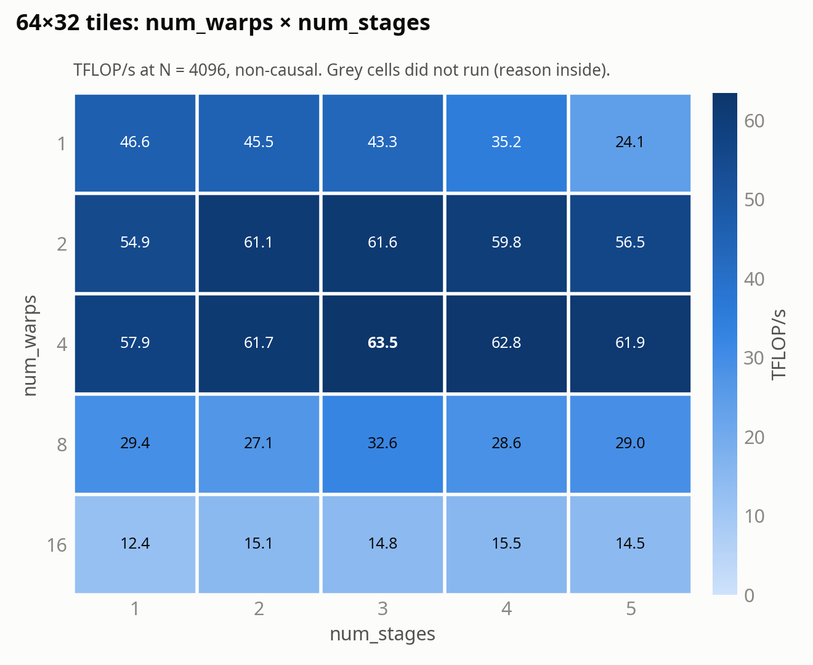

The 4-warp row is the best, with 2 warps close behind (61.6 TFLOP/s at best); 1, 8 and 16 warps are far behind. Along the 4-warp row, going from 1 stage (no pipelining) to 3 is worth 10% (57.9 to 63.5 TFLOP/s); 4 and 5 stages are slightly slower again.

A deeper pipeline is slower because adding a stage changes two things at once:

1. **The code changes.** The kernel keeps one more K tile and one more V tile in flight, and the compiler schedules the loop differently.
2. **Fewer programs fit on each SM.** Each extra stage adds 8 KB of shared memory to every program. An SM has 100 KB, so with 3 stages 4 programs fit, with 4 stages 3 fit, and with 5 stages only 2 fit. Fewer programs per SM means fewer warps to cover for each other while one of them waits.

Timing the 5-stage kernel measures both effects added together. To pull them apart, I need a kernel that has the second effect without the first: the 3-stage code, running with only 2 programs per SM.

Triton makes that possible. When it launches a kernel, it hands the GPU two things separately: the compiled code, and how much shared memory to reserve for each program. So I can launch the unchanged 3-stage code but ask the GPU to reserve as much shared memory as the 5-stage kernel needs. The program never touches the extra bytes, but the GPU sets them aside anyway, so only 2 programs fit on each SM, as with 5 stages. I call this the *padded* kernel. It has the 5-stage kernel's occupancy and the 3-stage kernel's code.

```
One SM has 100 KB of shared memory. Each box is one program, including the
1 KB the driver reserves for it.

3 stages: 25 KB each, 4 programs fit
┌───────────┬───────────┬───────────┬───────────┐
│  3-stage  │  3-stage  │  3-stage  │  3-stage  │
└───────────┴───────────┴───────────┴───────────┘

5 stages: 41 KB each, 2 programs fit
┌───────────────────┬───────────────────┬────────┐
│      5-stage      │      5-stage      │ unused │
└───────────────────┴───────────────────┴────────┘

3 stages, padded to 41 KB: same code as the first row, but only 2 programs fit
┌───────────┬───────┬───────────┬───────┬────────┐
│  3-stage  │padding│  3-stage  │padding│ unused │
└───────────┴───────┴───────────┴───────┴────────┘
```

The same trick works for 4 stages: pad the 3-stage kernel to 33 KB, and 3 programs fit, as with 4 stages. Timed at N = 4096 (ten interleaved rounds), against the plain 3-stage kernel:

| Kernel | Code | Programs per SM | Slower than 3 stages by |
|---|---|---|---|
| 3 stages | 3-stage | 4 | (reference) |
| 4 stages | 4-stage | 3 | 1.1% |
| 3 stages, padded to 4-stage size | 3-stage | 3 | 0.4% |
| 5 stages | 5-stage | 2 | 3.5% |
| 3 stages, padded to 5-stage size | 3-stage | 2 | 2.0% |

The padded kernel only loses occupancy, so its slowdown is the cost of occupancy alone, and whatever the real deeper kernel loses beyond that is the cost of the deeper pipeline itself:

- **5 stages:** 3.5% in total = 2.0% from occupancy + 1.5% from the deeper pipeline. Occupancy is about half of the loss.
- **4 stages:** 1.1% in total = 0.4% from occupancy + 0.7% from the deeper pipeline. Occupancy is about a third of the loss.

So a deeper pipeline loses twice here: it crowds programs off the SM, and the deeper pipeline is slower on its own terms too. For this tile on this card, 3 stages is the sweet spot.

Finally, does the winner depend on N? Repeating the first heatmap at every sequence length:


The 64 × 32 tile wins at every N. Only the number of stages changes: at N = 512, 4 stages beat 3. The main reason is how the programs are shared out across the GPU, in what are called *waves*.


Each SM can hold only a limited number of programs at once. Here the limit is shared memory: each SM has 102,400 bytes. Every program needs its own buffers, plus the 1,024 bytes the driver reserves. Multiply the programs per SM by the 56 SMs and you get the number of programs the whole GPU can run at the same time. Think of these as *slots*.

If the grid has more programs than there are slots, the GPU fills every slot and the rest wait. Whenever a program finishes, a waiting one takes its place. In the non-causal kernel every program does the same amount of work, so the programs in the slots all finish at about the same time. The kernel therefore runs in rounds: fill every slot, finish, fill again. Each round is a *wave*.

The number of waves is the number of programs divided by the number of slots. A whole number, such as 1.0 or 2.0, means every wave is full. A number just above a whole number, such as 1.14, means one full wave followed by a tiny last wave. During that last wave most of the GPU sits idle while a few programs finish. This is called the *tail effect*.


At N = 512 there are only 256 programs (because 512 / 64 = 8 query tiles per head, times 32 heads). How many fit at once depends on the stage count, because each extra stage adds 8 KB of shared memory per program:

- **3 stages:** 24,576 bytes per program, so 4 programs fit on each SM, giving 4 × 56 = 224 slots. 256 / 224 = **1.14 waves**.
- **4 stages:** 32,768 bytes per program, so only 3 fit on each SM, giving 3 × 56 = 168 slots. 256 / 168 = **1.52 waves**.

```
3 stages: 4 programs per SM × 56 SMs = 224 slots

Wave 1  ████████████████████████████████  224 programs, every slot busy
Wave 2  █████░░░░░░░░░░░░░░░░░░░░░░░░░░░   32 programs, 14% of slots busy

4 stages: 3 programs per SM × 56 SMs = 168 slots

Wave 1  ████████████████████████████████  168 programs, every slot busy
Wave 2  █████████████████░░░░░░░░░░░░░░░   88 programs, 52% of slots busy

█ = busy slot   ░ = idle slot
```

Both versions need two waves, but they waste different amounts of the GPU in the second one. With 3 stages the last 32 programs run on an almost empty GPU. With 4 stages the second wave is half full, and each program also shares its SM with only two others instead of three, so it gets a bigger share of the SM. The work is spread more evenly, so the kernel finishes sooner, even though fewer programs fit at once.

The padding experiment from above separates the two effects. At N = 512, 4 stages are 2.3% faster than 3. Padding the 3-stage kernel's shared memory so that only 3 programs fit per SM, with the code unchanged, recovers 1.6 of those 2.3 points. So about two thirds of the gain comes from the wave shape, and only the remaining third from the deeper pipeline.

The causal sweep tells the same story at half the TFLOP/s. This version of the kernel still computes every tile, including the ones the mask throws away, while the harness counts only the useful work. Its winners are 64 × 32 at N ≤ 2048 and 64 × 16 at N = 4096, all with 4 warps. So at these shapes on this GPU, one configuration comes within about 2% of the best everywhere. That will matter when deciding whether autotuning is worth its cost.

<a id="winner">
### The winner, through the unchanged harness and tests
</a>

[`kernels/v1_tiles`](https://github.com/searlion/cs336-2026-assignment2-systems/tree/main/flash_forward/2026_10_03_followup/kernels/v1_tiles) hard-codes the winner. The kernel body is unchanged; the class attributes and the launch change:

```python
class FlashAttentionTriton(torch.autograd.Function):
    # The sweep winner on an RTX 4070 SUPER (bf16, D = 64): 4 warps x 16 rows = 64 rows,
    # and 64*64*2 + (3-1) * 2 * 32*64*2 = 24,576 bytes of shared memory per program.
    Q_TILE_SIZE = 64
    K_TILE_SIZE = 32
    NUM_WARPS = 4
    NUM_STAGES = 3

    @staticmethod
    def forward(ctx, Q, K, V, is_causal=False):
        ...
        grid = (triton.cdiv(N_q, FlashAttentionTriton.Q_TILE_SIZE), B)
        # The tuned config assumes bf16 rows of D = 64 (128 bytes). fp32 at D = 128 has
        # 512-byte rows: with 3 stages Triton asks for 107,520 bytes of shared memory,
        # more than the 101,376 an Ada block may have, so drop to 2 stages there.
        num_stages = FlashAttentionTriton.NUM_STAGES if D * Q.element_size() <= 256 else 2

        flash_fwd_kernel[grid](
            ...,
            Q_TILE_SIZE=FlashAttentionTriton.Q_TILE_SIZE,
            K_TILE_SIZE=FlashAttentionTriton.K_TILE_SIZE,
            is_causal=is_causal,
            num_warps=FlashAttentionTriton.NUM_WARPS,
            num_stages=num_stages,
        )
```

My first attempt did not have the `num_stages` line. I changed only the four class attributes, and the unchanged [test file](https://github.com/searlion/cs336-2026-assignment2-systems/blob/main/flash_forward/2026_10_03_followup/test_flashattention_triton.py) failed one case out of twenty:

```
FAILED test_flashattention_triton.py::test_forward_matches_sdpa[1-200-96-128-False-dtype0]
E   triton.runtime.errors.OutOfResources: out of resource: shared memory, Required: 107520, Hardware limit: 101376.
```

This failing case uses fp32 inputs with D = 128. My budget equation above assumed bf16 (2 bytes per value) and D = 64. Here each value is 4 bytes and each row is twice as long, so every tile takes four times as many bytes. The Q tile now takes 32 KB, and each K + V stage also takes 32 KB.

There is a second change. At D = 128, the 64-row query tile is shorter than the head dimension. So Triton places the warps side by side along the key axis instead of stacking them. It does this for bf16 at D = 128 too. As in Round 0, no warp then holds a whole row, and this adds two more buffers:

- **A buffer for `P`, 8 KB.** With fp32 inputs, `tl.dot` uses TF32 instructions, so `P` stays in fp32 and takes 4 bytes per value.
- **1 KB of scratch space for the row sum.** Each row is now split across warps, so their partial sums have to be combined through shared memory.

With 3 stages, the total is 98,304 + 8,192 + 1,024 = 107,520 bytes. That is 6 KB more than a program is allowed. With 2 stages, the total is 74,752 bytes, which fits.

The lesson is that a configuration tuned for one dtype and head dimension may not work for another. The test file covers both, so it caught the problem. The autotuned version in Round 3 handles this case on its own, without any special code.



The fix is one line in v1's `forward`. It lowers the pipeline depth from 3 stages to 2 when the rows are too wide:

```python
num_stages = FlashAttentionTriton.NUM_STAGES if D * Q.element_size() <= 256 else 2
```

`D * Q.element_size()` is the number of bytes in one row of Q, K or V:

| Inputs | D | Bytes per row | Stages used |
|---|---|---|---|
| bf16 | 64 | 64 × 2 = 128 | 3 |
| bf16 | 128 | 128 × 2 = 256 | 3 |
| fp32 | 64 | 64 × 4 = 256 | 3 |
| fp32 | 128 | 128 × 4 = 512 | **2** |

Only fp32 at D = 128 gets 2 stages. With one fewer K + V stage, it needs 74,752 bytes of shared memory instead of 107,520. That is under the 101,376-byte limit, so the kernel launches and the failing test passes. Every other case keeps the tuned 3 stages, so the speed on the benchmark shape (bf16, D = 64) does not change.

This is a special case written by hand, and it only covers the one combination that failed. Round 3 removes it. With `@triton.autotune`, a configuration that does not fit in shared memory is skipped instead of crashing. For fp32 at D = 128, three of the four configurations are too big, so the autotuner uses the 2-stage one. In v5, the configuration `(64, 32, 4, 2)` is in the list only so that this case always has one that fits.



With that fixed, all tests pass, and the unchanged harness gives:

| N | causal | baseline (ms) | v1 (ms) | v1 TFLOP/s | SDPA TFLOP/s | v1 % of SDPA |
|---|---|---|---|---|---|---|
| 512 | no | 0.114 | 0.049 | 43.7 | 32.8 | 133% |
| 1024 | no | 0.387 | 0.149 | 57.5 | 56.7 | 101% |
| 2048 | no | 1.540 | 0.534 | 64.4 | 64.2 | 100% |
| 4096 | no | 6.386 | 2.121 | 64.8 | 68.5 | 95% |
| 512 | yes | 0.114 | 0.050 | 21.6 | 19.4 | 112% |
| 1024 | yes | 0.385 | 0.153 | 28.1 | 35.7 | 79% |
| 2048 | yes | 1.539 | 0.545 | 31.5 | 52.1 | 61% |
| 4096 | yes | 6.383 | 2.162 | 31.8 | 61.7 | 52% |

(These, and every harness table from here on, are medians of ten runs of the unchanged harness, with the versions interleaved and a 20-second pause before each run. "% of SDPA" is the median of each run's own ratio, since SDPA is measured in the same process, and in a version's own table SDPA's TFLOP/s come from that version's runs; the Results table pools all sixty. The medians matter: the short causal kernels at N = 512 vary by up to 22% between runs.)

Changing four numbers made the non-causal kernel three times faster: level with SDPA from N = 1024 to 2048, 5% behind at 4096, and ahead at N = 512, where SDPA itself only reaches 33 TFLOP/s. Two things hold SDPA back there. Its 128 × 128 tiles make only 128 programs at this size, 1.14 waves of the 112 that fit on the GPU at once, so Nsight Compute shows its SMs busy for only 78% of the kernel. And it loses more than this kernel does to the cache flush that `do_bench` runs before every call (more in [Results](#results)). Causal attention got the same 3× and is still half of SDPA at long sequences, because this kernel still computes every tile. Before fixing that, the profiler should confirm the new picture.

<a id="round2">
## Round 2: profile the tuned kernel
</a>

I follow the same steps as in Round 0, this time on the tuned kernel. The script `profile_all.sh` profiles each kernel version and SDPA. It skips [v2](https://github.com/searlion/cs336-2026-assignment2-systems/tree/main/flash_forward/2026_10_03_followup/kernels/v2_autotune), because it runs the same kernel as [v1](https://github.com/searlion/cs336-2026-assignment2-systems/tree/main/flash_forward/2026_10_03_followup/kernels/v1_tiles) and only adds autotuning, and the causal report also skips the baseline. Each report's Summary page lists all the kernels side by side. To compare against the baseline, right-click the baseline's row and choose Add Baseline(s). Every number on the other pages then also shows how much it changed from the baseline, and every chart shows both kernels.

### Step 1: Speed of Light, with the baseline

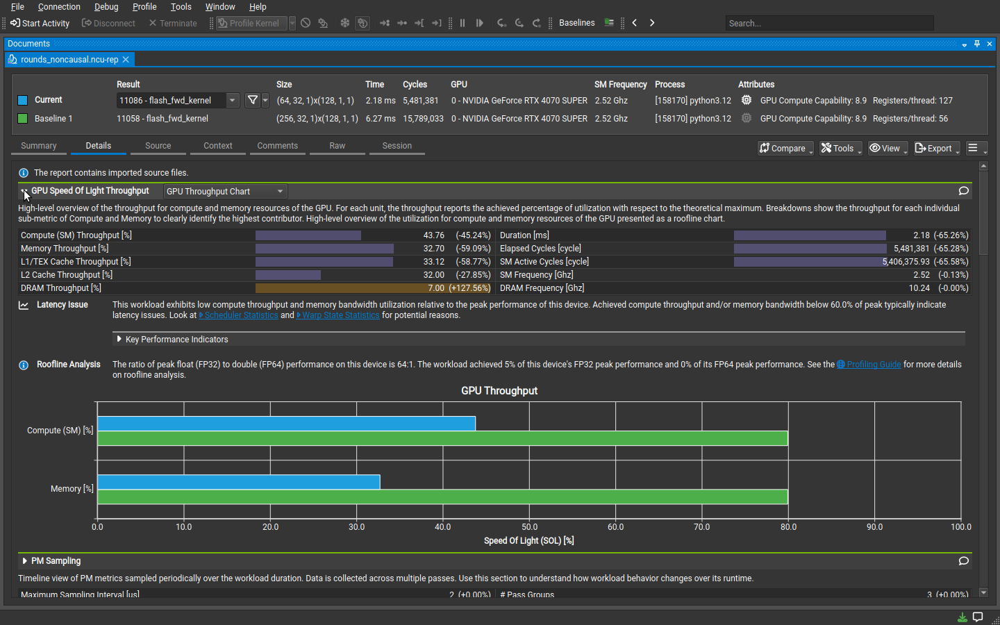

The tuned kernel (blue) takes 2.18 ms against the baseline's 6.27 ms (green), and its headline numbers are *lower*: Compute (SM) Throughput falls from 79.9% to 43.8%, Memory Throughput from 79.9% to 32.7%. Nsight Compute now adds a "Latency Issue" warning, because both are under 60%. Reading only these two bars may lead to the conclusion the tuned kernel is worse. However, round 0 already showed that the baseline's high percentages were because they were the LSU pipe doing work the faster kernel no longer needs.

### Step 2: the breakdown, and a trap in it

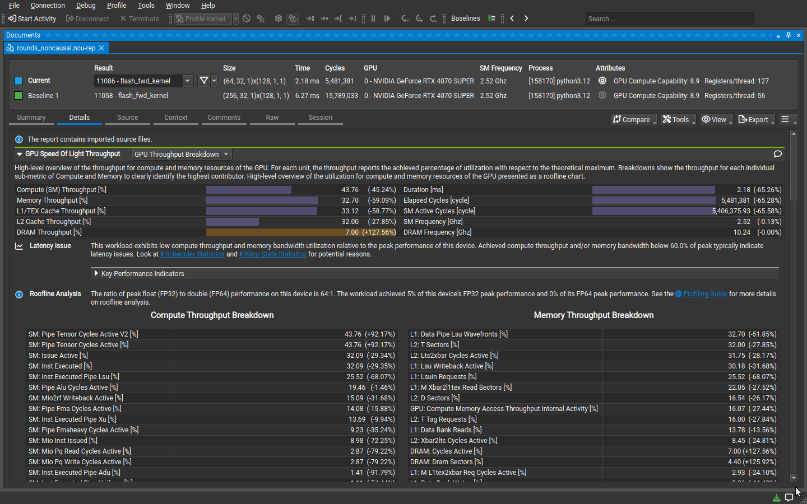

The top compute row is now `SM: Pipe Tensor Cycles Active` at 43.8% (+92% against the baseline), and the LSU pipe has dropped to 25.5% (−68%). The tensor cores are the busiest unit, which is what a matrix-multiply kernel should look like.

But 43.8% is not the whole story. The roofline (next step) says the same kernel runs the tensor cores at **87.5%** of their peak. For every kernel in this article the two numbers differ by a factor of two with rounding: 22.8% against 45.5% for the baseline, 43.8% against 87.5% for the tuned kernel, 44.6% against 89.2% for SDPA. A direct experiment shows where the factor of two comes from. Here is the same Triton matmul (8192³) with different input and accumulator types, with both counters:

| Inputs → accumulator | Operations, % of that type's peak | Tensor pipe % |
|---|---|---|
| bf16 → fp32 | 97.6 | 48.8 |
| fp16 → fp32 | 97.5 | 48.7 |
| tf32 → fp32 | 93.0 | 46.5 |
| fp16 → fp16 | 84.1 | 84.1 |
| int8 → int32 | 64.0 | 64.0 |

For bf16, fp16 and TF32 inputs with fp32 accumulation, the pipe counter reads exactly half; with fp16 accumulation, and for int8 inputs, the two agree. A reply on Nvidia [developer forums](https://forums.developer.nvidia.com/t/maximum-tensor-core-utilization/326341/3) describes this as a documented defect of the counter on GeForce cards: for `HMMA` (fp16, bf16, TF32) with fp32 accumulation it tops out at 50%, "a defect in the metric that cannot be fixed". So the consequence is practical: **for bf16 matrix multiplies with fp32 accumulation on a GeForce Ada card, about 50% on that row means the tensor cores are saturated**, and the "Latency Issue" rule is a false alarm. The roofline divides by the right peak for each data type, so that is where I read how compute-bound a kernel is.

### Step 3: the roofline, with the baseline

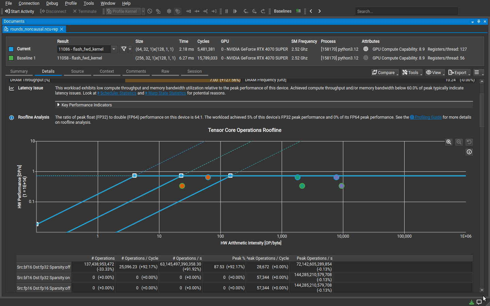

Every dot on the chart moved up, which means the tuned kernel does more work per second. The tuned kernel's dots now sit on the flat line at the top, so it is limited by the tensor cores, not by memory.

The dots also moved sideways. Remember that a dot's horizontal position is the number of operations divided by the number of bytes moved.

- **The L2 dot moved right**, from 23.9 to 63.5 operations per byte. This is because the kernel now reads much less data from L2, i.e. 2.16 GB instead of 8.6 GB. That is about 4 times less, which is what we expected. Each program now handles 64 query rows instead of 16, so it reads K and V 4 times less often. The drop is 3.98 times rather than exactly 4, because the kernel still reads all of `Q`, and that part does not shrink.
- **The L1 and DRAM dots moved slightly left.** The kernel no longer repeats the first multiply, so it does a third fewer operations. The bytes moved through L1 and DRAM fell by less than a third. Fewer operations divided by almost the same number of bytes gives a smaller number, so these dots moved left.

The table under the chart confirms the second prediction. The tensor cores did 137.4 G operations, 33.3% fewer than before. This is exactly the number the algorithm needs, so the repeated multiplies are gone.

The tuned kernel now runs the tensor cores at 87.5% of their maximum speed (63.1 TOP/s, at the 2.52 GHz clock that the profiler locks the GPU to). So for non-causal attention, there is not much speed left to gain.

### Step 4: why the warps wait now

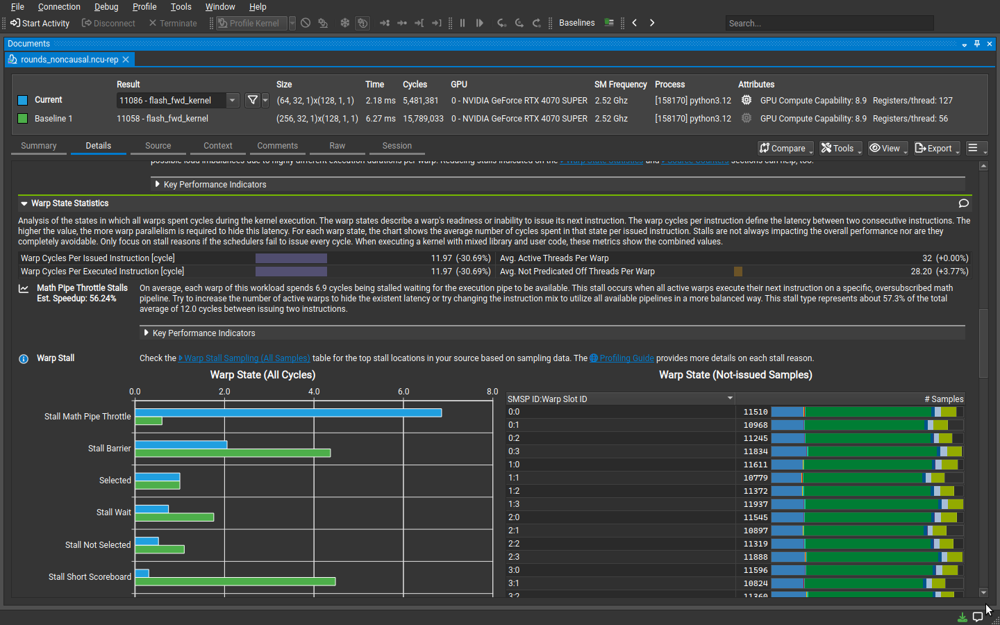

Math pipe throttle is now the longest stall, at 6.9 cycles per instruction. Warps are waiting for the tensor cores, the same signature as SDPA. Short scoreboard and MIO throttle, the shared-memory stalls that dominated the baseline, have almost disappeared. Barrier stalls remain at 2.1 cycles, and the Source page says where. The loop has two `BAR.SYNC`s per iteration, both generated for the `K_j = tl.load(...)` line, which guard the shared-memory buffers of the asynchronous K and V copies; they account for 99.5% of the barrier samples. 

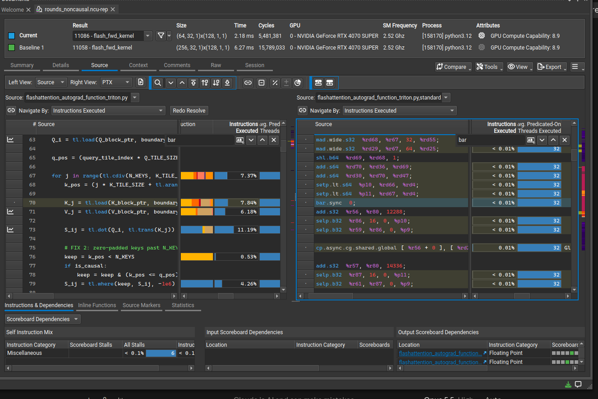


Side by side, with SDPA for reference:

| N = 4096, non-causal | baseline (v0) | tuned (v1) | SDPA |
|---|---|---|---|
| Duration under Nsight Compute | 6.27 ms | 2.18 ms | 2.14 ms |
| Tensor-core operations | 206.2 G | 137.4 G | 137.4 G |
| Tensor-core % of peak (roofline) | 45.5% | 87.5% | 89.2% |
| LSU pipe utilisation | 79.9% | 25.5% | 12.4% |
| Instructions executed | 1,606 M | 394 M | 220 M |
| Registers per thread | 56 | 127 | 255 |
| Shared memory per program | 10.8 KB | 24.6 KB | 49.2 KB |
| Theoretical occupancy | 66.7% | 33.3% | 16.7% |
| Bytes from L2 into the SMs | 8.61 GB | 2.16 GB | 1.35 GB |
| Shared-memory wavefronts | 545 M | 97 M | 40 M |
| Longest stall | short scoreboard | math pipe throttle | math pipe throttle |

Occupancy went down by half and the kernel got three times faster. SDPA runs at half the tuned kernel's occupancy again. Occupancy is a means of hiding latency, not a goal, and a kernel that is waiting on its tensor cores does not need more warps to wait with.

### Step 5: checking the claim about too many warps

Round 1 claimed that with 8 warps on a 64-row tile, Triton stacks the warps along the query axis and every multiply is done twice. One more profile, of the same 64 × 32 kernel with `num_warps=8`, settles the question. The tensor cores executed 274.9 G operations, exactly twice the algorithm's 137.4 G, at 89.3% of their peak, and the kernel took 4.26 ms instead of 2.18. The tensor cores were as busy as in the fast kernel. They were doing everything twice. "Busy" and "useful" are different questions, and the operation count tells them apart.

### Step 6: the causal run

The same report for causal attention says the tuned kernel executed 137.4 G tensor operations there too, against the 68.7 G that causal attention needs (and that the harness divides by). Half of the tensor-core work is thrown away by the mask, which is why causal runs at the same speed as non-causal and half of SDPA. That is the largest thing left, and it is inside the inner loop, which is where Round 4 goes. First, though, the last item of the tuning job: autotuning.

<a id="round3">
## Round 3: wrap the winner in `@triton.autotune`
</a>

Hard-coding one configuration has two weaknesses that the sweep and the test file have already shown. The best configuration can depend on the shape (4 stages at N = 512, a 16-key tile for long causal runs), and a configuration can be invalid for a dtype or head dimension it was not tuned on (fp32 at D = 128). Triton's answer is `@triton.autotune`, i.e. give it a list of configurations, and on the first call for each new combination of the `key` arguments it compiles and times every configuration on the real inputs, then keeps the fastest for that key.

[`kernels/v2_autotune`](https://github.com/searlion/cs336-2026-assignment2-systems/tree/main/flash_forward/2026_10_03_followup/kernels/v2_autotune) lists the per-shape winners of the sweep and lets the grid depend on the chosen tile:

```python
# The per-shape winners of the sweep (Q_TILE, K_TILE, num_warps, num_stages). They differ
# only in the pipeline depth and, for long causal runs, the key tile.
AUTOTUNE_CONFIGS = [
    triton.Config({"Q_TILE_SIZE": bq, "K_TILE_SIZE": bk}, num_warps=nw, num_stages=ns)
    for bq, bk, nw, ns in [(64, 32, 4, 3), (64, 32, 4, 4), (64, 32, 4, 2), (64, 16, 4, 5)]
]


# One tuning run per distinct (N_QUERIES, N_KEYS, D, is_causal) and input dtype; Triton adds
# the dtypes of the tensor arguments to the key on its own.
@triton.autotune(configs=AUTOTUNE_CONFIGS, key=["N_QUERIES", "N_KEYS", "D", "is_causal"])
@triton.jit
def flash_fwd_kernel(...):            # the body is unchanged
    ...


class FlashAttentionTriton(torch.autograd.Function):
    @staticmethod
    def forward(ctx, Q, K, V, is_causal=False):
        ...
        # The grid depends on the Q tile the autotuner picks, so it is a function of the config.
        grid = lambda meta: (triton.cdiv(N_q, meta["Q_TILE_SIZE"]), B)
        flash_fwd_kernel[grid](
            Q, K, V, O, L,
            ...,
            D=D,
            is_causal=is_causal,          # no tile sizes, num_warps or num_stages: the config supplies them
        )
```

Three details to watch out for:

- **Everything the configuration sets must be left out of the call.** Passing `Q_TILE_SIZE=` as well raises `Conflicting meta-parameters`.
- **Changing a key value always means re-timing, but not always recompiling.** Every time a value in the `key` changes, the autotuner times all the configurations again. Whether it also has to compile them again depends on the kind of value. `N_QUERIES` and `N_KEYS` are normal integers. Triton only checks a few simple things about them, i.e. whether they divide by 16, whether they equal 1, and whether they fit in 32 bits. So a new sequence length can reuse the kernels already compiled, and only the timing is repeated. `D` and `is_causal` are `tl.constexpr`, which means their values are built into the compiled code. A new value for either of them means compiling new kernels as well as timing them.
- **A configuration that does not fit is skipped, not fatal.** The autotuner catches `OutOfResources` and times that configuration as infinitely slow. For fp32 at D = 128, three of the four configurations need more than 99 KB of shared memory, and the autotuner quietly picks the 2-stage one. The special case in v1's `forward` is no longer needed, and the unchanged test file passes.

The unchanged harness:

| N | causal | v1, fixed (ms) | v2, autotuned (ms) | v2 TFLOP/s | v2 % of SDPA |
|---|---|---|---|---|---|
| 512 | no | 0.049 | 0.048 | 44.6 | 131% |
| 1024 | no | 0.149 | 0.150 | 57.1 | 101% |
| 2048 | no | 0.534 | 0.537 | 64.0 | 100% |
| 4096 | no | 2.121 | 2.129 | 64.6 | 95% |
| 512 | yes | 0.050 | 0.046 | 23.3 | 120% |
| 1024 | yes | 0.153 | 0.153 | 28.0 | 79% |
| 2048 | yes | 0.545 | 0.546 | 31.5 | 61% |
| 4096 | yes | 2.162 | 2.157 | 31.9 | 52% |

As the sweep predicted, v2 runs at about the same speed as the hard-coded winner: within 1% from N = 1024 up, causal or not. 

We can ask the autotuner about its choice With `TRITON_PRINT_AUTOTUNING=1`. The autotuner picked (64, 16, 4, 5) at N = 512 non-causal in 9 runs out of 10. That is the last candidate in the list. It is 6% slower than (64, 32, 4, 4) and 2.4% slower than v1's own configuration. This is not bad luck. After an idle period, this GPU stays at a lower clock (2.52 GHz) until it has been busy for 0.13 to 0.3 s (see "One warning about durations in a timeline" in Round 0). At the start of a harness run, GPU work is mixed with compilation. `nvidia-smi` updates only every half second, and it showed the clock at 2.52 GHz for 0.4 to 1.0 s in 58 of the 60 runs. The autotuner times the candidates in list order, so the first ones are timed on a slower GPU. In fresh processes after the same 20-second pause, it timed the first two candidates as 5% and 6% slower than their true speed, and it picked the last candidate 7 times out of 10. With one second of GPU work before tuning, it picked (64, 32, 4, 4) 10 times out of 10.

For the shapes that come later, the clock has settled, so differences in the choice are random noise, not bias. At N = 4096 causal, the ten harness runs picked three different configurations. When timed carefully, though, the four candidates are within 2% of each other there, so the choice barely matters. An autotuner is only as accurate as its timings, and the first timings after the GPU has been idle are the least accurate of all.

<a id="round4">
## Round 4: inside the inner loop
</a>

There are two outstanding optimisations:
1. Skipping operations on the masked tiles of causal attention
2. Trimming the instructions that compete with the tensor cores for issue slots, primarily the exponential, i.e. switching `tl.exp` to `tl.math.exp2` and folding the softmax scale and log₂e into one multiply-add *[Note: An issue slot is one opportunity for a warp scheduler to send one instruction to an execution unit. Each Ada SM is split into four sub-partitions, and each sub-partition has its own warp scheduler. On every clock cycle, each scheduler looks at its resident warps, picks one that is ready, and issues one instruction from it. That single “issue one instruction this cycle” opportunity is an issue slot. An SM therefore has 4 issue slots per cycle. Over a kernel’s runtime, the total number of slots is 4 × SMs × cycles.]*
3. Checking what the cast of `P` to bf16 costs, and whether it should stay

<a id="skip">
### Causal tile-skipping
</a>

In round 2, we found that for causal attention the tuned kernel executes 137.4 G tensor operations, double the expected count of 68.7 G. In the timeline below, two launches labelled `v1_tiles causal=True` are about as long as the two `v1_tiles causal=False` launches before them:

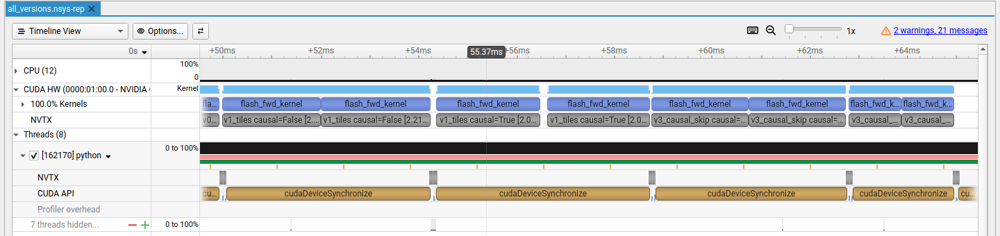

**Why.** The loop visits every key tile, computes `Q Kᵀ`, masks, exponentiates and multiplies by `V`, even when every element of the tile is masked. With 64-row query tiles and 32-key tiles at N = 4096, each head has 64 × 128 = 8,192 tile pairs. Query tile *i* covers rows 64*i* to 64*i* + 63, so it only needs keys up to 64*i* + 63: 2*i* + 2 key tiles. Summed over the 64 query tiles that is 4,160 pairs, 50.8% of the total, and only 128 of them (the two per query tile that straddle the diagonal) need a mask at all. The other 4,032 are fully visible and need no mask. The remaining 4,032 are fully masked and need no work.

**The change.** The loop body moves into a helper, and the kernel calls it twice. Once over the key tiles that need no mask, and once over the tiles that straddle the diagonal. Nothing above the diagonal is visited. `MASKED` is a `tl.constexpr`, so Triton compiles two separate loops, and the unmasked one has no mask (no compare or select on the scores) and no bounds checks on its loads:

```python
@triton.jit
def _attend_key_tiles(
    O_acc, l_acc, m_acc, Q_i, q_pos,
    K_block_ptr, V_block_ptr,
    start, stop, N_KEYS, scale,
    K_TILE_SIZE: tl.constexpr,
    MASKED: tl.constexpr,
    is_causal: tl.constexpr,
):
    # Fold the key tiles [start, stop) into the running state. MASKED is a
    # compile-time flag: the unmasked copy of this loop has no compare, no
    # select and no bounds checks on its loads.
    K_block_ptr = K_block_ptr.advance((start, 0))
    V_block_ptr = V_block_ptr.advance((start, 0))
    for k_start in range(start, stop, K_TILE_SIZE):
        if MASKED:
            K_j = tl.load(K_block_ptr, boundary_check=(0, 1), padding_option="zero")
            V_j = tl.load(V_block_ptr, boundary_check=(0, 1), padding_option="zero")
        else:
            K_j = tl.load(K_block_ptr)
            V_j = tl.load(V_block_ptr)

        S_ij = tl.dot(Q_i, tl.trans(K_j)) * scale          # (Q_TILE, K_TILE), fp32

        if MASKED:
            k_pos = (k_start + tl.arange(0, K_TILE_SIZE))[None, :]
            keep = k_pos < N_KEYS
            if is_causal:
                keep = keep & (k_pos <= q_pos)
            S_ij = tl.where(keep, S_ij, -1e6)

        # ... the online-softmax update and P @ V, unchanged ...

        K_block_ptr = K_block_ptr.advance((K_TILE_SIZE, 0))
        V_block_ptr = V_block_ptr.advance((K_TILE_SIZE, 0))
    return O_acc, l_acc, m_acc
```

and in `flash_fwd_kernel`, after loading `Q_i`:

```python
    q_start = query_tile_index * Q_TILE_SIZE
    q_pos = (q_start + tl.arange(0, Q_TILE_SIZE))[:, None]

    # Key tiles that end at or before full_stop lie entirely inside the tensor.
    full_stop = (N_KEYS // K_TILE_SIZE) * K_TILE_SIZE
    if is_causal:
        # Every key below the first query of this tile is visible to every row,
        # so those tiles need no mask. The tiles that straddle the diagonal get
        # the mask, and nothing beyond the last query of the tile is visited.
        unmasked_stop = tl.minimum((q_start // K_TILE_SIZE) * K_TILE_SIZE, full_stop)
        masked_stop = tl.minimum(q_start + Q_TILE_SIZE, N_KEYS)
    else:
        # Only a ragged last key tile needs the mask.
        unmasked_stop = full_stop
        masked_stop = N_KEYS

    O_acc, l_acc, m_acc = _attend_key_tiles(
        O_acc, l_acc, m_acc, Q_i, q_pos, K_block_ptr, V_block_ptr,
        0, unmasked_stop, N_KEYS, scale,
        K_TILE_SIZE=K_TILE_SIZE, MASKED=False, is_causal=is_causal,
    )
    O_acc, l_acc, m_acc = _attend_key_tiles(
        O_acc, l_acc, m_acc, Q_i, q_pos, K_block_ptr, V_block_ptr,
        unmasked_stop, masked_stop, N_KEYS, scale,
        K_TILE_SIZE=K_TILE_SIZE, MASKED=True, is_causal=is_causal,
    )
```

A few details matter for correctness. The diagonal range starts at `(q_start // K_TILE_SIZE) * K_TILE_SIZE`, rounded down to a key-tile boundary, so the split works when the key tile is larger than the query tile. Both ends are clipped to `N_KEYS`, so ragged key lengths still go through the masked loop with bounds checks. And the non-causal path gets the same treatment: its mask now runs only on a ragged last tile, which also clears item 6 from the previous article's list. And in the first masked tile, every row can see at least that tile's first key, so the `-1e6` sentinel can never become a row's maximum.

The unchanged test file checks the square cases; it keeps causal tests square. Non-square causal attention are checked separately in [`check_nonsquare_causal.py`](https://github.com/searlion/cs336-2026-assignment2-systems/blob/main/flash_forward/2026_10_03_followup_open_questions/04_nonsquare_causal/check_nonsquare_causal.py), against an explicit top-left mask, the convention SDPA's `is_causal=True` uses. The check covers query lengths both longer and shorter than the key length, including ragged lengths; D from 16 to 128, in bf16 and fp32; and key tiles smaller than, equal to and larger than the query tile. Summed over the six versions, all 2,748 cases pass (248 for each one-loop version, run through `apply` and three explicit tile configurations, and 668 for each two-loop version, through `apply` and ten): 1,194 of them are non-square causal, the rest non-causal or square, for comparison. Another 132 do not fit in shared memory for fp32 at D = 128 and are skipped. Since version 2.1, the FlashAttention library aligns the causal mask to the bottom right instead, so the two libraries give different answers whenever the query and key lengths differ.

**Measure.** The test file passes, and the harness:

| N | causal | v1 (ms) | v3 (ms) | v3 TFLOP/s | v3 % of SDPA |
|---|---|---|---|---|---|
| 512 | yes | 0.050 | 0.038 | 28.2 | 146% |
| 1024 | yes | 0.153 | 0.095 | 45.1 | 126% |
| 2048 | yes | 0.545 | 0.303 | 56.7 | 109% |
| 4096 | yes | 2.162 | 1.101 | 62.4 | 102% |
| 4096 | no | 2.121 | 2.056 | 66.8 | 97% |

Causal attention is twice as fast at N = 4096 (1.96×), and now level with or ahead of SDPA at every length. The non-causal path is 3% faster too, from dropping the mask on interior tiles.

**Profile again.** The same timeline shows the causal launches of v3 (last two) at half the width of everything else. In Nsight Compute, the causal kernel now executes 69.8 G tensor operations: the 68.7 G the algorithm needs plus 1.6% for the diagonal tiles, where half of each tile is computed and then masked. Instructions fell from 428 M to 184 M. SDPA executes 70.9 G here, a little more than v3, because its 128 × 128 tiles waste more on the diagonal.

One idea works only in the right form. In causal attention the last query tiles of each head have the most work, and the GPU starts them last, which can leave a tail of busy SMs at the end of the kernel. Reversing the order within each head (`query_tile_index = tl.num_programs(0) - 1 - tl.program_id(0)`) is a common fix, but here it gains only about 1% (1.099 ms to 1.087 ms at N = 4096 for v4, over ten interleaved rounds).

The likely reason is the launch order. The GPU starts programs roughly in order of `program_id(0)` first, then `program_id(1)`, so the heads are launched one after another, and the longest tiles of the last heads still start last. Swapping the grid axes, so that `program_id(0)` is the head, and reversing the query tiles along the other axis starts every head's longest tiles first:

```python
    batch_index = tl.program_id(0)
    query_tile_index = tl.num_programs(1) - 1 - tl.program_id(1)
    # launched with grid = (B, triton.cdiv(N_q, Q_TILE_SIZE))
```

That is 4 to 5% faster at N = 4096 and 7 to 10% at N = 2048, for 64 × 32, 64 × 64 and 64 × 128 tiles alike (its output matches SDPA's at both shapes, but it still needs the test file before it goes into a kernel). I found it after the measurements above, so it is not in the final kernel; it is the first thing I would add.

<a id="exp2">
### `exp2`
</a>

**What the profile said.** Nsight Compute's Source page shows the Python source next to the machine code, with a count of executed instructions for every line. For v3, one line of the loop accounts for 28.6% of every instruction the kernel executes:

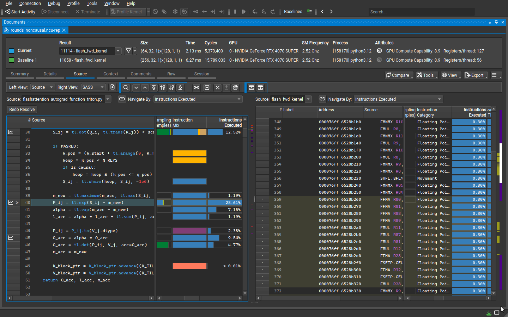

That line is `P_ij = tl.exp(S_ij - m_new)`. Selecting it highlights its SASS on the right, and the opcodes there are not one `MUFU.EX2` per element, as you might hope, but a mix of `FFMA`, `FMUL`, `FSETP.GEU` and `MUFU.EX2`. The PTX explains why. `tl.exp(x)` compiles to:

```
mul.f32         %r485, %r453, 0f3FB8AA3B;   // x * log2(e), 0f3FB8AA3B is 1.4426950
ex2.approx.f32  %r486, %r485;               // 2^x
```

The GPU has no natural exponential instruction, only `ex2` on the special-function unit (`MUFU`), so `exp(x)` becomes `2^(x · log₂e)`: one hidden multiply per element. And `ex2.approx.f32` without `.ftz` must handle results too small for a normal float (below 2⁻¹²⁶), so `ptxas` wraps every `MUFU.EX2` in a range check and two fix-ups. Per element, with the registers renamed for readability (the real code interleaves several elements), v3's SASS does this:

```
FSETP.GEU.AND  P0, PT, R1, -126, PT       // will 2^x be a denormal?
@!P0 FMUL      R1, R1, 0.5                 // if so, halve the exponent ...
MUFU.EX2       R2, R1                      // 2^x
@!P0 FMUL      R2, R2, R2                  // ... and square the result
```

Add the softmax scale, which the kernel multiplies into every score on the line before (`S_ij = tl.dot(...) * scale`), and the subtraction of the row maximum, and each score pays for a scale, a subtraction, a multiply by log₂e, a compare, up to two fix-ups and the `MUFU.EX2` itself (the compiler fuses some of the multiplies and subtractions into `FFMA`s).

**The change.** Fold the scale and log₂e into one constant, `qk_scale = scale · log₂e`, keep the running max `m` in log₂ units of the scaled scores, and call `tl.math.exp2` directly. Because `qk_scale` is positive, the row maximum of the raw scores times `qk_scale` is the maximum of the scaled ones, so the scale is applied to `Q_TILE_SIZE` maxima instead of `Q_TILE_SIZE × K_TILE_SIZE` scores, and the subtraction fuses with the multiply:

```python
        S_ij = tl.dot(Q_i, tl.trans(K_j))                   # raw scores, not yet scaled
        # ... mask as before ...

        # m is kept in log2 units of the scaled scores. qk_scale > 0, so the
        # row max of the raw scores times qk_scale is the max of the scaled ones,
        # and the scale is applied to Q_TILE values here instead of Q_TILE * K_TILE.
        m_new = tl.maximum(m_acc, tl.max(S_ij, axis=1, keep_dims=True) * qk_scale)
        # One FFMA and one ex2 per score: exp(scale*s - m) == 2^(s*qk_scale - m').
        P_ij = tl.math.exp2(S_ij * qk_scale - m_new)
        alpha = tl.math.exp2(m_acc - m_new)
```

with, outside the loop,

```python
    # Fold log2(e) into the softmax scale once, so the inner loop can use exp2.
    qk_scale = scale * 1.4426950408889634
    ...
    # m and log2(l) are in log2 units; the backward pass expects natural-log L.
    L_i = tl.reshape((m_acc + tl.math.log2(l_acc)) * 0.6931471805599453, (Q_TILE_SIZE,))
```

The last line matters: the test file checks `L` against `torch.logsumexp`, which is in natural-log units, so `L` has to be converted back (`L = (m + log₂ l) · ln 2`).

**What the compiler did with it.** `tl.math.exp2` compiles to `ex2.approx.ftz.f32`, the flush-to-zero variant, so the range check and fix-ups disappear, and the scale, the subtraction and the multiply become one `FFMA`:

```
FFMA      R89, R17, UR21, -R3              // s * qk_scale - m
MUFU.EX2  R89, R89                         // 2^x
```

Across the whole compiled kernel (both loops), `FMUL` instructions fell from 320 to 177, and the 40 range checks (`FSETP.GEU` against −126, one for every `MUFU.EX2`) are gone; the four `FSETP.GEU`s left guard the division and the logarithm after the loop. Flushing to zero is safe here: an element of `P` below 2⁻¹²⁶ is added to a row sum that already contains at least one 1 (the row maximum's own term, 2⁰), so it could never change the result.

**Measure.** The test file passes (including `L`). The harness:

| N | causal | v3 (ms) | v4 (ms) | v4 TFLOP/s | v4 % of SDPA |
|---|---|---|---|---|---|
| 1024 | no | 0.147 | 0.144 | 59.5 | 105% |
| 4096 | no | 2.056 | 2.027 | 67.8 | 99% |
| 1024 | yes | 0.095 | 0.091 | 47.1 | 131% |
| 4096 | yes | 1.101 | 1.083 | 63.5 | 103% |

About 1.5 to 4% on these shapes: the small win the previous article expected. (At N = 512 causal, the shortest and noisiest kernels, v4's median is 5% slower than v3's, but both vary by 16 to 22% between runs.)

**Profile again.**

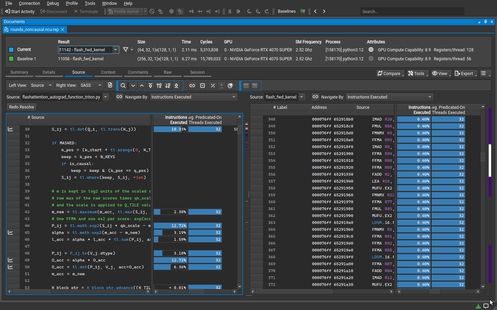

The `exp2` line is down to 12.7% of a smaller total. Executed instructions fell 25%, from 352 M to 264 M (non-causal), and issue-slot utilisation from 29% to 22%. And yet the kernel is only 1.5% faster. That is the lesson of this change: **instruction count is not time**. The kernel is limited by the tensor cores (the longest stall is still math pipe throttle, now 10.2 cycles), and the removed instructions ran on other pipes, mostly in parallel with the matrix multiplies. They only cost time where they delayed issuing the next `HMMA`.

The new profile also says what the next most expensive line is: `O_acc = alpha * O_acc`, at 12.7%, as large as the exponential now. That rescale costs `Q_TILE_SIZE` × D multiplies per iteration no matter how many keys the iteration covers, so a bigger key tile spreads it over more scores. Remember that for Round 5.

<a id="pcast">
### The P cast
</a>

The previous article's first bug was a cast that did nothing: `P_ij.to(V_j.type.element_ty)` without the assignment. The fix, `P_ij = P_ij.to(V_j.dtype)`, has been in every version since. This section asks what that line costs, where it should go, and whether it should be there at all.

**What it compiles to.** In the TTGIR of the 64 × 32, 4-warp kernel, the line becomes two operations:

```
%P_ij_153 = arith.truncf %P_ij_147 : tensor<64x32xf32, #mma> to tensor<64x32xbf16, #mma>
%P_ij_156 = ttg.convert_layout %P_ij_153 : tensor<64x32xbf16, #mma>
                -> tensor<64x32xbf16, #ttg.dot_op<{opIdx = 0, parent = #mma, kWidth = 2}>>
```

The first is the rounding from fp32 to bf16. The second is a change of layout: `P` comes out of the first `tl.dot` in the layout of an accumulator (`#mma`), and must go into the second `tl.dot` as its left-hand operand (`#ttg.dot_op<{opIdx = 0, ...}>`). In SASS the pair becomes:

```
F2FP.BF16.F32.PACK_AB  R72, R89, R90       // two fp32 values of P -> one register holding two bf16
F2FP.BF16.F32.PACK_AB  R74, R94, R93
F2FP.BF16.F32.PACK_AB  R73, R87, R88
F2FP.BF16.F32.PACK_AB  R75, R92, R91
HMMA.16816.F32.BF16    R68, R72, R28, R68  // R72..R75 are the left operand of P @ V
```

The layout conversion costs nothing: when each warp owns whole 16-row slices, the registers a thread holds as part of the `Q Kᵀ` result are exactly the ones it needs as part of the `P V` operand, so the packed registers go straight into the next tensor-core instruction, with no shared memory and no shuffles in between. The cast is one `F2FP` per two elements, 2.4% of the instructions in the v3 profile above.

That is not automatic. In the baseline configuration (16 × 16, 4 warps), the same line compiled to:

```
%P_ij_146 = arith.truncf %P_ij_140 : tensor<16x16xf32, #mma> to tensor<16x16xbf16, #mma>
%P_ij_147 = ttg.local_alloc %P_ij_146 : (tensor<16x16xbf16, #mma>) -> !ttg.memdesc<16x16xbf16, #shared1, #smem>
%P_ij_150 = ttg.local_load %P_ij_147 : !ttg.memdesc<16x16xbf16, #shared1, #smem>
                -> tensor<16x16xbf16, #ttg.dot_op<{opIdx = 0, parent = #mma, kWidth = 2}>>
```

With the warps side by side along the key axis, no warp holds a whole row of `P`, so `P` is written to shared memory and read back in the operand layout, behind a barrier, on every iteration: the extra 512 bytes in Round 0's shared-memory footprint, and part of its 545 M shared-memory wavefronts. The cost of a cast depends on the layout it converts between, and the layout depends on `num_warps` and on how the query tile compares with the head dimension (Round 1).

**Where it goes.** The kernel sums `l` from the fp32 `P`, then rounds `P` to bf16 for the multiply by `V`, so the denominator and the numerator see slightly different values of `P`. FlashAttention-2 does the same. The alternative is to round first and sum the rounded values, so the two agree. I timed both and compared each against a float64 reference on the same inputs:

| Variant (N = 4096, non-causal) | Time (ms) | TFLOP/s | Mean absolute error vs float64 |
|---|---|---|---|
| v4: sum fp32 `P`, cast, multiply | 2.025 | 67.9 | 4.52 × 10⁻⁵ |
| cast first, sum the bf16 `P` | 2.057 | 66.8 | 4.52 × 10⁻⁵ |
| no cast: fp32 `P`, `V` upcast, TF32 multiply | 2.886 | 47.6 | 3.01 × 10⁻⁵ |

Casting first changes nothing: the two orders give the same error to three digits, and the extra conversion back to fp32 for the sum costs a little. The order in the kernel stays. The error itself has two parts of about the same size. Over all 32 heads and three seeds, rounding the exact output to bf16 gives 2.9 × 10⁻⁵ on its own, the floor for any kernel with a bf16 output. The kernel writing its output in fp32 (a test-only change) gives 3.2 × 10⁻⁵, which is the cost of rounding `P`. Combined, over the same heads and seeds, they give 4.51 × 10⁻⁵, less than their sum, because the two roundings are independent and partly cancel.

**Whether it should be there.** The last row removes the cast: `P` stays fp32 and `V` is converted to fp32, so `tl.dot` runs TF32 tensor-core instructions. It delivers 30% fewer TFLOP/s (the kernel takes 43% longer), and the same 30% for causal (44.6 against 63.7 TFLOP/s). The peak table under the roofline chart explains why: on this card the tensor cores do 512 bf16 operations per clock per SM but only 256 in TF32, so with half the FLOPs at half the rate the multiplies take 1.5 times as long. It is more accurate (TF32 keeps 10 mantissa bits to bf16's 7): its bf16 output is within 4% of the floor above. But bf16 is already well inside the test tolerance. The cast is what keeps the second multiply on the fast path, and it is worth every one of its `F2FP` instructions.

<a id="round5">
## Round 5: re-tune, then the final profile
</a>

Round 1's sweep measured the kernel as it was then. Round 4 changed what each loop iteration costs: the per-score work shrank, so the per-iteration work (the `alpha * O_acc` rescale, the barrier around the asynchronous copies) is a bigger share; and causal programs now do half as much work each. Those are exactly the things the tile sizes trade against each other, so the old winner may no longer be the winner. The same `sweep.py`, pointed at `kernels/v4_exp2`, took 10.8 minutes:

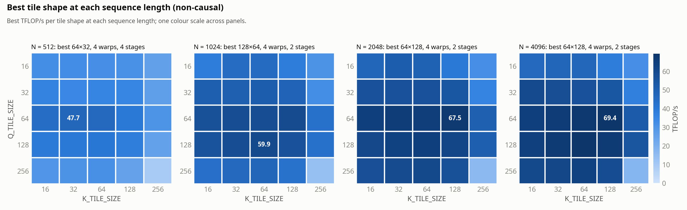

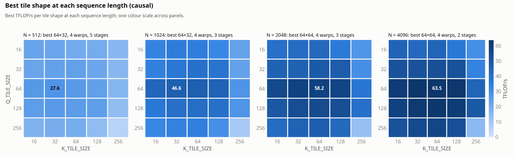

| N | causal | Best configuration (Q × K, warps, stages) | TFLOP/s | 64 × 32, 4, 3 (Round 1's winner) |
|---|---|---|---|---|
| 512 | no | 64 × 32, 4, 4 | 47.7 | 97.8% of best |
| 1024 | no | 128 × 64, 4, 2 | 59.9 | 97.9% |
| 2048 | no | 64 × 128, 4, 2 | 67.5 | 97.3% |
| 4096 | no | 64 × 128, 4, 2 | 69.4 | 94.9% |
| 512 | yes | 64 × 32, 4, 5 | 27.6 | 95.0% |
| 1024 | yes | 64 × 32, 4, 3 | 46.6 | 100% |
| 2048 | yes | 64 × 64, 4, 3 | 58.2 | 99.0% |
| 4096 | yes | 64 × 64, 4, 2 | 63.5 | 98.3% |

This time the best configuration does depend on the shape and the mask. Long non-causal sequences now prefer 128-key tiles (at N = 4096 the sweep had 128 × 64 tiles level with them, to 0.01%, but re-timed below, 64 × 128 is 0.8% faster), which is what Round 4's profile predicted: four times fewer iterations means four times less of everything the loop does once per iteration. Profiling the same kernel and mask with 64 × 32 tiles and 3 stages (Round 1's choice) and with 64 × 128 tiles and 2 stages (this round's) shows how much. Executed instructions fall by 35%, from 264 M to 171 M (26% or 31% if the stage count is held at 2 or 3). Of the drop:

- the rescale of `O_acc` is 27%;
- the K and V copies and their barriers are 22%;
- the loop's own bookkeeping is 21%;
- the per-row max, sum and `alpha` updates are 25%.

The lines that run once per iteration fall about 4×: the rescale, the bookkeeping, the `alpha`, `m` and `l` updates, and the warp shuffles inside `tl.max` and `tl.sum`. The copies fall about 2×, because their instructions grow with the tile. The per-score work barely changes: the `exp2`, the cast and the multiply by `V` not at all, and the reductions' compares and adds by 8%. Barrier stalls fall from 3.4 to 0.3 cycles per instruction, and the tensor cores go from 90.2% to about 92% of their peak. Removing the rescale outright, which gives wrong answers, makes the 32-key kernel only 2.7% faster, so the rescale is part of the story, not all of it. The price is 255 registers per thread (the non-causal kernel even spills two, though the spill code runs once per warp, not once per iteration) and 40,960 bytes of shared memory, which only pays off when there is plenty of work: short sequences and the causal diagonal (where a wide key tile means more masked waste) still prefer 32 or 64 keys. For 64-row tiles and larger, the warp rule from Round 1 still holds as a ceiling, never more warps than 16-row slices, but with the leaner loop, two slices per warp became competitive too: 128-row tiles now do best with 4 warps, the shape FlashAttention-2 itself uses.

So autotuning finally has something to choose. In the sweep, Round 1's winner is still within about 5% everywhere (97.5% of the best on average), but a short list can do better. Picking configurations greedily to raise the worst shape gives five that the sweep puts within 1% of the best on every shape, one of which is only there so that fp32 at D = 128 has a configuration that fits:

```python
# From the second sweep (after tile-skipping and exp2), chosen so that every benchmark shape
# is within 1% of its best configuration in that sweep: 64x32 tiles with 3, 4 or 5 stages
# for short sequences, 64x128 with 2 stages for long non-causal ones, and 64x32 with 2
# stages, the only one that fits in 99 KB of shared memory for fp32 inputs at D = 128.
AUTOTUNE_CONFIGS = [
    triton.Config({"Q_TILE_SIZE": bq, "K_TILE_SIZE": bk}, num_warps=nw, num_stages=ns)
    for bq, bk, nw, ns in [(64, 32, 4, 3), (64, 32, 4, 4), (64, 32, 4, 5), (64, 128, 4, 2), (64, 32, 4, 2)]
]


@triton.autotune(configs=AUTOTUNE_CONFIGS, key=["N_QUERIES", "N_KEYS", "D", "is_causal"])
@triton.jit
def flash_fwd_kernel(...):            # the v4 body, unchanged
    ...
```

A single sweep measurement per configuration is noisy, though, and the list was chosen from the same data. Re-timed together with the sweep's five best configurations for each shape (14 configurations in all), five rounds each, the list is within 1% of the best on seven of the eight shapes and 2.3% behind on the eighth (N = 1024 causal, where 64 × 64 tiles with 3 stages win). Round 1's winner, re-timed the same way, is up to 7.3% behind (at N = 512 causal) and 2.8% behind on average.

That is `kernels/v5_final`. The unchanged test file passes. The unchanged harness, against the previous article's kernel and SDPA:

| N | causal | baseline (ms) | final (ms) | final TFLOP/s | SDPA TFLOP/s | final % of SDPA |
|---|---|---|---|---|---|---|
| 512 | no | 0.114 | 0.045 | 47.9 | 34.0 | 141% |
| 1024 | no | 0.387 | 0.144 | 59.8 | 56.7 | 105% |
| 2048 | no | 1.540 | 0.507 | 67.8 | 63.8 | 106% |
| 4096 | no | 6.386 | 1.954 | 70.3 | 68.0 | 103% |
| 512 | yes | 0.114 | 0.037 | 29.1 | 19.4 | 149% |
| 1024 | yes | 0.385 | 0.091 | 47.1 | 35.8 | 132% |
| 2048 | yes | 1.539 | 0.294 | 58.5 | 52.0 | 112% |
| 4096 | yes | 6.383 | 1.077 | 63.8 | 61.5 | 104% |

### The final profile

Last loop of the method: profile the final kernel next to SDPA, with SDPA as the baseline.

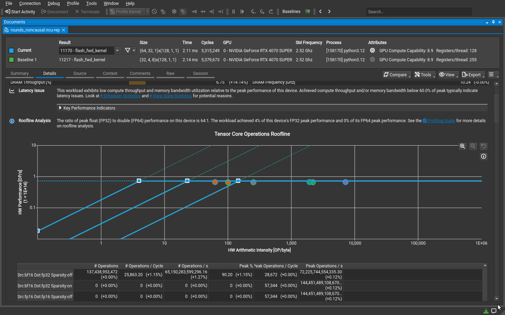

Both kernels sit on the roof. In all ten harness runs the autotuner picked 64 × 128 tiles with 2 stages for this shape, so that is the configuration profiled here (`profile_driver.py --config 64,128,4,2` leaves the autotuner only that one). It reaches 92.2% of the tensor-core peak against SDPA's 89.1%, with the same 137.4 G operations. (Separate captures of the same kernel differ by about 0.1 point; Round 2's capture had SDPA at 89.2%.) The L2 dots differ: SDPA's 128-row tiles move 1.35 GB through L2 against my 2.16 GB, so SDPA's dot sits further right, but both are far enough right of the L2 ridge that it does not matter here.

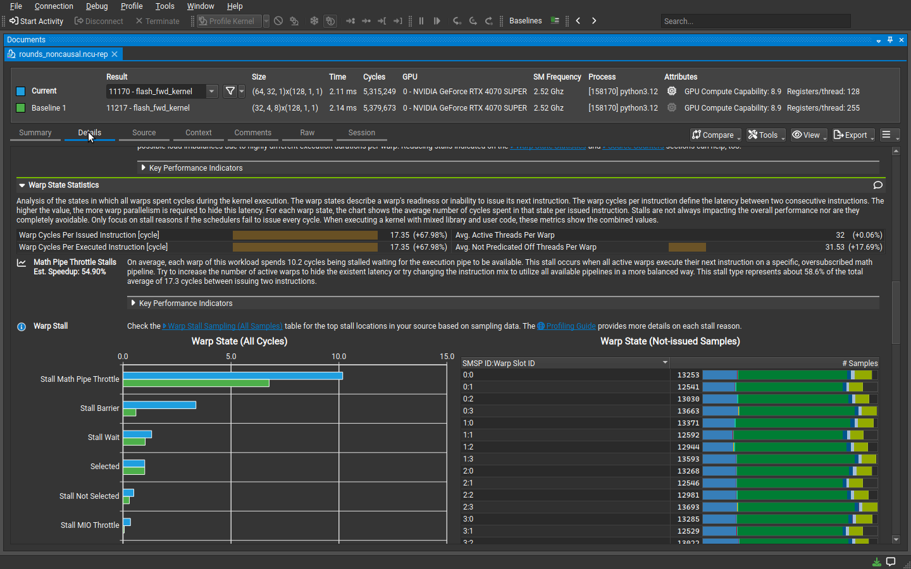

| N = 4096 | final, non-causal | SDPA, non-causal | final, causal | SDPA, causal |
|---|---|---|---|---|
| Duration under Nsight Compute | 2.06 ms | 2.13 ms | 1.15 ms | 1.18 ms |
| Tensor-core operations | 137.4 G | 137.4 G | 70.9 G | 70.9 G |
| Tensor-core % of peak | 92.2% | 89.1% | 85.4% | 83.5% |
| Instructions executed | 171 M | 220 M | 96 M | 114 M |
| Registers per thread | 255 | 255 | 255 | 255 |
| Shared memory per program | 41.0 KB | 49.2 KB | 41.0 KB | 49.2 KB |
| Longest stall | math pipe throttle (9.1) | math pipe throttle (6.8) | math pipe throttle (8.1) | math pipe throttle (6.6) |
| Barrier stall | 0.3 | 0.6 | 0.6 | 0.9 |

(Both of my columns use 64 × 128 tiles with 2 stages, hence the 255 registers and 41 KB. For the causal shape the harness's autotuner picked that configuration in 4 runs out of 10 and 64 × 32 tiles with 4 stages in the other 6, at the same speed within 1%; profiled, the 64 × 32 kernel reaches 86.0% of the peak with 69.8 G operations.)

What is left is small. Both kernels spend their time waiting for the tensor cores, at 89 to 92% of the peak that bf16 inputs with fp32 accumulation allow on this card (83 to 86% for causal). With 128-key tiles, my kernel's barrier stalls (0.3 cycles per instruction) are no longer above SDPA's (0.6); the same kernel with Round 1's 64 × 32 tiles has 3.4 (more per instruction than v1's 2.1 in Round 2, because this loop issues a third fewer instructions for a similar total wait). The loop has two `BAR.SYNC`s per iteration, guarding the shared-memory buffers of the asynchronous copies, and 32-key tiles need four times as many iterations. The next thing I would try is the order in which causal programs start (the end of the tile-skipping section), which is worth 4 to 5% at N = 4096.

And the whole journey on one timeline, every version except v2 (whose kernel is v1's) at N = 4096, non-causal then causal, each launched twice:

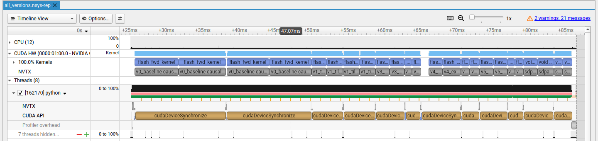

<a id="checklist">
## What to look for, as a checklist
</a>

This is the order I now read profiles in, and what each step has to answer before moving to the next.

**The benchmark**

1. Use the same harness for every comparison, and report medians. On a power-limited consumer card, single runs are sometimes 10% or more slower than usual, so compare each kernel with a reference measured in the same run, run several times before believing a 3% difference, and interleave the versions.
2. Decide what "100%" means. For this kernel it is the tensor cores' bf16-with-fp32-accumulation peak: 512 operations per clock per SM, half the fp16-accumulation rate on GeForce Ada, checked against a large matmul (93 to 98% of it). In TFLOP/s it moves with the clock: 72 at Nsight Compute's 2.52 GHz, 75 to 77 at the 2.61 to 2.68 GHz the card runs the harness's N = 4096 kernels at. So compare Nsight Compute's "% of peak", not TFLOP/s against a fixed number.
3. Autotune on a warm GPU. After an idle period the clock stays low until the GPU has been kept busy for a few tenths of a second (much longer if the work comes in short bursts), so the configurations an autotuner times first look slower than they are.

**The timeline (Nsight Systems)**

4. Is the GPU row solid? Gaps mean the CPU is the bottleneck. A long launch latency in the kernel tooltip means the CPU is comfortably ahead.
5. How many kernels does one call launch, and which takes the time?
6. Compare the kernel with a reference doing the same work, on the same timeline, and do not quote single launches: the clock depends on what the GPU did just before. After an idle period the clock stays at 2.52 GHz until the GPU has been kept busy for a few tenths of a second. Once it has boosted, a pause of a few tens of milliseconds to 1.8 s lets the next tens of milliseconds of power-limited work run faster than it can sustain, and starting a capture pauses the program for 0.4 to 0.6 s. On this card the desktop's drawing also interrupts a kernel now and then. `nsys profile --gpu-metrics-devices=0` shows the clock, and any graphics work, next to each kernel.

**The kernel (Nsight Compute)**

7. Speed of Light: never stop at the two headline percentages. Open the breakdown and read the name of the unit at the top. In the baseline, the "80% compute, 80% memory" was the load/store unit moving data inside the SM.
8. On GeForce Ada, the tensor-pipe row tops out at 50% for matrix multiplies with bf16, fp16 or TF32 inputs and fp32 accumulation; with fp16 accumulation it agrees with the roofline's count. So the "Latency Issue" rule fires on kernels that are compute-bound. Read compute-boundness from the tensor-core roofline's "Peak %", which uses the right peak for the data type.
9. Roofline: compare "# Operations" with the algorithm's count. It found duplicated multiplies (1.5× in the baseline, 2× with too many warps) and wasted ones (2× for causal without tile-skipping).
10. Predict the bytes before reading them. L2 traffic was programs × bytes each program reads (8.6 GB, then 2.16 GB), within 1%. When a prediction and a measurement disagree, one of your assumptions is wrong.
11. Warp state: math pipe throttle on top means the tensor cores are the limit, which is where a matrix-multiply kernel wants to be. Short scoreboard, MIO throttle and barrier on top mean shared-memory traffic and synchronisation. Long scoreboard means global-memory latency.
12. Barrier stalls are reported at an instruction after the `BAR.SYNC` (in this kernel, the first shared-memory load or `MUFU`), not at the `BAR.SYNC` itself. Count the `BAR.SYNC`s in the loop and give each one the samples that follow it.
13. Compute Workload Analysis and the Source page: which source lines produce the busiest pipe's instructions, and what share of all instructions each line costs. The Source page found `tl.exp` at 28.6% of the kernel.
14. Launch statistics and occupancy: which limit binds, registers or shared memory. Occupancy is a means, not a goal. The fastest kernels here run at a third or a sixth of the maximum. Occupancy also decides how a small grid splits into waves: 256 programs at 4 per SM is 1.14 waves, at 3 per SM 1.5.
15. Treat the "estimated speedup" suggestions as hypotheses. The top two for the baseline (occupancy and bank conflicts) were symptoms of the real problem.

**The compiler (Triton)**

16. `compiled.n_regs`, `n_spills` and `metadata.shared` for the configuration you are about to benchmark, and the budget arithmetic to predict them.
17. In the TTGIR: `warpsPerCTA` in the `#mma` layout (do the warps own whole rows?), any `ttg.local_alloc` or `ttg.convert_layout` in the loop (a round trip through shared memory?), and the `memdesc` shapes of the pipeline buffers.
18. The PTX or SASS of the hottest line. That is where `ex2.approx.f32` and its range check turned up.

**After every change**

19. Profile again, and check the change did what you expected and nothing else. `exp2` cut instructions by 25% and time by 1.5%, because the kernel was waiting on the tensor cores, not on the instructions it removed.

<a id="results">
## Results
</a>

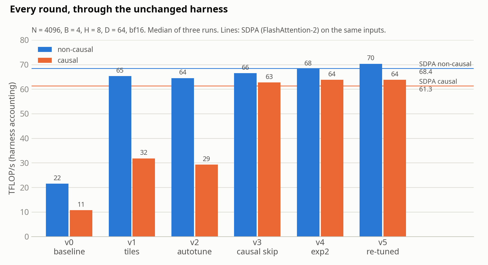

The unchanged harness, medians of ten interleaved runs, every version (milliseconds; TFLOP/s and % of SDPA in brackets for the two N = 4096 rows):

| N | causal | v0 baseline | v1 tiles | v2 autotune | v3 causal skip | v4 exp2 | v5 final | SDPA |
|---|---|---|---|---|---|---|---|---|
| 512 | no | 0.114 | 0.049 | 0.048 | 0.049 | 0.048 | 0.045 | 0.065 |
| 1024 | no | 0.387 | 0.149 | 0.150 | 0.147 | 0.144 | 0.144 | 0.151 |
| 2048 | no | 1.540 | 0.534 | 0.537 | 0.523 | 0.514 | 0.507 | 0.538 |
| 4096 | no | 6.386 (21.5, 32%) | 2.121 (64.8, 95%) | 2.129 (64.6, 95%) | 2.056 (66.8, 97%) | 2.027 (67.8, 99%) | 1.954 (70.3, 103%) | 2.010 (68.4) |
| 512 | yes | 0.114 | 0.050 | 0.046 | 0.038 | 0.040 | 0.037 | 0.055 |
| 1024 | yes | 0.385 | 0.153 | 0.153 | 0.095 | 0.091 | 0.091 | 0.120 |
| 2048 | yes | 1.539 | 0.545 | 0.546 | 0.303 | 0.295 | 0.294 | 0.330 |
| 4096 | yes | 6.383 (10.8, 18%) | 2.162 (31.8, 52%) | 2.157 (31.9, 52%) | 1.101 (62.4, 102%) | 1.083 (63.5, 103%) | 1.077 (63.8, 104%) | 1.118 (61.5) |

What each round was worth, at N = 4096:

| Change | Non-causal | Causal | Found by |
|---|---|---|---|
| Tiles, warps and stages (v0 → v1) | 3.0× | 3.0× | Speed of Light breakdown, roofline operation count, TTGIR layout |
| Autotuning the v1 configurations (v1 → v2) | none | none (the choice varies between runs) | the harness, then `TRITON_PRINT_AUTOTUNING` |
| Causal tile-skipping (v1 → v3) | 3% | 2.0× | roofline operation count, timeline |
| `exp2` (v3 → v4) | 1.5% | 2% | Source page, PTX, SASS |
| Re-tuning with autotune (v4 → v5) | 4% | under 1% | a second sweep, motivated by the Source page |

All of it runs with the same unchanged test file passing at every step.

One caveat on the harness itself. Its first row, N = 512 non-causal, follows a 20-second pause, so the versions that autotune (v2 and v5) are timed on a GPU that tuning has warmed up, and the others on a cold one. SDPA, timed in the same processes, is 3.7% faster in v2's and v5's runs at that row, and within about 1% everywhere else. So at that row, compare each version with SDPA in the same run rather than with the other versions. Even that is only approximate, because the harness times my kernel before SDPA.

Three caveats on the comparison with SDPA. First, at N = 4096 the lead is small, 3 to 4%, though it held in all ten harness runs. In one harness run with the clock recorded, the two kernels ran at nearly the same clock (2.61 GHz for mine, 2.62 GHz for SDPA, non-causal). Run back to back for 12 seconds instead, at the card's 220 W limit throughout, my kernel held 2.55 to 2.60 GHz and SDPA 2.64 to 2.67 GHz, and the lead shrank to 2% for non-causal and disappeared for causal. Second, at N = 512 the lead is large, but most of it measures how each kernel copes with `do_bench`'s cache flush, which zeroes a 256 MB buffer right before every call. Under `do_bench` the lead is the harness's 41% (non-causal) and 49% (causal). Timed without the flush, by replaying the calls from a CUDA graph (`triton.testing.do_bench_cudagraph`) on a warm GPU, with the final kernel's usual configuration at that size, it is 13% and 12%: the flush adds 41% to SDPA's time and 13% to mine (non-causal). Third, SDPA's FlashAttention-2 kernel is general-purpose (dropout, variable lengths, other head dimensions, a backward pass), while this comparison is forward only, at one head dimension.

<a id="future">
## Future articles
</a>

Some ideas I have for future articles:
* Backward pass of FA2. It needs the `L` this kernel has been writing all along, and it is a much harder kernel to tile, with two accumulations in different directions.
* The remaining 8%: whether a different pipelining structure gets closer to the tensor-core peak on Ada. With 128-key tiles the barriers are no longer the obvious culprit.
* Longest-first launch order for causal attention: swapping the grid axes and reversing the query tiles was 4 to 5% faster at N = 4096 and 7 to 10% at N = 2048 in a quick test (Round 4).
* Rewrite the kernel in TileLang and CuTe DSL, now that there is a profile-driven baseline to compare them against.
* The `-1e6` sentinel (item 4 in the previous list) is still in the kernel. Tile-skipping means no row can be fully masked in this kernel, but a kernel with padding masks or sliding windows would need to handle it.
