Table of Contents
- [What Triton did under the hood](#triton-did)
- [The setup](#setup)
- [CuTe in four ideas](#cute)
- [Round 0: a straightforward port](#round0)
- [Round 1: swizzle the shared memory](#round1)
- [Round 2: ldmatrix](#round2)
- [Round 3: keep `P` in registers](#round3)
- [Round 4: cp.async](#round4)
- [Round 5: tiles and stages under 99 KB](#round5)
- [The final profile, and was it a fair fight?](#final)
- [Round 6: beyond Triton's `tl`](#round6)
- [What CuTe makes you write by hand, as a checklist](#checklist)
- [Future articles](#future)

In my [previous article](TODO-dev.to-URL-of-the-follow-up-article), I tuned a FlashAttention-2 (FA2) forward kernel in Triton until it matched PyTorch's `scaled_dot_product_attention` (SDPA) on my RTX 4070 SUPER. Triton automatically handled where each value lives, how data moves into shared memory, and in what order.


**Global memory** is the GPU's main memory (DRAM, 12 GB here), reached through two caches. **L2** (48 MB) is shared by the whole GPU, and **L1** sits inside each SM. **Shared memory** is a small scratchpad inside each SM (at most 99 KB per thread block here) that a block's threads fill and read by hand. **Registers** are each thread's own, fastest storage.

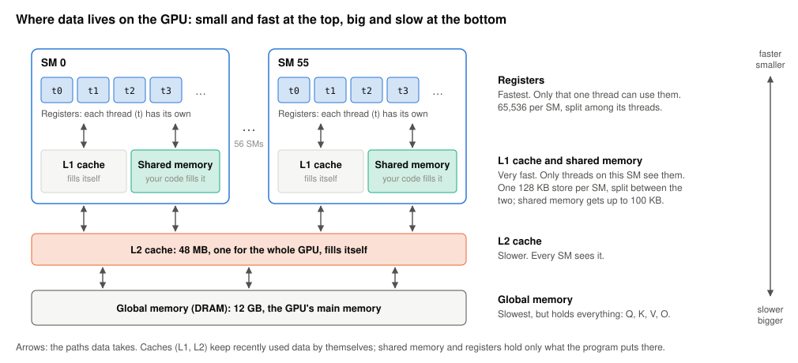


In this article I write the same kernel in NVIDIA's **CuTe DSL**, a Python library for writing kernels at the level of CUTLASS, NVIDIA's C++ template library. I begin with a direct porting of code from Triton to CuTe DSL without all the optimisations that Triton provided for under the hood. This gives a baseline measurement of the performance of an unoptimised kernel. I then layer on each optimisation which Triton automatically provided, measuring the performance gain which each optimisation brings.

The harness and the test file are copied unchanged, so the numbers compare directly with the previous article's. Here are the results at N = 4096, the median of the harness runs (10 for CuTe v5 and Triton v5, 3 for the other kernels, 35 for SDPA).

| | Triton v5 (previous article, re-measured) | CuTe v0 (straight port) | CuTe v5 (this article) | SDPA | NVIDIA's CuTe example |
|---|---|---|---|---|---|
| Non-causal | 1.968 ms, 69.8 TFLOP/s | 5.436 ms, 25.3 TFLOP/s | 1.991 ms, 69.1 TFLOP/s | 2.158 ms, 63.7 TFLOP/s | 1.950 ms, 70.5 TFLOP/s |
| Causal | 1.079 ms, 63.7 TFLOP/s | 2.997 ms, 22.9 TFLOP/s | 1.029 ms, 66.8 TFLOP/s | 1.118 ms, 61.5 TFLOP/s | 1.038 ms, 66.2 TFLOP/s |


Trillions of floating-point operations per second. The harness counts 4·B·H·N²·D operations for attention (half that for causal) and divides by the time. B is the batch size (4 here), H the number of attention heads (8), N the sequence length in tokens (512 to 4096), and D the size of each head's query, key and value vectors (64).


I also ran the kernels back to back for longer, logging clock speed and power ([Was it a fair fight?](#final)). CuTe v5 and Triton v5 ran at nearly the same clock (within 1.1%) and hit the power cap equally often. Under those matched conditions, the results were as follows.

- **Causal.** CuTe v5 is 4–5% faster for N ≥ 1024. At N = 4096 it is still 4% faster when Triton uses the same tile sizes, so the gap does not come from differences in tile size.
- **Non-causal.** CuTe v5 is 4% faster at N = 1024 and 2% faster at N = 2048. At N = 4096 they are level.
- **N = 512.** A tie, with or without the causal mask.


The **SM clock** is how many cycles per second the GPU's cores run, and every kernel's speed scales with it. 

**Throttling** is the driver lowering that clock to stay within a limit. The **power cap** is the limit on board power, 220 W here.

**Thermal** slowdowns are limits on temperature. 

NVML, the driver's monitoring library, reports which of these reasons is active.


Below are the four optimisations which Triton implemented under the hood, and which I have to manually implement in CuTe DSL.
1. a swizzled shared-memory layout. This change alone made the straight port about twice as fast (5.44 → 2.69 ms at N = 4096, non-causal)
2.  matrix loads with ldmatrix
3. keeping `P` in registers
4. asynchronous copies with cp.async. 

A sweep of tile and pipeline sizes then gained 0–4%.

This article assumes you know the Flash Attention 2 (FA2) forward pass and the previous article.

This article was written with the assistance of AI. If you spot any mistakes, please let me know.

<a id="triton-did">
## What Triton did under the hood
</a>

We can use Triton's GPU-level compiler stage (TTGIR) to examine the optimisations it did under the hood. The snippet below is the Python that produces TTGIR. It compiles the previous article's kernel for one configuration (64 × 64 tiles, 4 warps, 2 stages) without launching it, then prints the TTGIR text that Triton generated along the way. The comment on the `print` line shows one line of that output, the shared-memory layout Triton chose. The table after the snippet is built from lines like it. (Abridged from [`inspect_kernel.py`](https://github.com/searlion/cs336-2026-assignment2-systems/blob/main/flash_forward/2026_10_03_followup/inspect_kernel.py).)


Triton compiles a kernel in stages, Python → TTIR → TTGIR → LLVM IR → PTX → SASS. TTGIR (Triton GPU IR) is the stage where Triton makes its GPU-specific choices, such as which thread holds which values, how shared memory is laid out, and which copies run asynchronously. It is a text format, so you can read it.


```python
kern = flash_fwd_kernel.fn                         # unwrap @triton.autotune
compiled = kern.warmup(q, k, v, o, L, *strides, N, N, scale,   # compiles, does not launch
                       D=64, Q_TILE_SIZE=64, K_TILE_SIZE=64, is_causal=False,
                       num_warps=4, num_stages=2, grid=(triton.cdiv(N, 64), B))
print(compiled.asm["ttgir"])     # e.g. #ttg.swizzled_shared<{vec = 8, perPhase = 1, ...}>
# compiled.asm also holds "ttir", "llir", "ptx" and "cubin" (the binary holding the SASS)
```

TTGIR records what Triton chose, and in the table below, the **Round** column is the round of this article in which I replicated Triton's choice to my CuTe kernel by hand.  Round 0 is a plain port from Triton to CuTe DSL, where every CuTe kernel needs a tiled MMA. Rounds 1 to 5 add the other rows of optimisations mentioned in the table below one at a time, measuring improvements brought by each of these optimisations. The `ldmatrix` and `cp.async` counts in the table come from the SASS of the same compiled kernel (`compiled.asm["cubin"]` disassembled with `nvdisasm`). Speed-ups are for N = 4096, non-causal, unless stated. 

It is ok if the content of the table does not make sense at this point. I will dive into more details with more illustrations as we go through each round of optimisation, and all the concepts will become much clearer.

| What Triton decided | Where it shows in Triton's compiled kernel | What I write in CuTe | Round |
|---|---|---|---|
| Split the work by rows, so each of the 4 warps [groups of 32 threads] computes 16 rows of the tile | `warpsPerCTA = [4, 1]` puts 4 warps per CTA [cooperative thread array, NVIDIA's name for a thread block, which is a group of threads the GPU runs together, here 4 warps = 128 threads], stacked along the rows. As a result, each row of S stays inside one warp, so the softmax finds its max and sum without going through shared memory | `cute.make_tiled_mma(..., (4, 1, 1))` spreads the MMA [matrix multiply-accumulate] over 4 warps along the rows | 0 |
| Shuffle where values sit in shared memory [fast memory inside the chip, shared by a block's threads], so threads reading at once do not queue up | `#ttg.swizzled_shared<{vec = 8, perPhase = 1, maxPhase = 8}>` is a swizzled [shuffled] layout. Values move in groups of 8 (`vec`), each row is shuffled its own way (`perPhase = 1`), and the pattern repeats every 8 rows (`maxPhase = 8`). As a result, reads no longer queue up, making it about 2× faster (Round 1) | `cute.make_swizzle(3, 3, 3)` does the same shuffle | 1 |
| Read each multiply's inputs as whole 8 × 8 blocks, handing each thread exactly the values it needs | 76 `LDSM` instructions (ldmatrix [load matrix]). The 32 that load V also transpose it [swap rows and columns] on the way. As a result, 224 ordinary loads per key block become 40, about 20% faster (Round 2) | `warp.LdMatrix8x8x16bOp`, a copy that uses ldmatrix | 2 |
| Pass `P` [the softmax weights for one block of keys, exp(S − row max), not yet divided by the row sum] straight from the first multiply to the second, without going through shared memory | `ttg.convert_layout` turns `P` from the first multiply's output into the second multiply's input. Each thread already holds the values it needs, so nothing goes through shared memory. As a result, it saves 8 KB of shared memory but only about 1% of time (Round 3), since the round trip was already fast | Reuse the registers [each thread's own storage] holding `P` as the next multiply's input, without moving data | 3 |
| Load K and V in the background while the threads keep computing | `ttg.async_copy_global_to_local` [a copy from main GPU memory straight into shared memory, skipping registers], compiled to 32 `cp.async` (`LDGSTS`) instructions. As a result, threads keep computing while K and V load, instead of waiting for them, which is 6% faster (Round 4) | `cpasync.CopyG2SOp` [the same background copy], then commit [bundle the copies started so far into one group] and wait [until a batch has arrived] | 4 |
| Pick tile sizes and how many tiles to load ahead [pipeline stages] for each input size | `@triton.autotune` tries each setting and keeps the fastest. As a result, it is 0–4% faster than one fixed setting, depending on input size (Round 5) | A sweep [time every setting] and a lookup table | 5 |

For fair comparison, I fixed the tile size for both Triton and CuTe DSL at 64 query rows × 64 keys, 4 warps and 2 pipeline stages, with head size D = 64, bf16 inputs and no causal mask. At this tile size, Triton uses 168 registers per thread and 24,576 bytes of shared memory ([`inspect_64x64x4x2_noncausal.txt`](https://github.com/searlion/cs336-2026-assignment2-systems/blob/main/flash_forward/2026_11_09_cutedsl/results/triton_v5/inspect_64x64x4x2_noncausal.txt)). My Round 4 CuTe DSL kernel uses 165 registers and the same 24,576 bytes.

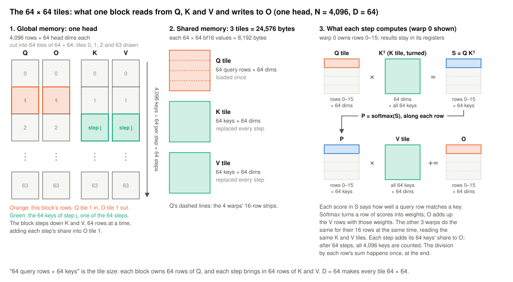


No. Each SM has 65,536 registers, and the GPU hands them out in steps of 8 per thread, so a count is rounded up to the next multiple of 8. A block is 128 threads, so the number of blocks that fit on one SM is 65,536 ÷ (rounded count × 128), rounded down.

| Kernel | Registers per thread | Rounded up | Per block (× 128) | Blocks per SM |
|---|---|---|---|---|
| CuTe v4 | 165 | 168 | 21,504 | 3 |
| Triton v5 | 168 | 168 | 21,504 | 3 |
| CuTe v1 (round 1) | 253 | 256 | 32,768 | 2 |

So the block count changes only at cut-offs. 129 to 168 registers fit 3 blocks, and 169 to 255 fit 2. 165 and 168 are in the same band, so both kernels fit 3 blocks (12 of 48 warps, the 25% theoretical occupancy Nsight Compute reports), and the 3 fewer registers make no measurable difference. Round 1's 253 falls in the next band down. Nsight Compute's "Block Limit Registers" agrees, with 3 for v4 and 2 for v1. I did not look into why the two counts differ. NVIDIA's assembler (ptxas) picks the count from the code each compiler hands it, and the two compilers produce different code.


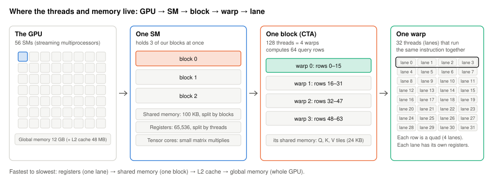


A **block** (a thread block, which CUDA and CuTe also call a CTA, cooperative thread array) is a group of threads that the GPU starts together and runs on one SM, where they share that SM's shared memory and can wait for each other at a barrier. In this kernel, one block is 128 threads (4 warps) and computes the attention output of 64 tokens for one head. Each token is one row. In a head's Q, K, V and O, row i is token i's query, key, value and output, 64 numbers each (the head size D). Counting up from there gives the following.

- **One head** of one sequence has 4,096 rows, one per token. A block takes 64 of them (block 1 takes tokens 64–127), so one head needs 4,096 ÷ 64 = **64 blocks**. This 64 is the number of rows per block, not the head size D.
- **The batch** has 4 sequences × 8 heads = **32 heads**, each a separate problem with its own Q, K and V.
- **The GPU** runs 64 × 32 = **2,048 blocks**, but not all at once. Only 3 fit on an SM at a time, so its 56 SMs run 168 blocks together. Each time one finishes, a waiting block takes its place.

**Why only 3 per SM?** A block starts on an SM only if the SM has room for everything the block needs, meaning its registers, its shared memory, its warps and a free block slot. Each SM has a fixed amount of each, and whichever runs out first sets the limit. Here are the limits for the kernel at 64 × 64 tiles (v4).

| Resource | One block needs | One SM has | Blocks that fit |
|---|---|---|---|
| Registers | 168 per thread × 128 threads = 21,504 | 65,536 | **3** (4 would need 86,016) |
| Shared memory | 24 KB, plus 1 KB the driver reserves | 100 KB | 4 |
| Warps | 4 | 48 | 12 |
| Block slots | 1 | 24 | 24 |

Registers run out first, so 3 blocks per SM. Nsight Compute reports the same limits. This is why a kernel's register count can matter. Needing more registers per thread can mean fewer blocks per SM.

The figure below shows the 32 heads, one head cut into 64 blocks, and what one block reads and writes.

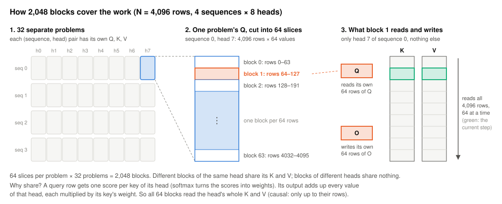



A block's 128 threads are 4 **warps** of 32, and each warp takes 16 of the block's 64 rows, warp 0 rows 0–15, warp 1 rows 16–31, and so on. The 32 threads of a warp execute the same instruction together. Each thread in it is a **lane**, numbered 0 to 31. A **quad** is 4 neighbouring lanes (0–3, 4–7, …). It is not a separate hardware unit.

When a warp runs one tensor-core multiply, its result is always 16 × 8, because the hardware fixes that shape (the instruction is `mma.m16n8k16`, more in "Why is one mma one warp, and why 16 × 8?" below). The instruction also fixes which lane receives which value of the result, and three counts explain the pattern.

1. **4 values per lane.** 16 × 8 = 128 values, shared by 32 lanes.
2. **One row per quad.** The instruction gives each row to one quad. A row is 8 values and a quad is 4 lanes, so each lane gets 2 values of the row. They are neighbours (columns 0 and 1, 2 and 3, …), and that pays off later. Once converted to bf16, the pair fits in one 32-bit register, which is exactly how the next multiply, P·V, wants its input. That is what lets `P` stay in registers in Round 3.
3. **Two rows per quad.** There are 16 rows but only 8 quads, so each quad must take 2 rows. The instruction pairs row q with row q + 8, so quad 0 holds rows 0 and 8, quad 1 rows 1 and 9, and so on.

So each lane's 4 values are 2 in row q and 2 in row q + 8. Because a whole row sits inside one quad, a row's max or sum needs only those 4 lanes to swap values with shuffles, not the whole warp.

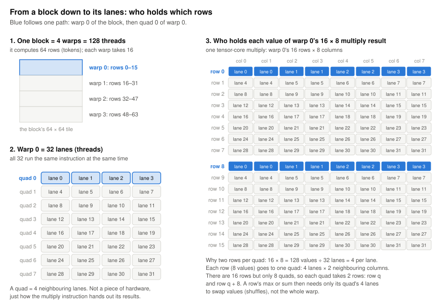



A tensor core is a unit inside each SM that multiplies small matrices. On this GPU one warp-wide MMA (matrix multiplication accumulator) instruction, `mma.sync.m16n8k16` (`HMMA.16816` in SASS), computes a 16 × 8 tile of `A·B + C` from a 16 × 16 piece of A and a 16 × 8 piece of B. Each of the 32 lanes supplies and receives a fixed handful of the values, and that fixed assignment is the instruction's layout.



The **accumulator** is the running total a multiply adds into (the C in D = A·B + C, which D overwrites), that is, where each lane keeps its share of the result, in fp32. The **operands** are A and B, that is, which values each lane must supply, in bf16. They are different assignments of values to lanes, so a result can only feed the next multiply directly if the two line up.



**ldmatrix** is the instruction that Round 2 adds (third row of the table in [What Triton did under the hood](#triton-did)). It is `warp.LdMatrix8x8x16bOp` in CuTe and `LDSM` in SASS. One warp-wide ldmatrix reads 8 × 8 tiles of 16-bit values from shared memory and hands each lane exactly the values the MMA wants from it. `ldmatrix.x4`, the version this kernel uses, reads four tiles at once. `ldmatrix.trans` transposes on the way, which is what V needs.

The 4 in `.x4` counts tiles. One instruction loads four 8 × 8 tiles (`.x1` and `.x2` load one and two). It is not the 4 lanes of a quad. Quads do show up inside each tile, though. ldmatrix gives each tile row (8 values) to one quad, 2 values per lane, the same pattern as the multiply's result.

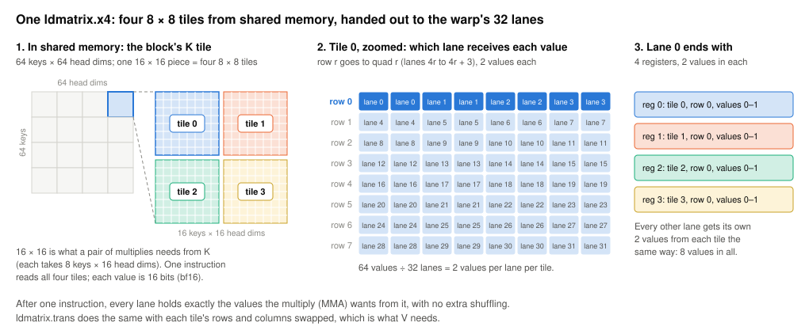



Data still goes global memory → shared memory → registers, and `cp.async` changes only how the first step is done. Without it, that step takes two instructions, a load from global memory into a register (`LDG`), then a store from the register into shared memory (`STS`), and the thread waits for the load before it can store. `cp.async` (SASS `LDGSTS`, "load global, store shared") does it in one. 16 bytes go straight from global memory into shared memory, and the thread moves on without waiting. The thread groups its copies with `commit_group` and later calls `wait_group(n)`, which returns once at most n groups are still in flight. A barrier after the wait makes the data visible to the whole block.

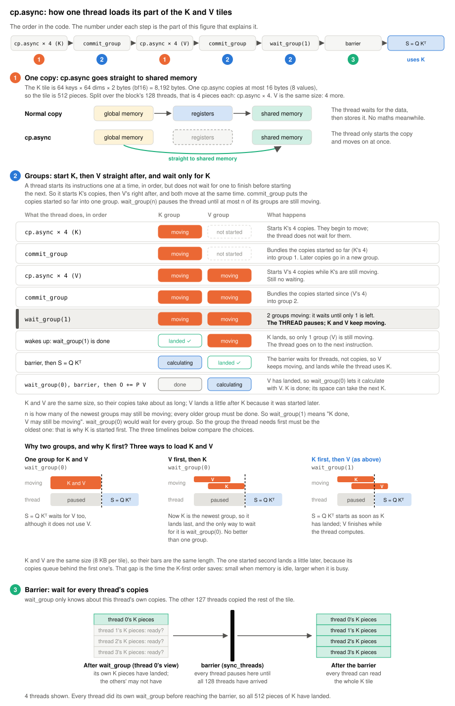


<a id="setup">
## The setup
</a>

| | Version |
|---|---|
| nvidia-cutlass-dsl (CuTe DSL) | 4.8.1 |
| PyTorch | 2.11.0 (CUDA 13.0) |
| Triton (for the comparison kernel) | 3.6.0 |
| Nsight Systems / Nsight Compute | 2026.1.3 / 2026.2.1 |
| NVIDIA driver | 595.99 |

The harness [`bench_flashattention.py`](https://github.com/searlion/cs336-2026-assignment2-systems/blob/main/flash_forward/2026_11_09_cutedsl/bench_flashattention.py), the test file [`test_flashattention_triton.py`](https://github.com/searlion/cs336-2026-assignment2-systems/blob/main/flash_forward/2026_11_09_cutedsl/test_flashattention_triton.py) and [`compare_driver.py`](https://github.com/searlion/cs336-2026-assignment2-systems/blob/main/flash_forward/2026_11_09_cutedsl/compare_driver.py) are byte-for-byte copies of the previous article's ([checksums](https://github.com/searlion/cs336-2026-assignment2-systems/blob/main/flash_forward/2026_11_09_cutedsl/results/sha256_harness.txt)). They import `FlashAttentionTriton` from `flashattention_autograd_function_triton.py`, so each CuTe version lives in a file of that name. Every version passes the unchanged test file ([results](https://github.com/searlion/cs336-2026-assignment2-systems/blob/main/flash_forward/2026_11_09_cutedsl/results/tests.txt)).


It times each kernel with Triton's `triton.testing.do_bench`, which runs the kernel repeatedly for about 100 ms, clears the L2 cache before each run, and returns the median time.


| Folder | What changes |
|---|---|
| [`kernels/v0_naive`](https://github.com/searlion/cs336-2026-assignment2-systems/tree/main/flash_forward/2026_11_09_cutedsl/kernels/v0_naive) | the Triton v5 algorithm, ported as directly as possible |
| [`kernels/v1_swizzle`](https://github.com/searlion/cs336-2026-assignment2-systems/tree/main/flash_forward/2026_11_09_cutedsl/kernels/v1_swizzle) | swizzled shared-memory layout |
| [`kernels/v2_ldmatrix`](https://github.com/searlion/cs336-2026-assignment2-systems/tree/main/flash_forward/2026_11_09_cutedsl/kernels/v2_ldmatrix) | operands loaded with ldmatrix |
| [`kernels/v3_p_regs`](https://github.com/searlion/cs336-2026-assignment2-systems/tree/main/flash_forward/2026_11_09_cutedsl/kernels/v3_p_regs) | `P` stays in registers |
| [`kernels/v4_cpasync`](https://github.com/searlion/cs336-2026-assignment2-systems/tree/main/flash_forward/2026_11_09_cutedsl/kernels/v4_cpasync) | K and V copied with cp.async, overlapped with the maths |
| [`kernels/v5_tuned`](https://github.com/searlion/cs336-2026-assignment2-systems/tree/main/flash_forward/2026_11_09_cutedsl/kernels/v5_tuned) | an optional ring of K/V buffers, and a configuration table from a sweep |

There are two details of the port.

- **Compile once** per (head size, dtype, causal, configuration). N and the batch size are runtime values.
- **fp32 inputs.** The tensor cores here take only 16-bit inputs, so fp32 inputs are rounded to fp16 (10 bits of mantissa, like the TF32 that Triton's fp32 `tl.dot` uses), multiplied with fp32 accumulation and cast back. Unlike TF32, fp16 tops out at 65,504, so larger fp32 inputs would overflow, but the fp32 tests pass at their unchanged tolerance.


They are number formats. The **mantissa** is the bits that hold a number's significant digits, and the exponent sets its size. fp32 has a 23-bit mantissa. **fp16** has 10 bits and a small range (up to 65,504). **bf16** has only 7 bits but fp32's range. **TF32** is fp32's range with fp16's 10 bits, used inside the tensor cores.


```python
# kernels/v5_tuned, FlashAttentionCuTe.forward (abridged)
work = Q.dtype if Q.dtype in _TORCH_TO_CUTE else torch.float16          # fp32 -> fp16
q, k, v = (x.detach().to(work).contiguous() for x in (Q, K, V))           # no copy for bf16
key = (D, work, bool(is_causal), cfg)
args = (_ptr(q, dt), _ptr(k, dt), _ptr(v, dt), _ptr(O, dt), _ptr(L, cutlass.Float32),
        B, N_q, N_k, (1.0 / math.sqrt(D)) * LOG2E, stream)
fn = FlashAttentionCuTe._compiled.get(key)
if fn is None:
    fn = cute.compile(FlashFwd(dt, D, bool(is_causal), *cfg), *args)    # once per key
    FlashAttentionCuTe._compiled[key] = fn
fn(*args)
```


It is the Python that runs on every call. It prepares the inputs, fetches or builds the GPU kernel, and launches it.

- **`work`** is the number format (dtype) the kernel will use, which is the input's own if it is bf16 or fp16, otherwise fp16. `_TORCH_TO_CUTE` maps PyTorch's names for these formats to CuTe's, and `dt` is the CuTe name for `work`.
- **`.detach().to(work).contiguous()`** chains three steps. `detach` tells PyTorch not to track gradients through this copy, `to(work)` converts the format, and `contiguous` stores the tensor as one unbroken block, row after row, as the kernel assumes. Each step does nothing if it is already true, so bf16 inputs are not copied.
- **`key`** names what a compiled kernel is specialised for, namely head size `D`, format, causal mask or not, and `cfg`, the tuning choice (rows of Q and of K/V per block, warps per block, and how many K/V buffers).
- **`args`** are what the kernel receives. `_ptr` turns a tensor into a pointer, a bare memory address tagged with its format, since the kernel takes addresses, not PyTorch tensors. `O` is the output and `L` holds one number per query row (the log of its softmax denominator) for the backward pass, both allocated just before (not shown). `B`, `N_q`, `N_k` are batch size and the query and key lengths. The scale is 1/√D times log₂e. The GPU has an instruction for 2ˣ but not for eˣ, and eˣ = 2^(x·log₂e), so the kernel calls `exp2` and the multiply by log₂e rides along with the 1/√D it already applies. `stream` is PyTorch's current CUDA stream, the queue of GPU work, so the kernel runs in order with everything else.
- **`_compiled`** is a cache from `key` to compiled kernel. On a miss, `cute.compile` turns the kernel class `FlashFwd` into GPU machine code, which takes seconds, and stores it. Every later call with the same key reuses it.
- **`fn(*args)`** launches the kernel. Afterwards (not shown) fp32 callers get `O` cast back to fp32.


Profiler captures are in [`profile_all.sh`](https://github.com/searlion/cs336-2026-assignment2-systems/blob/main/flash_forward/2026_11_09_cutedsl/profile_all.sh). Nsight Compute fixes the clock (its default `--clock-control base`, 2.52 GHz here), so its durations are not wall-clock speeds. [`sass_counts.py`](https://github.com/searlion/cs336-2026-assignment2-systems/blob/main/flash_forward/2026_11_09_cutedsl/sass_counts.py) disassembles each compiled kernel with `cuobjdump -sass` and counts instructions per loop.


SASS is the GPU's own machine code, the instructions the hardware runs. PTX is a portable assembly one level above it. `cuobjdump -sass` prints the SASS of a compiled kernel.


<a id="cute">
## CuTe in four ideas
</a>

**1. A layout maps coordinates to memory offsets.** A layout is a shape and a stride. A 64 × 64 row-major tile is `(64, 64):(64, 1)`, so element (r, c) lives at offset 64r + c. Every CuTe tensor is a pointer plus a layout.


A layout is a function from coordinates to offsets, written shape:stride. `(64, 64):(64, 1)` means two modes of size 64. One step in the first mode adds 64 to the offset, one step in the second adds 1. Layouts nest, and the brackets pair up the same way. In `((2, 2), 8):((1, 16), 2)`, `(2, 2)` pairs with `(1, 16)` and `8` with `2`. `(2, 2)` means 2 × 2 = 4 rows, numbered with two digits that are each 0 or 1, like binary, instead of one counter from 0 to 3. Each digit has its own stride, 1 and 16, so the rows start at 0, 1, 16 and 17. No single stride can give gaps of +1, +15, +1. CuTe builds everything below from these functions, and composes them like functions.

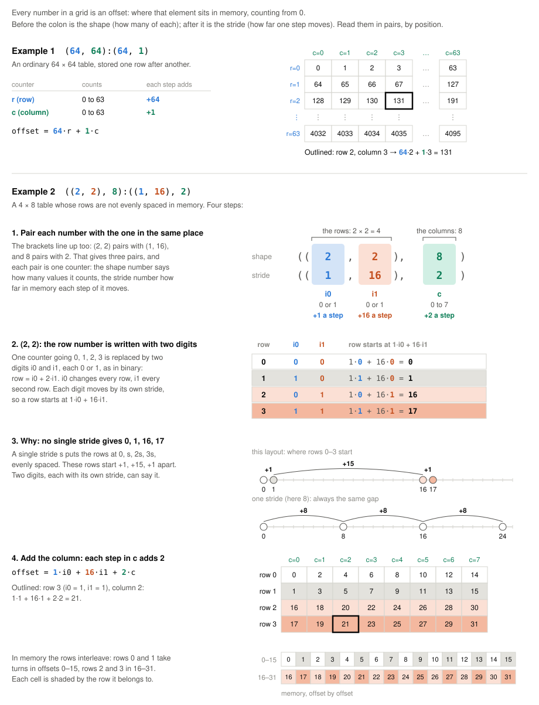


**2. A tiled MMA says which thread computes what.** Each block computes a 64 × 64 score tile S = Q·Kᵀ, its 64 query rows against one block of 64 keys, summed over the head size D = 64. The tensor-core instruction is much smaller. One warp computes a 16 × 8 piece of S, adding up 16 of the 64 head dimensions at a time.

The `(16, 8, 16)` in the code below describes that instruction. It is not the shape of a 3-D matrix. It is three sizes, (M, N, K), the usual way to describe a matrix multiply C = A·B. A is M × K, B is K × N, and C is M × N. Every matrix is 2-D and uses two of the three numbers. Here A is a 16 × 16 piece of Q, B a 16 × 8 piece of Kᵀ, and C a 16 × 8 piece of S. K is the length of the sum behind each value of C. A and B share that side, and C does not have it. Careful with the letters. M counts rows of Q, N counts rows of K, and K counts head dims (the columns that Q and K share). So this K is not the matrix K. The only thing with all three sizes is the work, 16 × 8 × 16 = 2,048 multiply-adds, one for each combination of a row of Q, a row of K and a head dim.

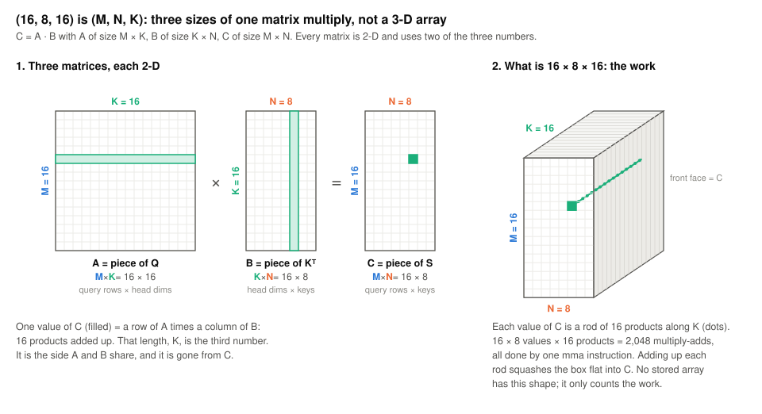

The tiled MMA says how the pieces are shared out.

```python
tiled_mma = cute.make_tiled_mma(
    warp.MmaF16BF16Op(cutlass.BFloat16, cutlass.Float32, (16, 8, 16)),   # (M, N, K): 16 x 16 of Q times 16 x 8 of Kᵀ
    (4, 1, 1),                        # 4 warps, one above the other: 16 rows each
    permutation_mnk=(64, 16, 16))     # one step of the 4 warps: 64 rows x 16 keys x 16 dims.
                                      # Left out, CuTe uses (16 x 4, 8 x 1, 16 x 1) = (64, 8, 16).
                                      # 16 keys: 2 mmas per warp, one ldmatrix.x4 loads K for both
```

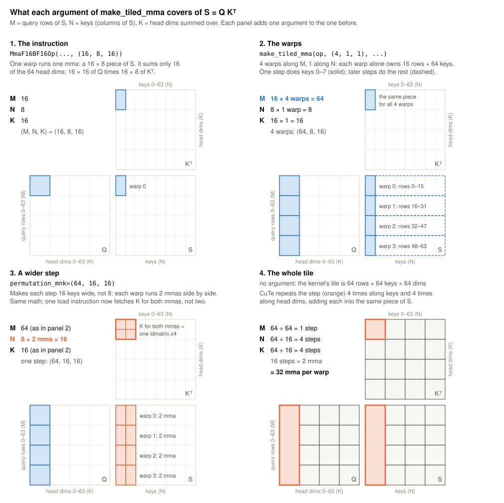


The tensor-core instruction, `mma.sync`, belongs to a warp, not a thread. All 32 lanes issue it together. Each lane holds a small share of the inputs in its registers and receives a small share of the result.

| Matrix | Size | Values | Per lane (÷ 32) |
|---|---|---|---|
| A, a piece of Q | 16 × 16 | 256 bf16 | 8 |
| B, a piece of Kᵀ | 16 × 8 | 128 bf16 | 4 |
| C, a piece of S | 16 × 8 | 128 fp32 | 4 |

No lane holds the whole problem. Only the 32 lanes together do, so the smallest unit of work is one warp running one mma.

The 16 × 8 is the piece of S that one mma produces, 16 query rows × 8 keys. The hardware fixes this shape. For bf16 the instruction is `mma.m16n8k16`, which is where `(16, 8, 16)` comes from. A kernel cannot ask for a bigger mma, only for more of them. One mma covers 1/32 of the 64 × 64 tile and 16 of its 64 head dims. Panels 2 to 4 cover the rest with more warps, more mmas per warp, then repeats.



For S = Q·Kᵀ, **M** is the query rows, **N** the keys, and **K** the head size D = 64. One instruction covers only 16 of those 64, so 4 instructions in a row finish a piece. For O = P·V, M is again the query rows, N is the head dims, and K is the keys. This K has nothing to do with the keys matrix K.



The three numbers say how many warps to place along M, N and K, and their product, 4 × 1 × 1, is the 4 warps. 4 along M gives each warp its own 16 rows. 1 along N means each warp computes all 64 keys of its rows, so a row's maximum and sum never leave the warp. 1 along K means no warp computes part of a sum that another warp would have to add in through shared memory. `(2, 2, 1)` would also be 4 warps, but each row would be split between two warps.



It sets the step, meaning how much of M, N and K the 4 warps cover together before CuTe repeats them over the tile. Left out, CuTe works the step out itself, one dimension at a time, as the instruction's size times the number of warps along that dimension. The rule is `TiledMma.get_tile_size` in CuTe DSL's `cutlass/cute/atom.py`.

```python
perm_tile = self.permutation_mnk[mode_idx]
if perm_tile is None:     # left out: instruction size x warps along this dimension
    return size(atom_shape_mnk, mode=[mode_idx]) * size(thr_layout_vmnk, mode=[mode_idx + 1])
else:                     # given: use it as is
    return size(perm_tile)
```

So `(64, 8, 16)`, the step in panel 2, is written nowhere in the code. CuTe computes it as (16 × 4, 8 × 1, 16 × 1). Calling `tiled_mma.get_tile_size` on CuTe DSL 4.8.1 gives (64, 8, 16) without `permutation_mnk` and (64, 16, 16) with it.

Only N changes, from 8 to 16. A step now spans 16 keys, so each warp runs 2 mmas side by side (the pairs in panel 3), and a 64-key tile takes 4 steps instead of 8. Each warp still runs 32 mmas over the tile, so the math is the same.

What changes is the copy. Before multiplying, each warp copies K from shared memory into its registers, and the kernel builds that copy from the tiled MMA (`make_tiled_copy_B`), one step's piece of K per copy. One copy instruction, `ldmatrix`, carries up to four 8 × 8 tiles. With 8 keys, a step's piece of K is 16 × 8, two tiles, so every mma needs its own copy. With 16 keys it is 16 × 16, four tiles, so one `ldmatrix.x4` feeds both mmas. The data is the same, but the number of copy instructions halves, for K and for V in O = P·V. A warp issues one instruction at a time, so every copy it skips leaves room for a multiply. I took the setting from NVIDIA's FlashAttention-2 example and did not time the default.

The name is broader than this use. In general the argument can also reorder which rows and columns each thread gets, while plain numbers, as here, only set the size.

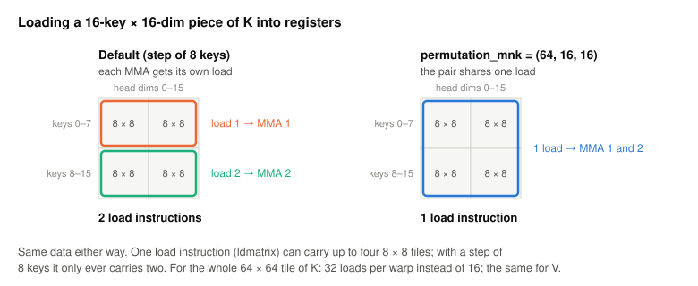


**3. Partitioning gives each thread its share.** The tiled MMA from idea 2 is a rule for which values of Q, K and S each thread works on. It holds no data. Each thread still has to find its values in the real tiles. CuTe calls this step **partitioning**. You pick a thread (`get_slice(tidx)`), pass in a whole tile, and get back only that thread's elements, with `partition_A` for Q and `partition_B` for K. This moves no data. The result still points into shared memory. The data moves later, when the loop copies it into the thread's registers. K is too big to fit in shared memory, so the kernel loads it 64 rows at a time, always into the same spot. The spot never changes, so neither does each thread's share, and the kernel partitions only once, at the start.

```python
# kernels/v0_naive (abridged): each thread finds its share of Q, K and S
thr_mma = tiled_mma.get_slice(tidx)          # the rule from idea 2, for thread tidx
tSsQ = thr_mma.partition_A(sQ)               # my values of Q (sQ: the 64 x 64 Q tile in shared memory)
tSsK = thr_mma.partition_B(sK)               # my values of K
tSrQ = thr_mma.make_fragment_A(tSsQ)         # registers to hold them (CuTe says "fragment")
tSrK = thr_mma.make_fragment_B(tSsK)
acc_S = cute.make_rmem_tensor(thr_mma.partition_shape_C((64, 64)), cutlass.Float32)  # my values of S

# then, for each key block: S = Q Kᵀ, 16 head dimensions at a time
for k in range(4):
    cute.autovec_copy(tSsQ[None, None, k], tSrQ[None, None, k])   # shared memory -> my registers
    cute.autovec_copy(tSsK[None, None, k], tSrK[None, None, k])
    cute.gemm(tiled_mma, acc_S, tSrQ[None, None, k], tSrK[None, None, k], acc_S)
```

This matters for two reasons. First, the kernel never computes a thread's indices by hand. Change the tiled MMA, and every partition changes with it. Second, the same rule decides which thread ends up holding which score in `acc_S`. The softmax needs the maximum and the sum of each row of S. Each row is spread over several threads, so those threads must combine their parts. The figure follows thread 0 through each line of the code.

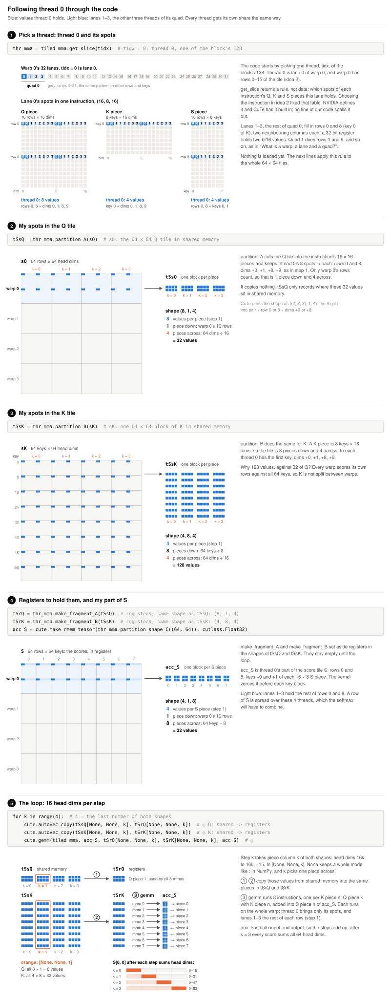

Here a row of S lives in one warp, spread over the 4 lanes of one quad, 16 values each. Each lane takes the maximum of its own 16 values, then the 4 lanes swap results twice with warp shuffles, straight from register to register. The kernel does this in a two-line helper. Its `op` argument says how to combine two values, and the two calls under it pass `cute.arch.fmax` for the row maximum and `+` for the row sum.

```python
# kernels/v0_naive: combine one value across the 4 lanes of a quad
def quad_reduce(v, op):
    v = op(v, cute.arch.shuffle_sync_bfly(v, offset=2, mask=-1, mask_and_clamp=31))
    return op(v, cute.arch.shuffle_sync_bfly(v, offset=1, mask=-1, mask_and_clamp=31))

# the calls, for row r: s.reduce(MAX, ...) is this lane's maximum of its own 16 scores
m_new = quad_reduce(s.reduce(cute.ReductionOp.MAX, -cutlass.Float32.inf, 0), cute.arch.fmax)
row_sum[r] = quad_reduce(row_sum[r], lambda x, y: x + y)
```


`shfl.sync` lets each lane read a register of another lane in the same warp, with no memory involved. In `quad_reduce`, each line is one such swap followed by one `op`. All 32 lanes run the line at once, each with its own register `v`. The shuffle sends this lane's `v` and returns its partner's, and `op` combines the two. The first line pairs each lane with the lane two away, the second with its neighbour. The figure takes the first line apart, argument by argument, then follows quad 0 through both lines.

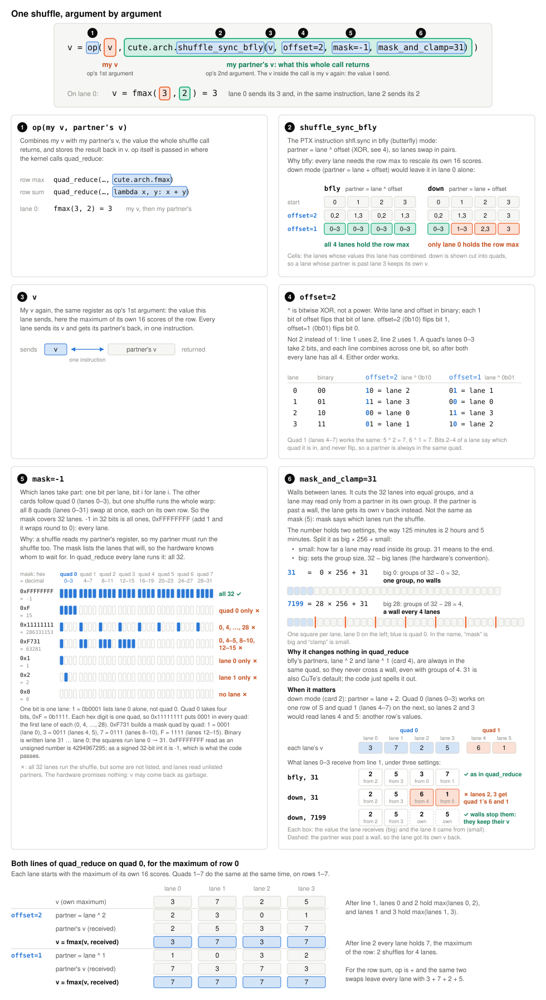

This matters because the online softmax needs each row's maximum and sum on every key block, and each lane of a quad holds only a quarter of the row. Without shuffles, the 4 lanes would pass their parts through shared memory. Each would write, wait for the others, then read all 4 back. Shared memory is already busy with the copies of K and V, and the wait stalls the warp. With shuffles, two swaps between registers leave every lane with the answer.

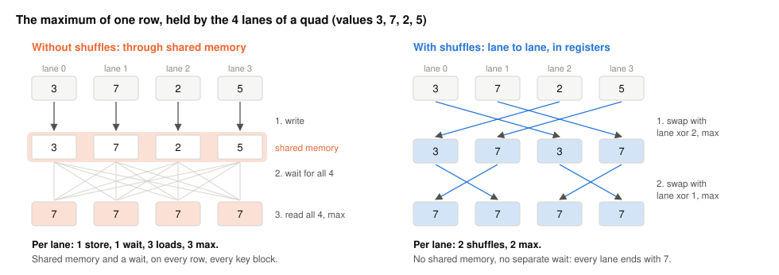


This only works because of the `(4, 1, 1)` passed to `cute.make_tiled_mma` earlier. It stacks the 4 warps along the rows, so each warp holds 16 whole rows of S. The other way to arrange 4 warps is `(2, 2, 1)`, a 2 × 2 grid with 2 warps along the rows and 2 along the 64 keys. Then each warp holds only half of each of its rows, 32 of the 64 keys. Shuffles work only inside one warp, so the row maximum would have to go through shared memory. Each warp writes its half, the whole block waits, and each warp reads the other half back. That would happen on every key block, and it is why the kernel uses `(4, 1, 1)`.

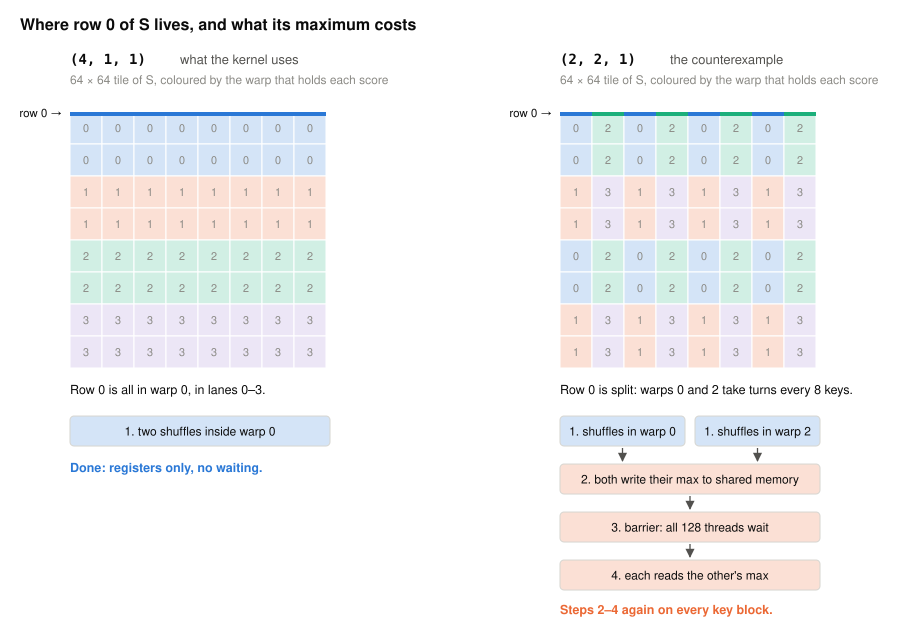

**4. Copies are layouts too.** A tiled copy has two parts. Its **layout** says which thread copies which piece of a tile. For the copy of K into shared memory, two `make_layout` calls arrange the block's 128 threads (4 warps × 32) as a 16 × 8 grid and give each thread 8 values, 16 bytes, per step.

```python
# kernels/v0_naive (abridged): the copy of K and V from global to shared memory
vec = 128 // dtype.width                   # 8 bf16 values = 16 bytes per thread per step
tpr = D // vec                             # 64 // 8 = 8 threads per row of the tile
g2s = cute.make_tiled_copy_tv(
    cute.make_copy_atom(cute.nvgpu.CopyUniversalOp(), dtype, num_bits_per_copy=128),  # the atom
    cute.make_layout((self.threads // tpr, tpr), stride=(tpr, 1)),  # threads: (16, 8):(8, 1)
    cute.make_layout((1, vec)))                                     # values:  (1, 8)

thr_g2s = g2s.get_slice(tidx)              # this thread's share, e.g. thread 19
tKgK = thr_g2s.partition_S(gK)             # its pieces of K in global memory (S: source)
tKsK = thr_g2s.partition_D(sK)             # the same pieces in shared memory (D: destination)
cute.copy(g2s, tKgK[None, None, None, j], tKsK)   # copy key block j: 4 steps of 16 bytes
```

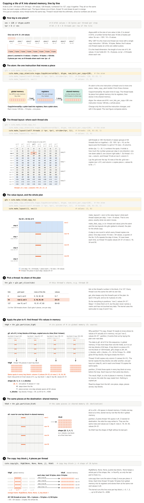

Its **atom** is the one instruction each thread uses to move its piece. Changing the atom changes the instruction, and with it the speed, without touching who copies what. The kernel makes two kinds of copy, and in each the atom Triton picks by itself is the faster one.

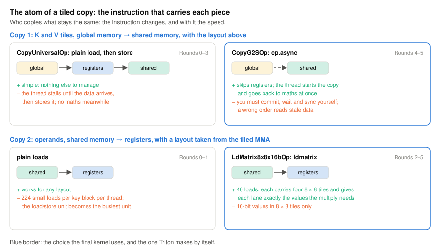

Most rounds below change only an atom or a layout.

<a id="round0">
## Round 0: a straightforward port
</a>

[v0](https://github.com/searlion/cs336-2026-assignment2-systems/blob/main/flash_forward/2026_11_09_cutedsl/kernels/v0_naive/flashattention_autograd_function_triton.py) keeps Triton v5's algorithm, with 64 query rows per block, 4 warps, an unmasked loop then a masked loop over the diagonal key blocks, `exp2` with the scale folded in. Everything else is the simplest thing that works, meaning row-major shared memory, copies through registers, operands read with ordinary loads, `P` written to shared memory and read back, 64-key blocks.

```python
# one key block in v0 (abridged)
cute.arch.sync_threads()                                   # everyone is done with the old K, V
cute.copy(g2s, tKgK[None, None, None, j], tKsK)            # LDG, then STS, for K and V
cute.copy(g2s, tVgV[None, None, None, j], tVsV)
cute.arch.sync_threads()                                   # K, V are in shared memory
for k in cutlass.range_constexpr(cute.size(tSsQ, mode=[2])):
    cute.autovec_copy(tSsQ[None, None, k], tSrQ[None, None, k])     # plain loads
    cute.autovec_copy(tSsK[None, None, k], tSrK[None, None, k])
    cute.gemm(tiled_mma, acc_S, tSrQ[None, None, k], tSrK[None, None, k], acc_S)
# ... mask, online softmax with quad shuffles, P -> shared memory -> registers, O += P V
```

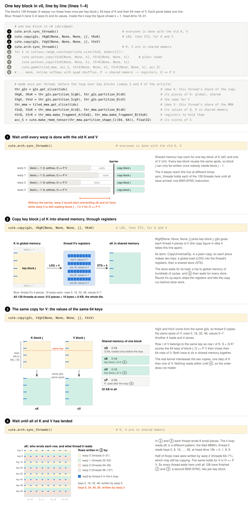

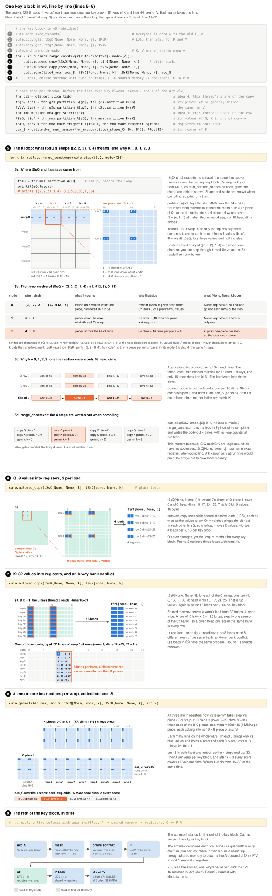


CuTe DSL traces the Python and compiles it. A plain `for` over runtime values becomes a loop in the kernel. `cutlass.range_constexpr` runs in Python at compile time and writes out every iteration, which is what you want for loops over register arrays, because their indices must be known when compiling, or the registers spill to memory.



FA2 never holds a whole row of scores. For each block of keys it updates a running row maximum and a running sum, rescaling what it has added so far whenever the maximum grows. See [Online softmax by hand](https://dev.to/lewis_won/online-softmax-by-hand-4h13).


**The timeline.**

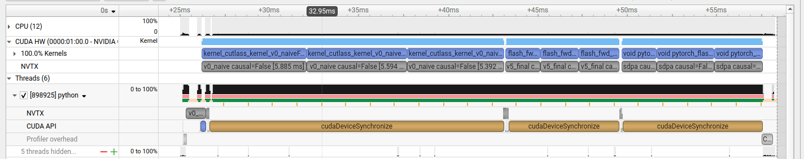

v0's launches take 5.39 to 5.89 ms, Triton v5's 1.91 to 2.23 ms and SDPA's 1.97 to 3.19 ms ([`round0_kernels.txt`](https://github.com/searlion/cs336-2026-assignment2-systems/blob/main/flash_forward/2026_11_09_cutedsl/results/nsys/round0_kernels.txt)). In the harness, v0 is 2.5–2.8× slower than both.

**Utilisation and warp state.** In Nsight Compute, v0 runs the tensor cores at 33.7% of their peak, against 88.9% for SDPA and 87.4% for Triton v5 in the same capture (at 64 × 32 tiles there), while L1 and shared memory are 99% busy.

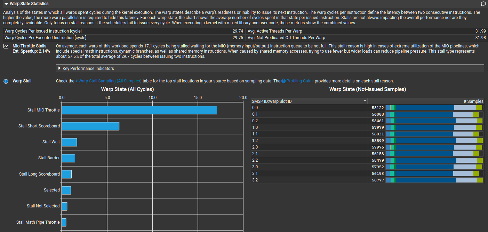

The two longest stalls are **MIO throttle** (17.1 cycles per instruction) and **short scoreboard** (6.3). Warps wait to issue shared-memory instructions, then wait for their results.


Nsight Compute samples why each warp could not issue an instruction. **MIO throttle** means the queue for shared-memory (and other memory-input/output) instructions is full. **Short scoreboard** means waiting for the result of a shared-memory load or a special-function instruction such as `exp2`. **Long scoreboard** means waiting for a global-memory load. **Barrier** means waiting at `__syncthreads()` for other warps. **Math pipe throttle** means the target unit, here the tensor cores, is busy, and for a matrix-multiply kernel this is the stall you want.


**The instructions.** One pass of the unmasked loop compiles to 590 SASS instructions ([`sass_counts.txt`](https://github.com/searlion/cs336-2026-assignment2-systems/blob/main/flash_forward/2026_11_09_cutedsl/results/sass_counts.txt)).

| Per key block, per thread | v0 |
|---|---|
| `HMMA` (tensor-core multiplies) | 64 |
| `LDS` shared loads | 224 (96 of 32 bits, 128 of 16 bits) |
| `STS` shared stores | 24 (16 for `P`, 8 of 128 bits for K and V) |
| `LDG` global loads | 8 |
| `BAR.SYNC` barriers | 2 |

The 16-bit loads are V, which the multiply needs transposed. Nsight Compute counts 117 M shared-load instructions for the whole kernel, served in 671 M wavefronts, with **554 M bank conflicts**. Its Summary page puts them first (rows 0–5 are v0–v5, row 6 Triton v5, row 7 SDPA).

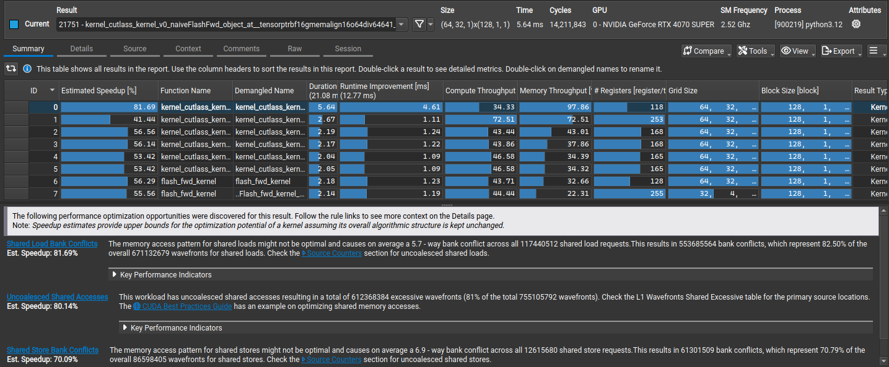


Shared memory is split into 32 banks, each 4 bytes wide, and consecutive 4-byte words go to consecutive banks. In one pass (a wavefront), each bank can serve one word. If several lanes of a warp read different words in the same bank, the reads are served one after another, so an n-way bank conflict takes n passes.




<a id="round1">
## Round 1: swizzle the shared memory
</a>

A 64-wide bf16 row is 128 bytes, exactly the 32 banks, so in a row-major tile column 0 of every row is in bank 0. The operand loads read the same columns of 8 rows, so they collide 8 ways. A swizzle fixes this.

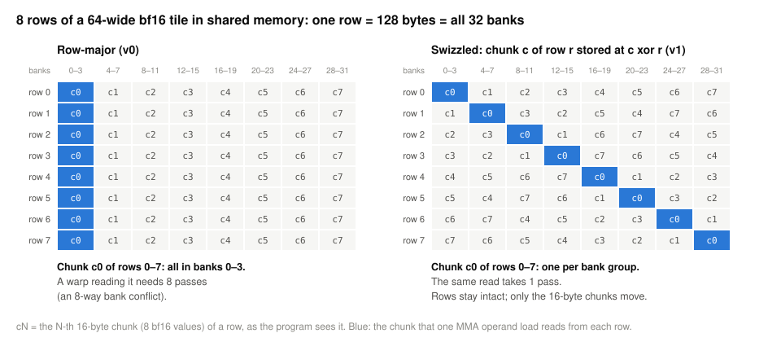


A swizzle is a fixed reshuffling of where values are stored. `Swizzle<3,3,3>` moves each 16-byte piece of a row to a different place in the same row, chosen by the row number, so that the same piece of 8 neighbouring rows ends up in 8 different groups of banks. The code that reads the tile never notices. It still asks for row r, column c, and the layout sends it to the new place.

Four words make the rest easy to follow, and the figure below walks through each one.

- **Slot.** Shared memory is one long line of numbered places, and the tile is stored in it row after row. Row 0 fills places 0–63, row 1 fills 64–127, and so on. A value's slot is its place in that line, row × 64 + column. Row 3, column 8 is slot 3 × 64 + 8 = 200.
- **Chunk.** A row of 64 bf16 values (128 bytes) is cut into 8 chunks of 8 values, 16 bytes each, the amount one thread loads at a time. The **chunk number** is column ÷ 8, rounded down (0 to 7), and the **position in the chunk** is the remainder (0 to 7). Column 8 is chunk 1, position 0.
- **Row mod 8.** The remainder of row ÷ 8. The pattern covers 8 rows and then repeats, so row 11 is treated like row 3 and row 8 like row 0.
- **XOR.** Compares two bits. The same gives 0, different gives 1. To XOR two numbers, write both in binary and XOR each pair of bits. For example, 1 XOR 3 = 001 XOR 011 = 010 = 2.

**The rule.** Chunk c of row r is stored at chunk position c XOR (r mod 8) of the same row. Chunk 1 of row 3 goes to position 1 XOR 3 = 2, so the value at row 3, column 8 is stored at slot 3 × 64 + 2 × 8 + 0 = 208 instead of 200. Row 0 never moves (XOR with 0 changes nothing). In every other row the chunks swap places in pairs, so each row still holds all 8 of its own chunks.

**Why it fixes the conflict.** The kernel reads the same chunk from 8 rows at once, for example chunk 1 of rows 0 to 7. Each place across a row is served by its own group of 4 banks (place 0 by banks 0–3, place 1 by banks 4–7, and so on), and a group serves one read at a time. Without the swizzle, chunk 1 is at place 1 in every row, so all 8 reads need banks 4–7 and queue up. With it, row r stores chunk 1 at place 1 XOR r, which puts row 0 at place 1, row 1 at place 0, row 2 at place 3, row 3 at place 2, and so on (1, 0, 3, 2, 5, 4, 7, 6). That is eight different places, so eight different groups of banks, and the 8 reads go through together. Step 4 of the figure works through all 8 chunks of row 3, and step 5 shows both arrangements of all 8 rows side by side.

**Where `<3,3,3>` comes from.** Written in binary, a slot's 9 bits split into three groups of 3. The top 3 are the row mod 8 (each worth 64), the middle 3 the chunk number (each worth 8), the bottom 3 the position in the chunk. 200 is `011 001 000`, which is row 3, chunk 1, position 0. `Swizzle<B, M, S>` names those groups by counting bits.

- **M = 3.** The lowest 3 bits, the position in the chunk, are never touched, so a chunk's 8 values move together.
- **B = 3.** The next 3 bits, the chunk number, are the ones that change.
- **S = 3.** The bits XORed into them, the row bits, sit 3 places higher.

**How the computer does it.** The rule above talks about a row and a chunk, but CuTe only ever sees the slot. One number goes in (200) and one must come out (208). The long way would take the slot apart (row = slot // 64 % 8 = 3, chunk = slot // 8 % 8 = 1, position = slot % 8 = 0), apply the rule (place = 1 XOR 3 = 2), and glue it back together (3 × 64 + 2 × 8 + 0 = 208). The short way uses the fact that the slot's bits already are row | chunk | position side by side. Build a number that holds the row in the chunk's place and 0s everywhere else (`000 011 000` = 24), then XOR the whole slot with it. The row and position bits meet 0s and stay as they are, while the chunk bits meet the row bits, which is the rule. In code that is one line, `new = slot ^ ((slot >> S) & (0b111 << M))`, read from the inside out. `slot >> 3` slides every bit 3 places down, putting the row bits where the chunk bits were (200 → 25). `0b111 << 3` is `111000` (56), a mask with 1s only over the chunk bits. `&` keeps only what is under the mask, the row in the chunk's place (25 & 56 = 24). Finally, `^` XORs that into the slot (200 ^ 24 = 208). Same answer as the long way, with no division or multiplication. Step 6 of the figure shows both ways bit by bit.




[v1](https://github.com/searlion/cs336-2026-assignment2-systems/blob/main/flash_forward/2026_11_09_cutedsl/kernels/v1_swizzle/flashattention_autograd_function_triton.py) changes only how shared memory is laid out, with a helper that builds the swizzled layouts and the four lines that use it.

```python
def smem_layout(rows, cols):
    width = 64 if cols % 64 == 0 else 32                   # Swizzle<3,3,3> for 128-byte rows
    atom = cute.make_composed_layout(cute.make_swizzle(3 if width == 64 else 2, 3, 3), 0,
                                     cute.make_layout((8, width), stride=(width, 1)))
    return cute.tile_to_shape(atom, (rows, cols), (0, 1))

sQ = storage.sQ.get_tensor(smem_layout(bM, D))             # was cute.make_layout((bM, D), stride=(D, 1))
```

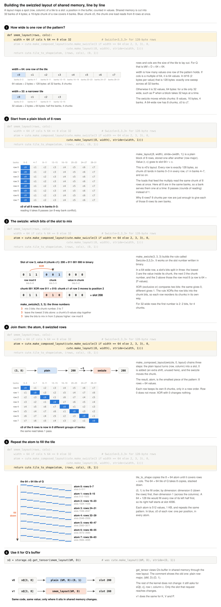

| N = 4096, non-causal (Nsight Compute) | v0 | v1 |
|---|---|---|
| Duration | 5.64 ms | 2.67 ms |
| Tensor cores, % of peak | 33.7% | 71.3% |
| Shared-load bank conflicts | 554 M | 0 |
| Shared-load wavefronts | 671 M | 117 M |
| Shared-load instructions | 117 M | 117 M |
| Registers per thread | 118 | 253 |

The same 117 M loads now take one wavefront each, 2.1× faster, and 5.436 → 2.686 ms non-causal, 2.997 → 1.324 ms causal in the harness. Registers jumped to 253, most likely swizzled V addresses precomputed outside the loop, which barely changed (590 → 594 instructions).

**A pitfall (the kernels' results are not affected).** CuTe DSL 4.8.1 gives two ways to read the same value of V. With the swizzle, one of them returns wrong values. This looks like a bug in CuTe DSL ([repro](https://github.com/searlion/cs336-2026-assignment2-systems/blob/main/flash_forward/2026_11_09_cutedsl/repro/swizzle_partition_repro.py), [output](https://github.com/searlion/cs336-2026-assignment2-systems/blob/main/flash_forward/2026_11_09_cutedsl/results/swizzle_partition_repro.txt)).

| How the value is read | No swizzle | With swizzle |
|---|---|---|
| In two steps, take block k, then the value inside it, `tsV[None, None, k][i]` | correct | **wrong**. Blocks 1–3 return block 0's values (3 values in 4 wrong) |
| In one step, all three coordinates at once, `tsV[v, n, k]` | correct | correct |

v0 and v1 use the one-step way, so their results are correct. From Round 2 on, V is loaded with ldmatrix, which does not have this problem.

The load/store pipe is now the busiest unit (72.5%), because there are still 117 M loads.


The load/store unit (LSU) is the part of each SM that issues memory instructions, including every shared-memory load and store. Nsight Compute reports how busy it is as a share of its peak.


<a id="round2">
## Round 2: ldmatrix
</a>

[v2](https://github.com/searlion/cs336-2026-assignment2-systems/blob/main/flash_forward/2026_11_09_cutedsl/kernels/v2_ldmatrix/flashattention_autograd_function_triton.py) builds copies whose layout matches the MMA, and uses them for Q, K, `P` and V.

```python
def ldsm(transpose):
    return cute.make_copy_atom(warp.LdMatrix8x8x16bOp(transpose=transpose, num_matrices=4), dtype)
s2r_A = cute.make_tiled_copy_A(ldsm(False), tiled_mma)     # Q and P
s2r_K = cute.make_tiled_copy_B(ldsm(False), tiled_mma)
s2r_V = cute.make_tiled_copy_B(ldsm(True), tiled_mma)      # V, transposed on the way
...
cute.copy(s2r_A, ops.sQ[None, None, k], ops.rQ[None, None, k])
```

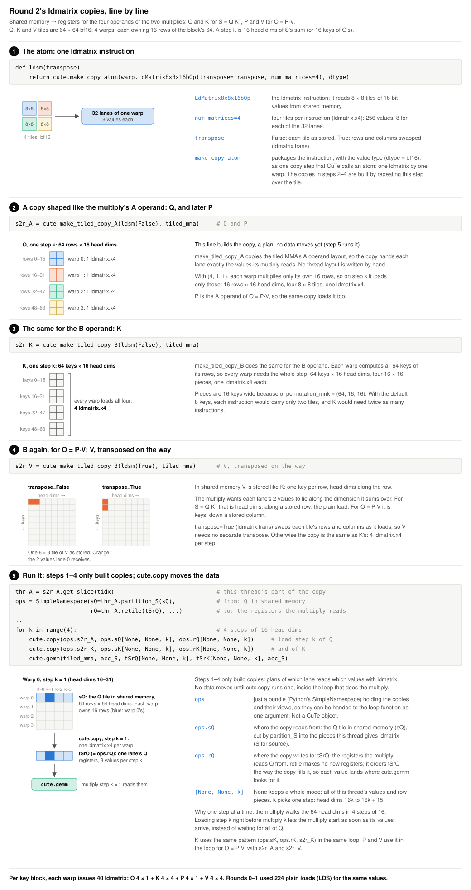

The loop's 224 `LDS`, and the 64 `PRMT` instructions that packed V's 16-bit loads into pairs, become 40 `LDSM`, and one pass shrinks from 594 to 342 instructions. The load/store pipe falls from 72.5% to 26.0% busy and the tensor cores rise from 71.3% to 86.9% of peak, and the harness gives 2.248 ms non-causal and 1.119 ms causal.

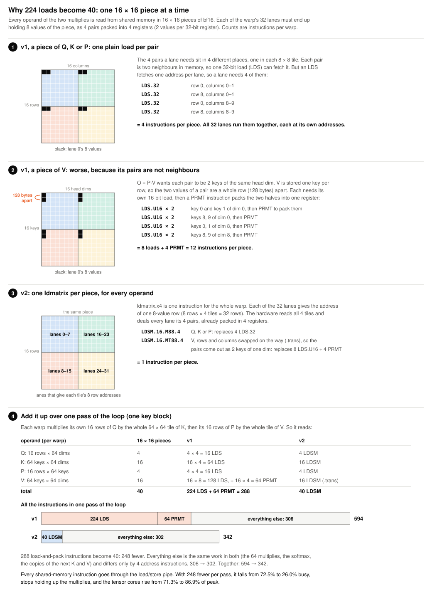

<a id="round3">
## Round 3: keep `P` in registers
</a>

Problem 3 of the previous article was `P`'s round trip through shared memory. Each thread receives values of S in exactly the rows and columns it must later supply to `P·V`, so the accumulator, converted to bf16, can be re-viewed as an operand without moving data.

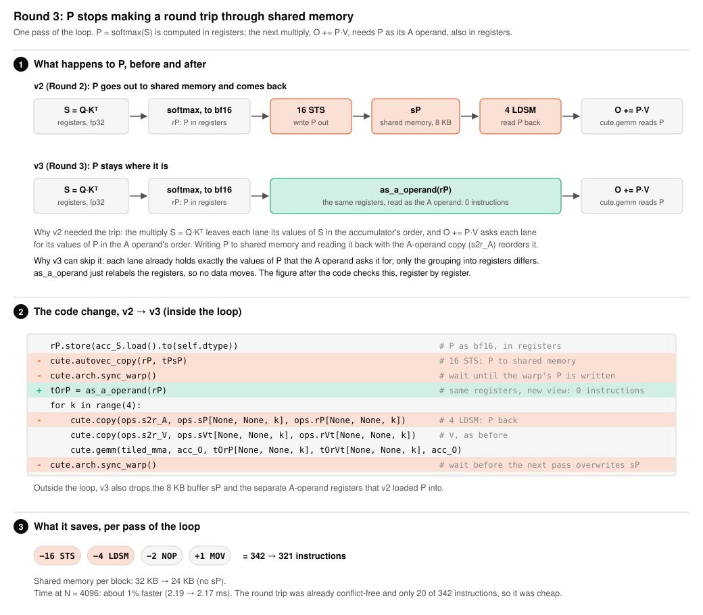

The whole change is `as_a_operand`.

```python
def as_a_operand(acc):
    # accumulator ((2,2), MMA_M, MMA_N) -> A operand ((2,2,2), MMA_M, MMA_N/2):
    # two neighbouring 16x8 accumulator tiles are one 16x16 A tile.
    pairs = cute.logical_divide(acc.layout, (None, None, 2))
    return cute.make_tensor(acc.iterator, cute.make_layout(
        ((pairs.shape[0], pairs.shape[2][0]), pairs.shape[1], pairs.shape[2][1]),
        stride=((pairs.stride[0], pairs.stride[2][0]), pairs.stride[1], pairs.stride[2][1])))
```

Step by step, for one thread, here is why relabelling is enough.


In [v3](https://github.com/searlion/cs336-2026-assignment2-systems/blob/main/flash_forward/2026_11_09_cutedsl/kernels/v3_p_regs/flashattention_autograd_function_triton.py) the 16 stores of `P` and 4 `LDSM` per pass disappear (342 → 321 instructions), and shared memory drops from 32 KB to 24 KB. The gain at N = 4096 is about 1% (2.19 → 2.17 ms under Nsight Compute), since the round trip was already conflict-free.


Occupancy is the number of warps resident on an SM, as a share of the maximum (48 on this GPU). It is limited by registers per thread, shared memory per block and threads per block, whichever runs out first. More resident warps can hide more waiting, but a kernel limited by the tensor cores does not need many.


<a id="round4">
## Round 4: cp.async
</a>

Long scoreboard (2.8 cycles) and barrier (2.3) are now the largest stalls after math pipe throttle. Both come from the copies, which go through registers and make every thread wait.

[v4](https://github.com/searlion/cs336-2026-assignment2-systems/blob/main/flash_forward/2026_11_09_cutedsl/kernels/v4_cpasync/flashattention_autograd_function_triton.py) changes the copy atom to `cpasync.CopyG2SOp` and orders the work the way FA2 does, so that every copy overlaps maths that does not need it.

```python
cute.arch.cp_async_wait_group(0); cute.arch.sync_threads()                # step 1: K_j has landed; sV is free
self.start_load(kv.gV, kv.sV, kv, j); cute.arch.cp_async_commit_group()   # step 2: V_j in flight
# step 3: ... S = Q K_j^T ...
cute.arch.cp_async_wait_group(0); cute.arch.sync_threads()                # step 4: V_j has landed; sK is free
if j + 1 < kv.n_end:                                                      # step 5: K_{j+1} in flight
    self.start_load(kv.gK, kv.sK, kv, j + 1)
cute.arch.cp_async_commit_group()
# step 6: ... mask, softmax, O += P V_j ...
```

The figure takes these steps one at a time, then shows them in time against v3.


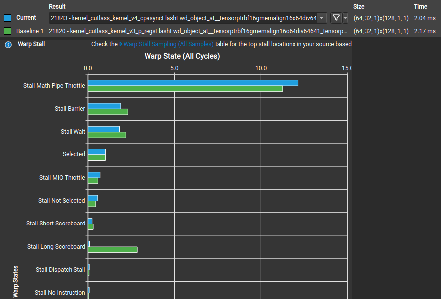

Long scoreboard leaves the top four stalls, barrier falls from 2.3 to 1.9, and the tensor cores reach 93.2% of peak (2.04 ms under Nsight Compute), on par with Triton v5's 92.2% (64 × 128 tiles, 2 stages) at the same fixed clock. The harness gives 2.100 ms non-causal and 1.040 ms causal.

<a id="round5">
## Round 5: tiles and stages under 99 KB
</a>

With no autotuner in CuTe, [v5](https://github.com/searlion/cs336-2026-assignment2-systems/blob/main/flash_forward/2026_11_09_cutedsl/kernels/v5_tuned/flashattention_autograd_function_triton.py) adds the choices as parameters, and [`sweep_cute.py`](https://github.com/searlion/cs336-2026-assignment2-systems/blob/main/flash_forward/2026_11_09_cutedsl/sweep_cute.py) times every combination that fits. Besides the tile sizes (bM query rows, bN keys) and warps, v5 adds a **ring**. With S ≥ 2 stages, K and V for the next S − 1 key blocks are in flight while block j is computed, and each key block needs one barrier instead of two.


A stage is one set of shared-memory buffers (here one K tile and one V tile). With S stages, the block can compute on one set while S − 1 others are being filled. More stages hide more latency but cost shared memory.


A block gets at most 99 KB of shared memory on this GPU.


\text{bytes} = 2 \cdot D \cdot (b_M + 2 \cdot S \cdot b_N) \le 101{,}376


For D = 64, 64 × 64 tiles with one stage need 24 KB, with two 40 KB and with three 56 KB. An SM has 100 KB, so three stages leave room for only one block per SM, and the sweep shows it, with 58.1 TFLOP/s at N = 4096 non-causal against 70.8 with one stage ([`sweep_v5.csv`](https://github.com/searlion/cs336-2026-assignment2-systems/blob/main/flash_forward/2026_11_09_cutedsl/results/sweep_v5.csv)). I re-timed the sweep's best four configurations for each shape in five interleaved rounds ([`rank_v5.txt`](https://github.com/searlion/cs336-2026-assignment2-systems/blob/main/flash_forward/2026_11_09_cutedsl/results/rank_v5.txt)).

| Shape | Best configuration (bM × bN, warps, stages) | v4's 64 × 64, 1 stage |
|---|---|---|
| N = 512 | 64 × 32, 4, 3 | 91.3% of best (non-causal), 94.5% (causal) |
| N ≥ 1024, non-causal | 64 × 64, 4, 1 | best |
| N ≥ 1024, causal | 64 × 64, 4, 2 | 95.8% to 98.8% of best |

These rows are v5's lookup table. In the harness the table gains 4% over v4 at N = 512 non-causal, 0–2% at N ≥ 1024, and loses one digit (0.038 → 0.039 ms) at N = 512 causal. In the causal profile, the 2-stage ring cuts barrier stalls from 2.21 to 0.66 cycles and lifts the tensor cores from 86.7% to 89.0%.

<a id="final">
## The final profile, and was it a fair fight?
</a>

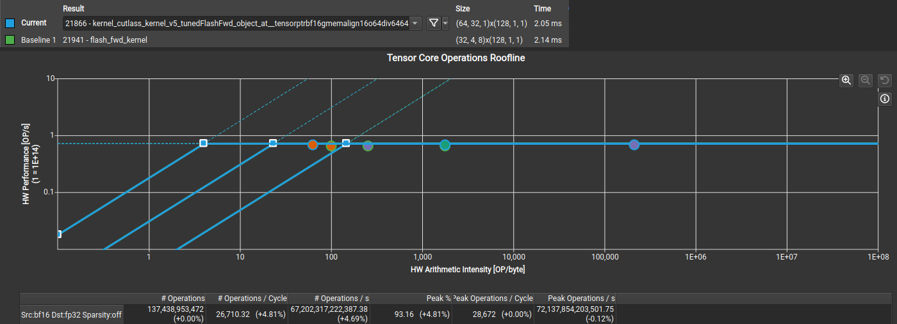


A chart of speed (operations per second) against operations per byte moved. The flat roof is the tensor cores' peak, and the sloped lines are the limits set by memory bandwidth. A kernel on the flat roof is limited by its arithmetic, not by memory.


CuTe v5 (blue) and SDPA (green) both sit on the roof. Both do 137.4 G operations, exactly what the algorithm needs. v5 reaches 93.2% of peak against SDPA's 88.9%, 4.3 points higher (the chart's +4.81% is relative).

| N = 4096, Nsight Compute (clock fixed at 2.52 GHz) | CuTe v5 | Triton v5 (64 × 128, 2 stages, pinned) | SDPA |
|---|---|---|---|
| Non-causal, duration and % of tensor peak | 2.045 ms, 93.2% | 2.063 ms, 92.2% | 2.141 ms, 88.9% |
| Causal, duration and % of tensor peak | 1.086 ms, 89.0% | 1.151 ms, 85.3% | 1.204 ms, 81.5% |
| Instructions, non-causal | 180 M | 171 M | 220 M |
| Registers per thread, non-causal | 165 | 255 | 255 |
| Shared memory per block, non-causal | 24.6 KB | 41.0 KB | 49.2 KB |
| Longest stall, non-causal | math pipe throttle (12.2) | math pipe throttle (9.1) | math pipe throttle (6.8) |

Here are the results from the unchanged harness (median of 10 runs for CuTe v5 and Triton v5, 3 for NVIDIA's example, 35 for SDPA).

| N | causal | CuTe v5 | Triton v5 | NVIDIA's example | SDPA | CuTe v5 vs Triton v5 |
|---|---|---|---|---|---|---|
| 512 | no | 0.046 ms, 46.6 | 0.044 ms, 48.5 | 0.047 ms, 45.6 | 0.066 ms, 32.7 | tie (4% slower here) |
| 1024 | no | 0.138 ms, 62.1 | 0.144 ms, 59.5 | 0.138 ms, 62.1 | 0.151 ms, 57.0 | 4% faster |
| 2048 | no | 0.495 ms, 69.5 | 0.507 ms, 67.8 | 0.498 ms, 69.0 | 0.537 ms, 64.0 | 2% faster |
| 4096 | no | 1.991 ms, 69.1 | 1.968 ms, 69.8 | 1.950 ms, 70.5 | 2.158 ms, 63.7 | tie (1% slower) |
| 512 | yes | 0.039 ms, 27.6 | 0.042 ms, 25.6 | 0.040 ms, 26.9 | 0.054 ms, 19.8 | tie |
| 1024 | yes | 0.089 ms, 48.2 | 0.093 ms, 46.2 | 0.092 ms, 46.6 | 0.119 ms, 36.1 | 4% faster |
| 2048 | yes | 0.281 ms, 61.2 | 0.294 ms, 58.5 | 0.289 ms, 59.5 | 0.330 ms, 52.1 | 4% faster |
| 4096 | yes | 1.029 ms, 66.8 | 1.079 ms, 63.7 | 1.038 ms, 66.2 | 1.118 ms, 61.5 | 4–5% faster |

(ms and TFLOP/s, see [`summary.txt`](https://github.com/searlion/cs336-2026-assignment2-systems/blob/main/flash_forward/2026_11_09_cutedsl/results/final/summary.txt). NVIDIA's example ran at 64 × 64 tiles through the same `do_bench` in [`bench_nvidia_example.py`](https://github.com/searlion/cs336-2026-assignment2-systems/blob/main/flash_forward/2026_11_09_cutedsl/bench_nvidia_example.py).)

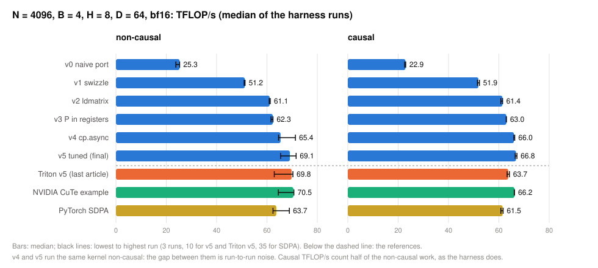

CuTe v5 beats SDPA on every shape. Against Triton v5 it is 2–5% faster on 5 of 8 shapes and ties on the rest. Non-causal N = 4096 times jump between two speeds for every kernel (CuTe v5 1.92–1.95 or 2.03–2.10 ms), so the 1% is noise, as is the v4–v5 gap. NVIDIA's example lands within 4% of v5 everywhere.

**Was it a fair fight?** A kernel at a lower clock looks slower for reasons unrelated to its code, and NVML samples taken during the harness are too coarse to show the runs were matched.

So [`fair_fight.py`](https://github.com/searlion/cs336-2026-assignment2-systems/blob/main/flash_forward/2026_11_09_cutedsl/fair_fight.py) runs each kernel's `do_bench` back to back for 4 s, interleaved over 3 rounds with 30 s cool-downs, sampling every 10 ms, at every N ([`fair_fight_summary.md`](https://github.com/searlion/cs336-2026-assignment2-systems/blob/main/flash_forward/2026_11_09_cutedsl/results/fair_fight_summary.md), medians over the rounds).

| N, mask | time, ms (CuTe v5 / Triton v5 / SDPA) | median SM clock, MHz | median power, W | share at power cap | max °C | CuTe vs Triton |
|---|---|---|---|---|---|---|
| 512, non-causal | 0.043 / 0.045 / 0.063 | 2730 / 2730 / 2730 | 142 / 143 / 138 | 0 / 0 / 0% | 65 | tie (one digit = 2.3%) |
| 512, causal | 0.037 / 0.037 / 0.054 | 2730 / 2730 / 2730 | 135 / 136 / 133 | 0 / 0 / 0% | 55 | tie |
| 1024, non-causal | 0.138 / 0.143 / 0.152 | 2715 / 2730 / 2730 | 160 / 159 / 156 | 0 / 0 / 0% | 64 | +4% |
| 1024, causal | 0.087 / 0.091 / 0.120 | 2730 / 2730 / 2730 | 148 / 150 / 142 | 0 / 0 / 0% | 57 | +5% |
| 2048, non-causal | 0.498 / 0.508 / 0.538 | 2715 / 2715 / 2715 | 205 / 201 / 186 | 14 / 14 / 0% | 70 | +2% |
| 2048, causal | 0.281 / 0.293 / 0.328 | 2715 / 2715 / 2730 | 181 / 184 / 166 | 0 / 0 / 0% | 64 | +4% |
| 4096, non-causal | 1.946 / 2.119 / 2.021 | 2655 / 2685 / 2700 | 219 / 219 / 208 | 97 / 97 / 29% | 72 | tie (see below) |
| 4096, causal | 1.030 / 1.075 / 1.115 | 2700 / 2685 / 2715 | 218 / 219 / 189 | 93 / 98 / 0% | 73 | +4% |

(+ means CuTe v5 is faster.) Below N = 2048 nothing reached the power cap. The sustained times agree with the harness except at N = 512 non-causal (4% faster here, 4% slower there), which is a tie.

No window, and none of the 38 benchmark runs, showed a thermal slowdown. CuTe v5 and Triton v5 drew the same power at median clocks within 1.1% at every N. Causal, CuTe v5 was 4–5% faster in every round at N ≥ 1024. This is not because Triton's 64 × 128 tiles do 1.6% more work on the diagonal (70.9 G against 69.8 G, see [`triton_tiles_causal_ncu.txt`](https://github.com/searlion/cs336-2026-assignment2-systems/blob/main/flash_forward/2026_11_09_cutedsl/results/round6/triton_tiles_causal_ncu.txt)). At 64 × 32 or 64 × 64 (69.8 G) Triton is still 3.9–4.1% slower (Round 6's run at 218–220 W, 96–98% at the power cap, max 73 °C, see [`summary.txt`](https://github.com/searlion/cs336-2026-assignment2-systems/blob/main/flash_forward/2026_11_09_cutedsl/results/round6/summary.txt)). None of Rounds 1–5 is CuTe-only. The likely cause is leaner compiled code, 350 instructions per key block against 388 and half as many outside the loop ([`causal_gap.txt`](https://github.com/searlion/cs336-2026-assignment2-systems/blob/main/flash_forward/2026_11_09_cutedsl/results/round6/causal_gap.txt)), which `tl` gives no control over. Non-causal at N = 4096, whole windows ran fast or slow for all three kernels. In the two rounds where all three ran at the same speed, CuTe v5 was 0.8% and 0.9% faster, which is a tie.

<a id="round6">
## Round 6: beyond Triton's `tl`
</a>

Can CuTe win with something Triton's `tl` language cannot express, keeping O and L identical bit for bit?

The limit is the tensor cores, at 512 bf16 operations per clock per SM, on 56 SMs. At SM clock frequency f_SM, no kernel can be faster than


t_{\min} = \frac{\text{tensor operations}}{512 \cdot 56 \cdot f_{\text{SM}}}


At v5's median clocks in Round 6's sustained run (2,640 MHz non-causal, 2,670 MHz causal) that is 1.815 and 0.912 ms. v5 took 1.954 and 1.037 ms in that separate run (1.946 and 1.030 in the fair-fight table, see [`summary.txt`](https://github.com/searlion/cs336-2026-assignment2-systems/blob/main/flash_forward/2026_11_09_cutedsl/results/round6/summary.txt)).


A GPU runs as many blocks at once as fit on its SMs, and that set is one **wave** (168 blocks for v5 non-causal, 3 per SM). B·H = 32 gives 2,048 blocks, 12.19 waves, so the last wave keeps a fifth of the GPU busy. With B·H = 21, exactly 8 waves, v5's throughput is 1.9% higher, Triton's 1.5% ([`wave_probe_time.txt`](https://github.com/searlion/cs336-2026-assignment2-systems/blob/main/flash_forward/2026_11_09_cutedsl/results/round6/wave_probe_time.txt)).


I built two candidates. Both give O and L bitwise equal to v5's ([`bitwise_v6.txt`](https://github.com/searlion/cs336-2026-assignment2-systems/blob/main/flash_forward/2026_11_09_cutedsl/results/round6/bitwise_v6.txt), [`bitwise_v7.txt`](https://github.com/searlion/cs336-2026-assignment2-systems/blob/main/flash_forward/2026_11_09_cutedsl/results/round6/bitwise_v7.txt)), and both are slower.

- [v6](https://github.com/searlion/cs336-2026-assignment2-systems/tree/main/flash_forward/2026_11_09_cutedsl/kernels/v6_mbarrier) drops `__syncthreads`. Each buffer gets its own **mbarriers**, so a warp waits only for the tile it reads and the buffer it refills, whereas Triton waits for K and V together ([`loop_sync_counts.txt`](https://github.com/searlion/cs336-2026-assignment2-systems/blob/main/flash_forward/2026_11_09_cutedsl/results/triton_v5/loop_sync_counts.txt)). On sm_89 (this GPU's architecture) an mbarrier wait is a polling loop, which costs 25–33% more instructions ([`ncu_v5_v6.txt`](https://github.com/searlion/cs336-2026-assignment2-systems/blob/main/flash_forward/2026_11_09_cutedsl/results/round6/ncu_v5_v6.txt)).
- [v7](https://github.com/searlion/cs336-2026-assignment2-systems/tree/main/flash_forward/2026_11_09_cutedsl/kernels/v7_swpipe) **software-pipelines** each warp. The next `Q·Kᵀ` runs, in slices, between pieces of the current softmax. Other warps already fill those gaps, and non-causal the extra buffers cost a block per SM. Loop rotation in plain `tl` (computing the next S before this softmax, see [`t6_rotated`](https://github.com/searlion/cs336-2026-assignment2-systems/tree/main/flash_forward/2026_11_09_cutedsl/kernels/t6_rotated)) slows Triton by 0.4–5.3% (against itself, clocks not logged, see [`ab_t6_rotated.txt`](https://github.com/searlion/cs336-2026-assignment2-systems/blob/main/flash_forward/2026_11_09_cutedsl/results/round6/ab_t6_rotated.txt)).


A barrier object in shared memory. Threads **arrive** on it (a cp.async can arrive when its copy lands) and **wait** until enough arrivals have happened. Unlike `__syncthreads`, arriving and waiting are separate, and each buffer can have its own. sm_89 has no hardware wait for it, so waiting is a loop that reads the barrier until it flips. CuTe DSL 4.8.1's own mbarrier helpers refuse sm_89, so v6 calls the operations beneath them ([`cute_mbarrier_probe.txt`](https://github.com/searlion/cs336-2026-assignment2-systems/blob/main/flash_forward/2026_11_09_cutedsl/results/round6/cute_mbarrier_probe.txt)).



Reordering a loop so that work from the next iteration overlaps work from this one. Here the next `Q·Kᵀ` runs on the tensor cores while this iteration's softmax runs on the other units.


| N = 4096, sustained | non-causal | causal | in `tl`? | in Gluon? |
|---|---|---|---|---|
| floor / CuTe v5 | 1.815 / 1.954 ms | 0.912 / 1.037 ms | | |
| wave tail | 1.9% | none | | |
| v6, mbarriers | +2.4% | +7.0% | no | yes |
| v7, software pipelining | +2.1% | +2.8% | as loop rotation, also slower | yes |
| producer warp (not built) | | | no | no on sm_89 |

(218–222 W, 96–100% of samples at the power cap, max 70–74 °C, no thermal slowdown, clocks within 0.6% of v5's.) **Gluon** compiles v6's mbarriers and v7's sliced multiplies on sm_89 ([`gluon_probe.txt`](https://github.com/searlion/cs336-2026-assignment2-systems/blob/main/flash_forward/2026_11_09_cutedsl/results/gluon/gluon_probe.txt), [`gluon_capabilities.txt`](https://github.com/searlion/cs336-2026-assignment2-systems/blob/main/flash_forward/2026_11_09_cutedsl/results/gluon/gluon_capabilities.txt)). That is beyond `tl`, not beyond Triton. Warp specialisation works on sm_89 in neither Gluon nor `tl` ([`warp_specialize_probe.txt`](https://github.com/searlion/cs336-2026-assignment2-systems/blob/main/flash_forward/2026_11_09_cutedsl/results/triton_v5/warp_specialize_probe.txt)). A CuTe producer warp would poll v6's mbarriers, so I did not build it. On this card, scheduling beyond `tl` does not pay.


`triton.experimental.gluon`, a lower-level language shipped with Triton 3.6. The programmer picks layouts, shared-memory buffers, barriers and MMA instructions explicitly, much as in CuTe, and Triton compiles the rest.



Giving warps different jobs, where a **producer** warp only issues copies and the others only compute. On Hopper and Blackwell, `setmaxnreg` moves registers from the producer to the computing warps, but sm_89 has no such instruction. Gluon always emits `setmaxnreg`, so it fails to compile on sm_89.


<a id="checklist">
## What CuTe makes you write by hand, as a checklist
</a>

Each item is something Triton decided for me.

1. **Ownership.** Pick the tiled MMA (warps along rows), and derive every copy and softmax reduction from it.
2. **Shared-memory layout.** Swizzle every tile read 8 rows at a time. Bank conflicts in Nsight Compute should be zero.
3. **Operand loads.** ldmatrix copies built from the MMA, transposed for V. Count `LDSM` against `LDS` in the SASS.
4. **Registers.** Re-view the accumulator as the next multiply's operand.
5. **Copy schedule.** Issue, commit, wait and barrier in the right order, since a wrong order is a race, not a slowdown.
6. **Ragged edges.** Skip copies of rows past the end of the sequence and fill those rows with zeros. Mask scores with a finite value.
7. **Configuration.** Sweep it, check shared memory against 99 KB for `sm_89`, keep a table.
8. **Calls.** Compile once per configuration and keep the per-call Python small.
9. **Correctness.** Check results after every change, because a wrong answer can still be fast.
10. **Fair comparisons.** Interleave, cool down, and record clock, power and throttle reasons next to every time.

<a id="future">
## Future articles
</a>

The backward pass, in Triton and in CuTe DSL, and a closer look at the host-side cost of each call.
