Table of Contents
- [What Triton did under the hood](#triton-did)
- [The setup](#setup)
- [CuTe in four ideas](#cute)
- [Round 0: a straightforward port](#round0)
- [Round 1: swizzle the shared memory](#round1)
- [Round 2: ldmatrix](#round2)
- [Round 3: keep `P` in registers](#round3)
- [Round 4: cp.async](#round4)
- [Round 5: tiles and stages under 99 KB](#round5)
- [The final profile, and was it a fair fight?](#final)
- [Round 6: beyond Triton's `tl`](#round6)
- [What CuTe makes you write by hand, as a checklist](#checklist)
- [Future articles](#future)

In my [previous article](TODO-dev.to-URL-of-the-follow-up-article), I tuned a FlashAttention-2 (FA2) forward kernel in Triton until it matched PyTorch's `scaled_dot_product_attention` (SDPA) on my RTX 4070 SUPER. With Triton, I did not have to think about where each value lives, how data moves into shared memory, and in what order.


**Global memory** is the GPU's main memory (DRAM, 12 GB here), reached through two caches: **L2**, shared by the whole GPU (48 MB), and **L1**, inside each SM. **Shared memory** is a small scratchpad inside each SM (at most 99 KB per thread block here) that a block's threads fill and read by hand. **Registers** are each thread's own, fastest storage.


In this article I write the same kernel in NVIDIA's **CuTe DSL**, a Python library for writing kernels at the level of CUTLASS, NVIDIA's C++ template library, where I make those decisions myself. I begin with a direct porting of code from Triton to CuTe DSL without all the optimisations that Triton provided for under the hood. This gives a baseline measurement of the performance of an unoptimised kernel. I then layer on each optimisation which Triton automatically provided, measuring the performance gain which each optimisation brings.

The harness and the test file are copied unchanged, so the numbers compare directly with the previous article's. At N = 4096 (median of the harness runs: 10 for CuTe v5 and Triton v5, 3 for the other kernels, 35 for SDPA):

| | Triton v5 (previous article, re-measured) | CuTe v0 (straight port) | CuTe v5 (this article) | SDPA | NVIDIA's CuTe example |
|---|---|---|---|---|---|
| Non-causal | 1.968 ms, 69.8 TFLOP/s | 5.436 ms, 25.3 TFLOP/s | 1.991 ms, 69.1 TFLOP/s | 2.158 ms, 63.7 TFLOP/s | 1.950 ms, 70.5 TFLOP/s |
| Causal | 1.079 ms, 63.7 TFLOP/s | 2.997 ms, 22.9 TFLOP/s | 1.029 ms, 66.8 TFLOP/s | 1.118 ms, 61.5 TFLOP/s | 1.038 ms, 66.2 TFLOP/s |


Trillions of floating-point operations per second. The harness counts 4·B·H·N²·D operations for attention (half that for causal) and divides by the time.


I also ran the kernels back to back for longer, logging clock speed and power ([Was it a fair fight?](#final)). CuTe v5 and Triton v5 ran at nearly the same clock (within 1.1%) and hit the power cap equally often. Under those matched conditions:

- **Causal:** CuTe v5 is 4–5% faster for N ≥ 1024. At N = 4096 it is still 4% faster when Triton uses the same tile sizes, so the gap does not come from differences in tile size.
- **Non-causal:** CuTe v5 is 4% faster at N = 1024 and 2% faster at N = 2048. At N = 4096 they are level.
- **N = 512:** a tie, with or without the causal mask.


The **SM clock** is how many cycles per second the GPU's cores run; every kernel's speed scales with it. 

**Throttling** is the driver lowering that clock to stay within a limit. The **power cap** is the limit on board power, 220 W here.

**Thermal** slowdowns are limits on temperature. 

NVML, the driver's monitoring library, reports which of these reasons is active.


The four optimisations which Triton implemented under the hood, and which I have to manually implement in CuTe DSL:
1. a swizzled shared-memory layout (2.0× on its own)
2.  matrix loads with ldmatrix
3. keeping `P` in registers
4. asynchronous copies with cp.async. 

A sweep of tile and pipeline sizes then gained 0–4%.

This article assumes you know the Flash Attention 2 (FA2) forward pass and the previous article.

This article was written with the assistance of AI. If you spot any mistakes, please let me know.

<a id="triton-did">
## What Triton did under the hood
</a>

We can use Triton's GPU-level compiler stage (TTGIR) to examine the optimisations it did under the hood. We can get the TTGIR by compiling one configuration without launching it and reading `asm["ttgir"]` (abridged from [`inspect_kernel.py`](https://github.com/searlion/cs336-2026-assignment2-systems/blob/main/flash_forward/2026_10_03_followup/inspect_kernel.py)).


Triton compiles a kernel in stages: Python → TTIR → TTGIR → LLVM IR → PTX → SASS. TTGIR (Triton GPU IR) is the stage where Triton makes its GPU-specific choices: which thread holds which values, how shared memory is laid out, and which copies run asynchronously. It is a text format, so you can read it.


```python
kern = flash_fwd_kernel.fn                         # unwrap @triton.autotune
compiled = kern.warmup(q, k, v, o, L, *strides, N, N, scale,   # compiles, does not launch
                       D=64, Q_TILE_SIZE=64, K_TILE_SIZE=64, is_causal=False,
                       num_warps=4, num_stages=2, grid=(triton.cdiv(N, 64), B))
print(compiled.asm["ttgir"])     # e.g. #ttg.swizzled_shared<{vec = 8, perPhase = 1, ...}>
# compiled.asm also holds "ttir", "llir", "ptx" and "cubin" (the binary holding the SASS)
```

In the table below, the **Round** column is the round of this article in which I add that decision to my CuTe kernel by hand. TTGIR  only records what Triton chose. Round 0 is a plain port from Triton to CuTe DSL, and every CuTe kernel needs a tiled MMA. Rounds 1 to 5 add the other rows of optimisations mentioned in the table below one at a time, measuring improvements brought by each of these optimisations. The ldmatrix and cp.async counts in the table come from the SASS of the same compiled kernel (`compiled.asm["cubin"]` disassembled with `nvdisasm`).

| What Triton decided | Where it shows in Triton's compiled kernel | What I write in CuTe | Round |
|---|---|---|---|
| Split the work by rows: each of the 4 warps [groups of 32 threads] computes 16 rows of the tile | `warpsPerCTA = [4, 1]`: 4 warps per thread block [CTA, cooperative thread array], stacked along the rows | `cute.make_tiled_mma(..., (4, 1, 1))`: spread the MMA [matrix multiply-accumulate] over 4 warps along the rows | 0 |
| Shuffle where values sit in shared memory [fast memory inside the chip, shared by a block's threads], so threads reading at once do not queue up | `#ttg.swizzled_shared<{vec = 8, perPhase = 1, maxPhase = 8}>`: a swizzled [shuffled] layout that moves 8 values at a time and shuffles each of 8 rows differently | `cute.make_swizzle(3, 3, 3)`: the same shuffle | 1 |
| Read each multiply's inputs as whole 8 × 8 blocks, handing each thread exactly the values it needs | 76 `LDSM` (ldmatrix [load matrix]) instructions; 32 also transpose [swap rows and columns] for V | `warp.LdMatrix8x8x16bOp`: a copy that uses ldmatrix | 2 |
| Pass `P` [the softmax output] straight from the first multiply to the second, without going through shared memory | `ttg.convert_layout`: a change in which thread holds which value of `P`, with no write to shared memory | Reuse the registers [each thread's own storage] holding `P` as the next multiply's input, without moving data | 3 |
| Load K and V in the background while the threads keep computing | `ttg.async_copy_global_to_local` [background copy from main GPU memory to shared memory], compiled to 32 cp.async (`LDGSTS`) instructions | `cpasync.CopyG2SOp` [the same background copy], then commit [close a batch of copies] and wait [until a batch has arrived] | 4 |
| Pick tile sizes and how many tiles to load ahead [pipeline stages] for each input size | `@triton.autotune`: tries each setting and keeps the fastest | A sweep [time every setting] and a lookup table | 5 |

For fair comparison, I fixed the tile size for both Triton and CuTe DSL at 64 query rows × 64 keys, 4 warps and 2 pipeline stages, with head size D = 64, bf16 inputs and no causal mask. At this tile size, Triton uses 168 registers per thread and 24,576 bytes of shared memory ([`inspect_64x64x4x2_noncausal.txt`](https://github.com/searlion/cs336-2026-assignment2-systems/blob/main/flash_forward/2026_11_09_cutedsl/results/triton_v5/inspect_64x64x4x2_noncausal.txt)). My Round 4 CuTe DSL kernel uses 165 registers and the same 24,576 bytes.

The 3 fewer registers make no measurable difference in performance. The GPU hands out registers in steps of 8 per thread, so 165 is rounded up to 168, and both kernels fit 3 blocks on each SM (Nsight Compute gives v4 a theoretical occupancy of 25%: 12 of 48 warps). Registers matter only when a kernel crosses such a limit, e.g. round 1's 253 registers allow only 2 blocks per SM. I did not look into why the two counts differ. NVIDIA's assembler (ptxas) picks the count from the code each compiler hands it, and the two compilers produce different code.

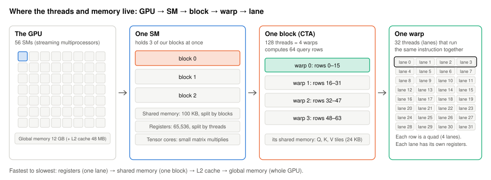


A **block** (thread block; CUDA and CuTe also call it a CTA, cooperative thread array) is a group of threads that the GPU starts together and runs on one SM, where they share that SM's shared memory and can wait for each other at a barrier. Here a block is 128 threads (4 warps) and computes 64 query rows for one (batch, head) pair, so N = 4096 with B·H = 32 launches 64 × 32 = 2,048 blocks. Each SM has 65,536 registers and 100 KB of shared memory to split between the blocks on it, so the more each block uses, the fewer blocks fit at once.



A **warp** is 32 threads that execute the same instruction together. Each thread in it is a **lane**, numbered 0 to 31. A **quad** is 4 neighbouring lanes (0–3, 4–7, …). It is not a separate hardware unit. The tensor-core instruction gives the 4 lanes of a quad the same rows of the result, so a row can be reduced with shuffles among just those 4. A thread block (CuTe also says CTA) of 128 threads is 4 warps. Blocks run on **SMs** (streaming multiprocessors); this GPU has 56. Each SM has its own registers, shared memory and tensor cores, and holds several blocks at once.



A tensor core is a unit inside each SM that multiplies small matrices. On this GPU one warp-wide MMA instruction, `mma.sync.m16n8k16` (`HMMA.16816` in SASS), computes a 16 × 8 tile of `A·B + C` from a 16 × 16 piece of A and a 16 × 8 piece of B. Each of the 32 lanes supplies and receives a fixed handful of the values; that fixed assignment is the instruction's layout.



The **accumulator** is the running total a multiply adds into (the C in D = A·B + C, which D overwrites): where each lane keeps its share of the result, in fp32. The **operands** are A and B: which values each lane must supply, in bf16. They are different assignments of values to lanes, so a result can only feed the next multiply directly if the two line up.



`ldmatrix.x4` is one warp-wide instruction that reads four 8 × 8 tiles of 16-bit values from shared memory and hands each lane exactly the values the MMA wants from it. `ldmatrix.trans` transposes on the way, which is what V needs. In SASS it is `LDSM`.

The "4" in `.x4` is the number of 8 × 8 tiles (`.x1` and `.x2` also exist), not a quad. The two are linked only through the tile: each row of an 8 × 8 tile is 8 values, which ldmatrix spreads over the 4 lanes of one quad, two values each.



`cp.async` (SASS `LDGSTS`) copies 16 bytes from global memory straight into shared memory, without passing through registers and without making the thread wait. The thread groups its copies with `commit_group` and later calls `wait_group(n)`, which returns once at most n groups are still in flight. A barrier after the wait makes the data visible to the whole block.


<a id="setup">
## The setup
</a>

| | Version |
|---|---|
| nvidia-cutlass-dsl (CuTe DSL) | 4.8.1 |
| PyTorch | 2.11.0 (CUDA 13.0) |
| Triton (for the comparison kernel) | 3.6.0 |
| Nsight Systems / Nsight Compute | 2026.1.3 / 2026.2.1 |
| NVIDIA driver | 595.99 |

The harness [`bench_flashattention.py`](https://github.com/searlion/cs336-2026-assignment2-systems/blob/main/flash_forward/2026_11_09_cutedsl/bench_flashattention.py), the test file [`test_flashattention_triton.py`](https://github.com/searlion/cs336-2026-assignment2-systems/blob/main/flash_forward/2026_11_09_cutedsl/test_flashattention_triton.py) and [`compare_driver.py`](https://github.com/searlion/cs336-2026-assignment2-systems/blob/main/flash_forward/2026_11_09_cutedsl/compare_driver.py) are byte-for-byte copies of the previous article's ([checksums](https://github.com/searlion/cs336-2026-assignment2-systems/blob/main/flash_forward/2026_11_09_cutedsl/results/sha256_harness.txt)). They import `FlashAttentionTriton` from `flashattention_autograd_function_triton.py`, so each CuTe version lives in a file of that name. Every version passes the unchanged test file ([results](https://github.com/searlion/cs336-2026-assignment2-systems/blob/main/flash_forward/2026_11_09_cutedsl/results/tests.txt)).


It times each kernel with Triton's `triton.testing.do_bench`, which runs the kernel repeatedly for about 100 ms, clears the L2 cache before each run, and returns the median time.


| Folder | What changes |
|---|---|
| [`kernels/v0_naive`](https://github.com/searlion/cs336-2026-assignment2-systems/tree/main/flash_forward/2026_11_09_cutedsl/kernels/v0_naive) | the Triton v5 algorithm, ported as directly as possible |
| [`kernels/v1_swizzle`](https://github.com/searlion/cs336-2026-assignment2-systems/tree/main/flash_forward/2026_11_09_cutedsl/kernels/v1_swizzle) | swizzled shared-memory layout |
| [`kernels/v2_ldmatrix`](https://github.com/searlion/cs336-2026-assignment2-systems/tree/main/flash_forward/2026_11_09_cutedsl/kernels/v2_ldmatrix) | operands loaded with ldmatrix |
| [`kernels/v3_p_regs`](https://github.com/searlion/cs336-2026-assignment2-systems/tree/main/flash_forward/2026_11_09_cutedsl/kernels/v3_p_regs) | `P` stays in registers |
| [`kernels/v4_cpasync`](https://github.com/searlion/cs336-2026-assignment2-systems/tree/main/flash_forward/2026_11_09_cutedsl/kernels/v4_cpasync) | K and V copied with cp.async, overlapped with the maths |
| [`kernels/v5_tuned`](https://github.com/searlion/cs336-2026-assignment2-systems/tree/main/flash_forward/2026_11_09_cutedsl/kernels/v5_tuned) | an optional ring of K/V buffers, and a configuration table from a sweep |

Two details of the port:

- **Compile once** per (head size, dtype, causal, configuration); N and the batch size are runtime values.
- **fp32 inputs.** The tensor cores here take only 16-bit inputs, so fp32 inputs are rounded to fp16 (10 bits of mantissa, like the TF32 that Triton's fp32 `tl.dot` uses), multiplied with fp32 accumulation and cast back. Unlike TF32, fp16 tops out at 65,504, so larger fp32 inputs would overflow; the fp32 tests pass at their unchanged tolerance.


They are number formats. The **mantissa** is the bits that hold a number's significant digits; the exponent sets its size. fp32 has a 23-bit mantissa. **fp16** has 10 bits and a small range (up to 65,504); **bf16** has only 7 bits but fp32's range; **TF32** is fp32's range with fp16's 10 bits, used inside the tensor cores.


```python
# kernels/v5_tuned, FlashAttentionCuTe.forward (abridged)
work = Q.dtype if Q.dtype in _TORCH_TO_CUTE else torch.float16          # fp32 -> fp16
q, k, v = (x.detach().to(work).contiguous() for x in (Q, K, V))           # no copy for bf16
key = (D, work, bool(is_causal), cfg)
args = (_ptr(q, dt), _ptr(k, dt), _ptr(v, dt), _ptr(O, dt), _ptr(L, cutlass.Float32),
        B, N_q, N_k, (1.0 / math.sqrt(D)) * LOG2E, stream)
fn = FlashAttentionCuTe._compiled.get(key)
if fn is None:
    fn = cute.compile(FlashFwd(dt, D, bool(is_causal), *cfg), *args)    # once per key
    FlashAttentionCuTe._compiled[key] = fn
fn(*args)
```

Profiler captures are in [`profile_all.sh`](https://github.com/searlion/cs336-2026-assignment2-systems/blob/main/flash_forward/2026_11_09_cutedsl/profile_all.sh). Nsight Compute fixes the clock (its default `--clock-control base`, 2.52 GHz here), so its durations are not wall-clock speeds. [`sass_counts.py`](https://github.com/searlion/cs336-2026-assignment2-systems/blob/main/flash_forward/2026_11_09_cutedsl/sass_counts.py) disassembles each compiled kernel with `cuobjdump -sass` and counts instructions per loop.


SASS is the GPU's own machine code, the instructions the hardware runs. PTX is a portable assembly one level above it. `cuobjdump -sass` prints the SASS of a compiled kernel.


<a id="cute">
## CuTe in four ideas
</a>

**1. A layout maps coordinates to memory offsets.** A layout is a shape and a stride. A 64 × 64 row-major tile is `(64, 64):(64, 1)`: element (r, c) lives at offset 64r + c. Every CuTe tensor is a pointer plus a layout.


A layout is a function from coordinates to offsets, written shape:stride. `(64, 64):(64, 1)` means two modes of size 64; one step in the first mode adds 64 to the offset, one step in the second adds 1. Layouts nest: in `((2, 2), 8):((1, 16), 2)` the first mode is itself two modes, with strides 1 and 16. CuTe builds everything below from these functions, and composes them like functions.

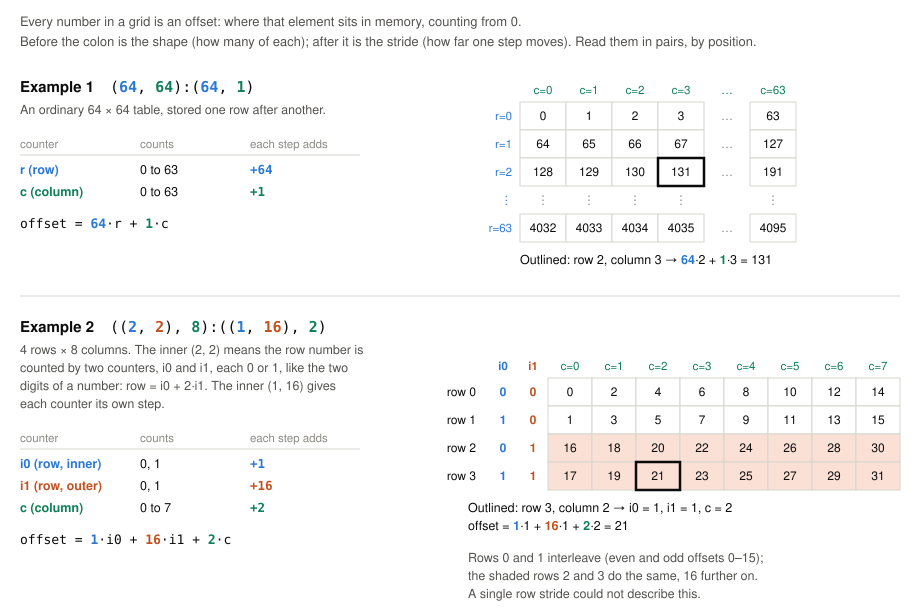


**2. A tiled MMA says which thread computes what.** One tensor-core instruction multiplies 16 × 16 bf16 by 16 × 8 and adds into a 16 × 8 fp32 tile. CuTe repeats it over the 4 warps of a block:

```python
tiled_mma = cute.make_tiled_mma(
    warp.MmaF16BF16Op(cutlass.BFloat16, cutlass.Float32, (16, 8, 16)),   # one MMA instruction
    (4, 1, 1),                                     # 4 warps stacked along the rows
    permutation_mnk=(64, 16, 16))   # tile size per step: 64 rows, and two MMAs side by side
                                    # along N (16), so one ldmatrix.x4 can feed both
```

**3. Partitioning gives each thread its share.** `thr_mma = tiled_mma.get_slice(thread_index)` and then `thr_mma.partition_A(sQ)` returns a view of only the elements of `sQ` that this thread feeds to the tensor cores. `make_fragment_A` allocates a register array of the same shape (CuTe calls it a fragment). The figure shows the result for the score tile S:

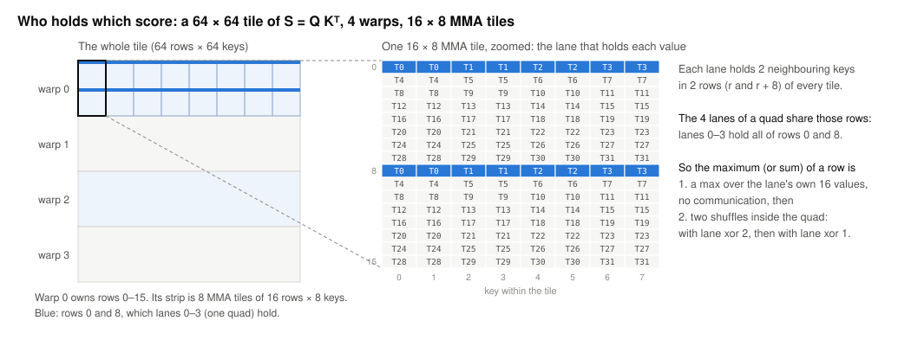

A row of S is spread over the 4 lanes of a quad, 16 values each, so a row maximum is a local maximum plus two warp shuffles, with no shared memory.


`shfl.sync` lets each lane read a register of another lane in the same warp, with no memory involved. `shuffle_sync_bfly(v, offset=2)` swaps values between lanes whose numbers differ in bit 1 (lane xor 2).


```python
def quad_reduce(v, op):
    v = op(v, cute.arch.shuffle_sync_bfly(v, offset=2, mask=-1, mask_and_clamp=31))
    return op(v, cute.arch.shuffle_sync_bfly(v, offset=1, mask=-1, mask_and_clamp=31))
```

**4. Copies are layouts too.** A tiled copy says how threads split a copy (here 16 bytes per thread per step), and its atom, the single copy instruction it repeats, picks the instruction: a plain load and store, ldmatrix, or cp.async. Most rounds below change only an atom or a layout.

<a id="round0">
## Round 0: a straightforward port
</a>

[v0](https://github.com/searlion/cs336-2026-assignment2-systems/blob/main/flash_forward/2026_11_09_cutedsl/kernels/v0_naive/flashattention_autograd_function_triton.py) keeps Triton v5's algorithm: 64 query rows per block, 4 warps, an unmasked loop then a masked loop over the diagonal key blocks, `exp2` with the scale folded in. Everything else is the simplest thing that works: row-major shared memory, copies through registers, operands read with ordinary loads, `P` written to shared memory and read back, 64-key blocks.

```python
# one key block in v0 (abridged)
cute.arch.sync_threads()                                   # everyone is done with the old K, V
cute.copy(g2s, tKgK[None, None, None, j], tKsK)            # LDG, then STS, for K and V
cute.copy(g2s, tVgV[None, None, None, j], tVsV)
cute.arch.sync_threads()                                   # K, V are in shared memory
for k in cutlass.range_constexpr(cute.size(tSsQ, mode=[2])):
    cute.autovec_copy(tSsQ[None, None, k], tSrQ[None, None, k])     # plain loads
    cute.autovec_copy(tSsK[None, None, k], tSrK[None, None, k])
    cute.gemm(tiled_mma, acc_S, tSrQ[None, None, k], tSrK[None, None, k], acc_S)
# ... mask, online softmax with quad shuffles, P -> shared memory -> registers, O += P V
```


CuTe DSL traces the Python and compiles it. A plain `for` over runtime values becomes a loop in the kernel. `cutlass.range_constexpr` runs in Python at compile time and writes out every iteration, which is what you want for loops over register arrays: their indices must be known when compiling, or the registers spill to memory.



FA2 never holds a whole row of scores. For each block of keys it updates a running row maximum and a running sum, rescaling what it has added so far whenever the maximum grows. See [Online softmax by hand](https://dev.to/lewis_won/online-softmax-by-hand-4h13).


**The timeline.**

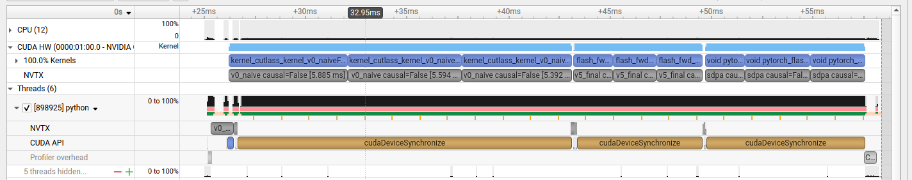

v0's launches take 5.39 to 5.89 ms, Triton v5's 1.91 to 2.23 ms and SDPA's 1.97 to 3.19 ms ([`round0_kernels.txt`](https://github.com/searlion/cs336-2026-assignment2-systems/blob/main/flash_forward/2026_11_09_cutedsl/results/nsys/round0_kernels.txt)). In the harness, v0 is 2.5–2.8× slower than both.

**Utilisation and warp state.** In Nsight Compute, v0 runs the tensor cores at 33.7% of their peak, against 88.9% for SDPA and 87.4% for Triton v5 in the same capture (at 64 × 32 tiles there), while L1 and shared memory are 99% busy.

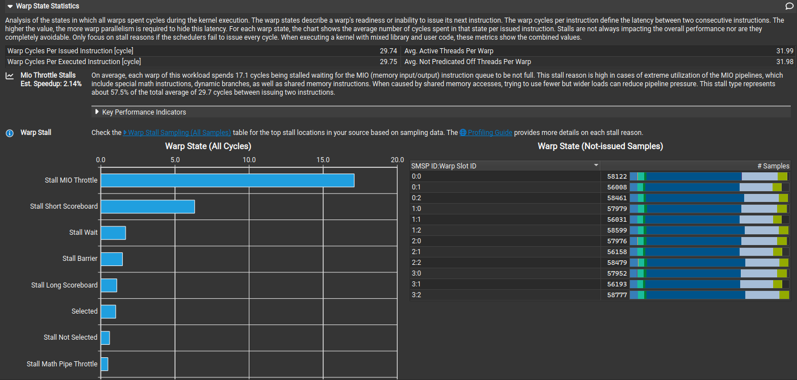

The two longest stalls are **MIO throttle** (17.1 cycles per instruction) and **short scoreboard** (6.3): warps wait to issue shared-memory instructions, then wait for their results.


Nsight Compute samples why each warp could not issue an instruction. **MIO throttle**: the queue for shared-memory (and other memory-input/output) instructions is full. **Short scoreboard**: waiting for the result of a shared-memory load or a special-function instruction such as `exp2`. **Long scoreboard**: waiting for a global-memory load. **Barrier**: waiting at `__syncthreads()` for other warps. **Math pipe throttle**: the target unit, here the tensor cores, is busy; for a matrix-multiply kernel this is the stall you want.


**The instructions.** One pass of the unmasked loop compiles to 590 SASS instructions ([`sass_counts.txt`](https://github.com/searlion/cs336-2026-assignment2-systems/blob/main/flash_forward/2026_11_09_cutedsl/results/sass_counts.txt)):

| Per key block, per thread | v0 |
|---|---|
| `HMMA` (tensor-core multiplies) | 64 |
| `LDS` shared loads | 224 (96 of 32 bits, 128 of 16 bits) |
| `STS` shared stores | 24 (16 for `P`, 8 of 128 bits for K and V) |
| `LDG` global loads | 8 |
| `BAR.SYNC` barriers | 2 |

The 16-bit loads are V, which the multiply needs transposed. Nsight Compute counts 117 M shared-load instructions for the whole kernel, served in 671 M wavefronts, with **554 M bank conflicts**; its Summary page puts them first (rows 0–5 are v0–v5, row 6 Triton v5, row 7 SDPA):

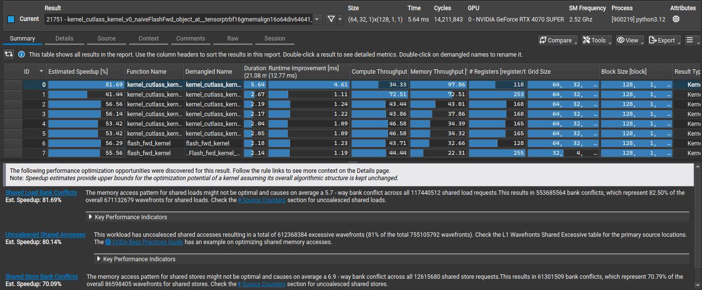


Shared memory is split into 32 banks, each 4 bytes wide; consecutive 4-byte words go to consecutive banks. In one pass (a wavefront), each bank can serve one word. If several lanes of a warp read different words in the same bank, the reads are served one after another: an n-way bank conflict takes n passes.


<a id="round1">
## Round 1: swizzle the shared memory
</a>

A 64-wide bf16 row is 128 bytes, exactly the 32 banks, so in a row-major tile column 0 of every row is in bank 0. The operand loads read the same columns of 8 rows, so they collide 8 ways. A swizzle fixes this:

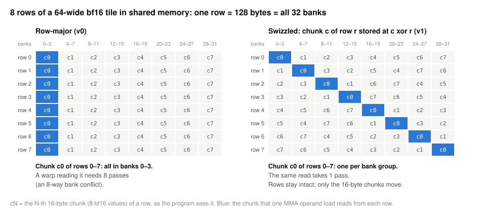


A swizzle is a fixed reshuffling of addresses. `Swizzle<3,3,3>` takes the 16-byte chunk number inside a 128-byte row (3 bits) and XORs it with the row number mod 8 (3 bits); XOR flips each bit of the chunk number where the row number has a 1. Each row keeps its 8 chunks, in a different order. Code that indexes through the layout never notices; only the bank each chunk lands in changes.


[v1](https://github.com/searlion/cs336-2026-assignment2-systems/blob/main/flash_forward/2026_11_09_cutedsl/kernels/v1_swizzle/flashattention_autograd_function_triton.py) changes only how shared memory is laid out: a helper that builds the swizzled layouts, the four lines that use it, and each buffer aligned to 1 KB instead of 128 bytes.

```python
def smem_layout(rows, cols):
    width = 64 if cols % 64 == 0 else 32                   # Swizzle<3,3,3> for 128-byte rows
    atom = cute.make_composed_layout(cute.make_swizzle(3 if width == 64 else 2, 3, 3), 0,
                                     cute.make_layout((8, width), stride=(width, 1)))
    return cute.tile_to_shape(atom, (rows, cols), (0, 1))

sQ = storage.sQ.get_tensor(smem_layout(bM, D))             # was cute.make_layout((bM, D), stride=(D, 1))
```

| N = 4096, non-causal (Nsight Compute) | v0 | v1 |
|---|---|---|
| Duration | 5.64 ms | 2.67 ms |
| Tensor cores, % of peak | 33.7% | 71.3% |
| Shared-load bank conflicts | 554 M | 0 |
| Shared-load wavefronts | 671 M | 117 M |
| Shared-load instructions | 117 M | 117 M |
| Registers per thread | 118 | 253 |

The same 117 M loads now take one wavefront each: 2.1× faster, and 5.436 → 2.686 ms non-causal, 2.997 → 1.324 ms causal in the harness. Registers jumped to 253, most likely swizzled V addresses precomputed outside the loop, which barely changed (590 → 594 instructions).

**A pitfall.** In CuTe DSL 4.8.1, slicing block k out of a thread's partition of the transposed, swizzled V (`tsV[None, None, k]`) returned block 0's values for every k ≥ 1; a full coordinate (`tsV[v, n, k]`), or no swizzle, was correct ([repro](https://github.com/searlion/cs336-2026-assignment2-systems/blob/main/flash_forward/2026_11_09_cutedsl/repro/swizzle_partition_repro.py), [output](https://github.com/searlion/cs336-2026-assignment2-systems/blob/main/flash_forward/2026_11_09_cutedsl/results/swizzle_partition_repro.txt)). It looks like a DSL bug. v0 and v1 index V by coordinate instead; the ldmatrix path from Round 2 on is not affected.

The load/store pipe is now the busiest unit (72.5%): still 117 M loads.


The load/store unit (LSU) is the part of each SM that issues memory instructions, including every shared-memory load and store. Nsight Compute reports how busy it is as a share of its peak.


<a id="round2">
## Round 2: ldmatrix
</a>

[v2](https://github.com/searlion/cs336-2026-assignment2-systems/blob/main/flash_forward/2026_11_09_cutedsl/kernels/v2_ldmatrix/flashattention_autograd_function_triton.py) builds copies whose layout matches the MMA, and uses them for Q, K, `P` and V:

```python
def ldsm(transpose):
    return cute.make_copy_atom(warp.LdMatrix8x8x16bOp(transpose=transpose, num_matrices=4), dtype)
s2r_A = cute.make_tiled_copy_A(ldsm(False), tiled_mma)     # Q and P
s2r_K = cute.make_tiled_copy_B(ldsm(False), tiled_mma)
s2r_V = cute.make_tiled_copy_B(ldsm(True), tiled_mma)      # V, transposed on the way
...
cute.copy(s2r_A, ops.sQ[None, None, k], ops.rQ[None, None, k])
```

The loop's 224 `LDS` become 40 `LDSM`, and one pass shrinks from 594 to 342 instructions. The load/store pipe falls from 72.5% to 26.0% busy and the tensor cores rise from 71.3% to 86.9% of peak; the harness gives 2.248 ms non-causal and 1.119 ms causal.

<a id="round3">
## Round 3: keep `P` in registers
</a>

Problem 3 of the previous article was `P`'s round trip through shared memory. Each thread receives values of S in exactly the rows and columns it must later supply to `P·V`, so the accumulator, converted to bf16, can be re-viewed as an operand without moving data:

```python
def as_a_operand(acc):
    # accumulator ((2,2), MMA_M, MMA_N) -> A operand ((2,2,2), MMA_M, MMA_N/2):
    # two neighbouring 16x8 accumulator tiles are one 16x16 A tile.
    pairs = cute.logical_divide(acc.layout, (None, None, 2))
    return cute.make_tensor(acc.iterator, cute.make_layout(
        ((pairs.shape[0], pairs.shape[2][0]), pairs.shape[1], pairs.shape[2][1]),
        stride=((pairs.stride[0], pairs.stride[2][0]), pairs.stride[1], pairs.stride[2][1])))
```

In [v3](https://github.com/searlion/cs336-2026-assignment2-systems/blob/main/flash_forward/2026_11_09_cutedsl/kernels/v3_p_regs/flashattention_autograd_function_triton.py) the 16 stores of `P` and 4 `LDSM` per pass disappear (342 → 321 instructions), and shared memory drops from 32 KB to 24 KB. The gain at N = 4096 is about 1% (2.19 → 2.17 ms under Nsight Compute), since the round trip was already conflict-free.


Occupancy is the number of warps resident on an SM, as a share of the maximum (48 on this GPU). It is limited by registers per thread, shared memory per block and threads per block, whichever runs out first. More resident warps can hide more waiting, but a kernel limited by the tensor cores does not need many.


<a id="round4">
## Round 4: cp.async
</a>

Long scoreboard (2.8 cycles) and barrier (2.3) are now the largest stalls after math pipe throttle. Both come from the copies, which go through registers and make every thread wait.

[v4](https://github.com/searlion/cs336-2026-assignment2-systems/blob/main/flash_forward/2026_11_09_cutedsl/kernels/v4_cpasync/flashattention_autograd_function_triton.py) changes the copy atom to `cpasync.CopyG2SOp` and orders the work the way FA2 does, so that every copy overlaps maths that does not need it:

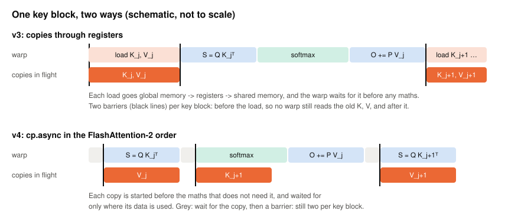

```python
cute.arch.cp_async_wait_group(0); cute.arch.sync_threads()    # K_j has landed; V buffer is free
self.start_load(kv.gV, kv.sV, kv, j); cute.arch.cp_async_commit_group()     # V_j in flight
# ... S = Q K_j^T ...
cute.arch.cp_async_wait_group(0); cute.arch.sync_threads()    # V_j has landed; K buffer is free
if j + 1 < kv.n_end:
    self.start_load(kv.gK, kv.sK, kv, j + 1)                    # K_{j+1} in flight
cute.arch.cp_async_commit_group()
# ... mask, softmax, O += P V_j ...
```

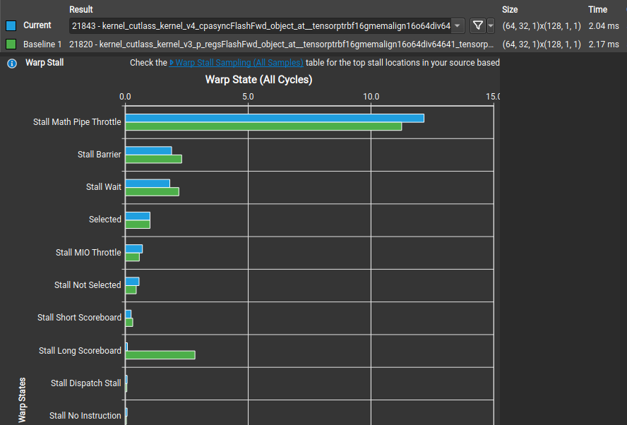

Long scoreboard leaves the top four stalls, barrier falls from 2.3 to 1.9, and the tensor cores reach 93.2% of peak (2.04 ms under Nsight Compute), on par with Triton v5's 92.2% (64 × 128 tiles, 2 stages) at the same fixed clock. The harness gives 2.100 ms non-causal and 1.040 ms causal.

<a id="round5">
## Round 5: tiles and stages under 99 KB
</a>

With no autotuner in CuTe, [v5](https://github.com/searlion/cs336-2026-assignment2-systems/blob/main/flash_forward/2026_11_09_cutedsl/kernels/v5_tuned/flashattention_autograd_function_triton.py) adds the choices as parameters, and [`sweep_cute.py`](https://github.com/searlion/cs336-2026-assignment2-systems/blob/main/flash_forward/2026_11_09_cutedsl/sweep_cute.py) times every combination that fits. Besides the tile sizes (bM query rows, bN keys) and warps, v5 adds a **ring**: with S ≥ 2 stages, K and V for the next S − 1 key blocks are in flight while block j is computed, and each key block needs one barrier instead of two.


A stage is one set of shared-memory buffers (here one K tile and one V tile). With S stages, the block can compute on one set while S − 1 others are being filled. More stages hide more latency but cost shared memory.


A block gets at most 99 KB of shared memory on this GPU:


\text{bytes} = 2 \cdot D \cdot (b_M + 2 \cdot S \cdot b_N) \le 101{,}376


For D = 64, 64 × 64 tiles with one stage need 24 KB, with two 40 KB and with three 56 KB. An SM has 100 KB, so three stages leave room for only one block per SM, and the sweep shows it: 58.1 TFLOP/s at N = 4096 non-causal, against 70.8 with one stage ([`sweep_v5.csv`](https://github.com/searlion/cs336-2026-assignment2-systems/blob/main/flash_forward/2026_11_09_cutedsl/results/sweep_v5.csv)). I re-timed the sweep's best four configurations for each shape in five interleaved rounds ([`rank_v5.txt`](https://github.com/searlion/cs336-2026-assignment2-systems/blob/main/flash_forward/2026_11_09_cutedsl/results/rank_v5.txt)):

| Shape | Best configuration (bM × bN, warps, stages) | v4's 64 × 64, 1 stage |
|---|---|---|
| N = 512 | 64 × 32, 4, 3 | 91.3% of best (non-causal), 94.5% (causal) |
| N ≥ 1024, non-causal | 64 × 64, 4, 1 | best |
| N ≥ 1024, causal | 64 × 64, 4, 2 | 95.8% to 98.8% of best |

These rows are v5's lookup table. In the harness the table gains 4% over v4 at N = 512 non-causal, 0–2% at N ≥ 1024, and loses one digit (0.038 → 0.039 ms) at N = 512 causal. In the causal profile, the 2-stage ring cuts barrier stalls from 2.21 to 0.66 cycles and lifts the tensor cores from 86.7% to 89.0%.

<a id="final">
## The final profile, and was it a fair fight?
</a>

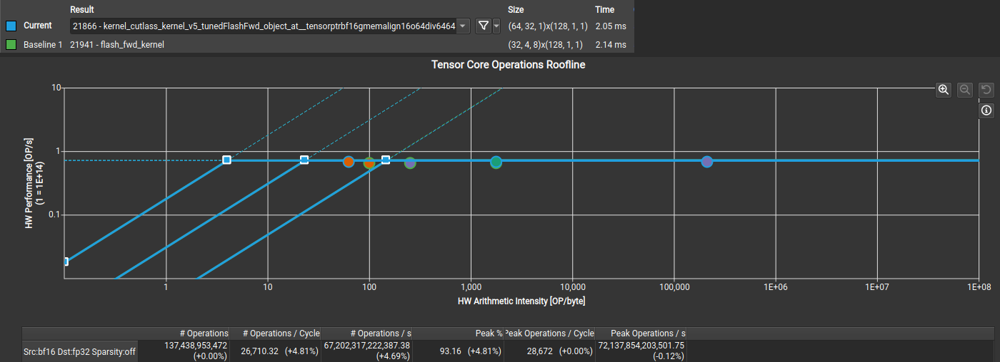


A chart of speed (operations per second) against operations per byte moved. The flat roof is the tensor cores' peak; the sloped lines are the limits set by memory bandwidth. A kernel on the flat roof is limited by its arithmetic, not by memory.


CuTe v5 (blue) and SDPA (green) both sit on the roof. Both do 137.4 G operations, exactly what the algorithm needs; v5 reaches 93.2% of peak against SDPA's 88.9%, 4.3 points higher (the chart's +4.81% is relative).

| N = 4096, Nsight Compute (clock fixed at 2.52 GHz) | CuTe v5 | Triton v5 (64 × 128, 2 stages, pinned) | SDPA |
|---|---|---|---|
| Non-causal: duration, % of tensor peak | 2.045 ms, 93.2% | 2.063 ms, 92.2% | 2.141 ms, 88.9% |
| Causal: duration, % of tensor peak | 1.086 ms, 89.0% | 1.151 ms, 85.3% | 1.204 ms, 81.5% |
| Instructions, non-causal | 180 M | 171 M | 220 M |
| Registers per thread, non-causal | 165 | 255 | 255 |
| Shared memory per block, non-causal | 24.6 KB | 41.0 KB | 49.2 KB |
| Longest stall, non-causal | math pipe throttle (12.2) | math pipe throttle (9.1) | math pipe throttle (6.8) |

The unchanged harness (median of 10 runs for CuTe v5 and Triton v5, 3 for NVIDIA's example, 35 for SDPA):

| N | causal | CuTe v5 | Triton v5 | NVIDIA's example | SDPA | CuTe v5 vs Triton v5 |
|---|---|---|---|---|---|---|
| 512 | no | 0.046 ms, 46.6 | 0.044 ms, 48.5 | 0.047 ms, 45.6 | 0.066 ms, 32.7 | tie (4% slower here) |
| 1024 | no | 0.138 ms, 62.1 | 0.144 ms, 59.5 | 0.138 ms, 62.1 | 0.151 ms, 57.0 | 4% faster |
| 2048 | no | 0.495 ms, 69.5 | 0.507 ms, 67.8 | 0.498 ms, 69.0 | 0.537 ms, 64.0 | 2% faster |
| 4096 | no | 1.991 ms, 69.1 | 1.968 ms, 69.8 | 1.950 ms, 70.5 | 2.158 ms, 63.7 | tie (1% slower) |
| 512 | yes | 0.039 ms, 27.6 | 0.042 ms, 25.6 | 0.040 ms, 26.9 | 0.054 ms, 19.8 | tie |
| 1024 | yes | 0.089 ms, 48.2 | 0.093 ms, 46.2 | 0.092 ms, 46.6 | 0.119 ms, 36.1 | 4% faster |
| 2048 | yes | 0.281 ms, 61.2 | 0.294 ms, 58.5 | 0.289 ms, 59.5 | 0.330 ms, 52.1 | 4% faster |
| 4096 | yes | 1.029 ms, 66.8 | 1.079 ms, 63.7 | 1.038 ms, 66.2 | 1.118 ms, 61.5 | 4–5% faster |

(ms and TFLOP/s; [`summary.txt`](https://github.com/searlion/cs336-2026-assignment2-systems/blob/main/flash_forward/2026_11_09_cutedsl/results/final/summary.txt). NVIDIA's example ran at 64 × 64 tiles through the same `do_bench` in [`bench_nvidia_example.py`](https://github.com/searlion/cs336-2026-assignment2-systems/blob/main/flash_forward/2026_11_09_cutedsl/bench_nvidia_example.py).)

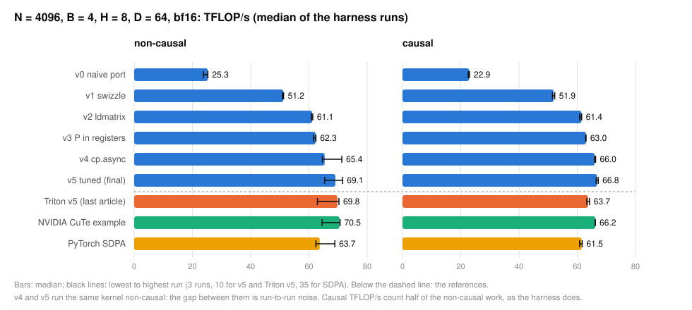

CuTe v5 beats SDPA on every shape. Against Triton v5 it is 2–5% faster on 5 of 8 shapes and ties on the rest. Non-causal N = 4096 times jump between two speeds for every kernel (CuTe v5 1.92–1.95 or 2.03–2.10 ms), so the 1% is noise, as is the v4–v5 gap. NVIDIA's example lands within 4% of v5 everywhere.

**Was it a fair fight?** A kernel at a lower clock looks slower for reasons unrelated to its code, and NVML samples taken during the harness are too coarse to show the runs were matched.

So [`fair_fight.py`](https://github.com/searlion/cs336-2026-assignment2-systems/blob/main/flash_forward/2026_11_09_cutedsl/fair_fight.py) runs each kernel's `do_bench` back to back for 4 s, interleaved over 3 rounds with 30 s cool-downs, sampling every 10 ms, at every N ([`fair_fight_summary.md`](https://github.com/searlion/cs336-2026-assignment2-systems/blob/main/flash_forward/2026_11_09_cutedsl/results/fair_fight_summary.md); medians over the rounds):

| N, mask | time, ms (CuTe v5 / Triton v5 / SDPA) | median SM clock, MHz | median power, W | share at power cap | max °C | CuTe vs Triton |
|---|---|---|---|---|---|---|
| 512, non-causal | 0.043 / 0.045 / 0.063 | 2730 / 2730 / 2730 | 142 / 143 / 138 | 0 / 0 / 0% | 65 | tie (one digit = 2.3%) |
| 512, causal | 0.037 / 0.037 / 0.054 | 2730 / 2730 / 2730 | 135 / 136 / 133 | 0 / 0 / 0% | 55 | tie |
| 1024, non-causal | 0.138 / 0.143 / 0.152 | 2715 / 2730 / 2730 | 160 / 159 / 156 | 0 / 0 / 0% | 64 | +4% |
| 1024, causal | 0.087 / 0.091 / 0.120 | 2730 / 2730 / 2730 | 148 / 150 / 142 | 0 / 0 / 0% | 57 | +5% |
| 2048, non-causal | 0.498 / 0.508 / 0.538 | 2715 / 2715 / 2715 | 205 / 201 / 186 | 14 / 14 / 0% | 70 | +2% |
| 2048, causal | 0.281 / 0.293 / 0.328 | 2715 / 2715 / 2730 | 181 / 184 / 166 | 0 / 0 / 0% | 64 | +4% |
| 4096, non-causal | 1.946 / 2.119 / 2.021 | 2655 / 2685 / 2700 | 219 / 219 / 208 | 97 / 97 / 29% | 72 | tie (see below) |
| 4096, causal | 1.030 / 1.075 / 1.115 | 2700 / 2685 / 2715 | 218 / 219 / 189 | 93 / 98 / 0% | 73 | +4% |

(+ means CuTe v5 is faster.) Below N = 2048 nothing reached the power cap. The sustained times agree with the harness except at N = 512 non-causal (4% faster here, 4% slower there): a tie.

No window, and none of the 38 benchmark runs, showed a thermal slowdown. CuTe v5 and Triton v5 drew the same power at median clocks within 1.1% at every N. Causal, CuTe v5 was 4–5% faster in every round at N ≥ 1024. Not because Triton's 64 × 128 tiles do 1.6% more work on the diagonal (70.9 G against 69.8 G; [`triton_tiles_causal_ncu.txt`](https://github.com/searlion/cs336-2026-assignment2-systems/blob/main/flash_forward/2026_11_09_cutedsl/results/round6/triton_tiles_causal_ncu.txt)): at 64 × 32 or 64 × 64 (69.8 G) Triton is still 3.9–4.1% slower (Round 6's run: 218–220 W, 96–98% at the power cap, max 73 °C; [`summary.txt`](https://github.com/searlion/cs336-2026-assignment2-systems/blob/main/flash_forward/2026_11_09_cutedsl/results/round6/summary.txt)). None of Rounds 1–5 is CuTe-only; the likely cause is leaner compiled code, 350 instructions per key block against 388 and half as many outside the loop ([`causal_gap.txt`](https://github.com/searlion/cs336-2026-assignment2-systems/blob/main/flash_forward/2026_11_09_cutedsl/results/round6/causal_gap.txt)), which `tl` gives no control over. Non-causal at N = 4096, whole windows ran fast or slow for all three kernels; in the two rounds where all three ran at the same speed, CuTe v5 was 0.8% and 0.9% faster: a tie.

<a id="round6">
## Round 6: beyond Triton's `tl`
</a>

Can CuTe win with something Triton's `tl` language cannot express, keeping O and L identical bit for bit?

The limit is the tensor cores: 512 bf16 operations per clock per SM, on 56 SMs. At SM clock frequency f_SM, no kernel can be faster than


t_{\min} = \frac{\text{tensor operations}}{512 \cdot 56 \cdot f_{\text{SM}}}


At v5's median clocks in Round 6's sustained run (2,640 MHz non-causal, 2,670 MHz causal) that is 1.815 and 0.912 ms. v5 took 1.954 and 1.037 ms in that separate run (1.946 and 1.030 in the fair-fight table; [`summary.txt`](https://github.com/searlion/cs336-2026-assignment2-systems/blob/main/flash_forward/2026_11_09_cutedsl/results/round6/summary.txt)).


A GPU runs as many blocks at once as fit on its SMs: one **wave** (168 blocks for v5 non-causal, 3 per SM). B·H = 32 gives 2,048 blocks, 12.19 waves, so the last wave keeps a fifth of the GPU busy. With B·H = 21, exactly 8 waves, v5's throughput is 1.9% higher, Triton's 1.5% ([`wave_probe_time.txt`](https://github.com/searlion/cs336-2026-assignment2-systems/blob/main/flash_forward/2026_11_09_cutedsl/results/round6/wave_probe_time.txt)).


I built two candidates. Both give O and L bitwise equal to v5's ([`bitwise_v6.txt`](https://github.com/searlion/cs336-2026-assignment2-systems/blob/main/flash_forward/2026_11_09_cutedsl/results/round6/bitwise_v6.txt), [`bitwise_v7.txt`](https://github.com/searlion/cs336-2026-assignment2-systems/blob/main/flash_forward/2026_11_09_cutedsl/results/round6/bitwise_v7.txt)), and both are slower:

- [v6](https://github.com/searlion/cs336-2026-assignment2-systems/tree/main/flash_forward/2026_11_09_cutedsl/kernels/v6_mbarrier) drops `__syncthreads`. Each buffer gets its own **mbarriers**, so a warp waits only for the tile it reads and the buffer it refills; Triton waits for K and V together ([`loop_sync_counts.txt`](https://github.com/searlion/cs336-2026-assignment2-systems/blob/main/flash_forward/2026_11_09_cutedsl/results/triton_v5/loop_sync_counts.txt)). On sm_89 (this GPU's architecture) an mbarrier wait is a polling loop: 25–33% more instructions ([`ncu_v5_v6.txt`](https://github.com/searlion/cs336-2026-assignment2-systems/blob/main/flash_forward/2026_11_09_cutedsl/results/round6/ncu_v5_v6.txt)).
- [v7](https://github.com/searlion/cs336-2026-assignment2-systems/tree/main/flash_forward/2026_11_09_cutedsl/kernels/v7_swpipe) **software-pipelines** each warp: the next `Q·Kᵀ` runs, in slices, between pieces of the current softmax. Other warps already fill those gaps, and non-causal the extra buffers cost a block per SM. Loop rotation in plain `tl` (computing the next S before this softmax; [`t6_rotated`](https://github.com/searlion/cs336-2026-assignment2-systems/tree/main/flash_forward/2026_11_09_cutedsl/kernels/t6_rotated)) slows Triton by 0.4–5.3% (against itself, clocks not logged; [`ab_t6_rotated.txt`](https://github.com/searlion/cs336-2026-assignment2-systems/blob/main/flash_forward/2026_11_09_cutedsl/results/round6/ab_t6_rotated.txt)).


A barrier object in shared memory. Threads **arrive** on it (a cp.async can arrive when its copy lands) and **wait** until enough arrivals have happened. Unlike `__syncthreads`, arriving and waiting are separate, and each buffer can have its own. sm_89 has no hardware wait for it, so waiting is a loop that reads the barrier until it flips. CuTe DSL 4.8.1's own mbarrier helpers refuse sm_89; v6 calls the operations beneath them ([`cute_mbarrier_probe.txt`](https://github.com/searlion/cs336-2026-assignment2-systems/blob/main/flash_forward/2026_11_09_cutedsl/results/round6/cute_mbarrier_probe.txt)).



Reordering a loop so that work from the next iteration overlaps work from this one: here the next `Q·Kᵀ` runs on the tensor cores while this iteration's softmax runs on the other units.


| N = 4096, sustained | non-causal | causal | in `tl`? | in Gluon? |
|---|---|---|---|---|
| floor / CuTe v5 | 1.815 / 1.954 ms | 0.912 / 1.037 ms | | |
| wave tail | 1.9% | none | | |
| v6, mbarriers | +2.4% | +7.0% | no | yes |
| v7, software pipelining | +2.1% | +2.8% | as loop rotation, also slower | yes |
| producer warp (not built) | | | no | no on sm_89 |

(218–222 W, 96–100% of samples at the power cap, max 70–74 °C, no thermal slowdown, clocks within 0.6% of v5's.) **Gluon** compiles v6's mbarriers and v7's sliced multiplies on sm_89 ([`gluon_probe.txt`](https://github.com/searlion/cs336-2026-assignment2-systems/blob/main/flash_forward/2026_11_09_cutedsl/results/gluon/gluon_probe.txt), [`gluon_capabilities.txt`](https://github.com/searlion/cs336-2026-assignment2-systems/blob/main/flash_forward/2026_11_09_cutedsl/results/gluon/gluon_capabilities.txt)): beyond `tl`, not beyond Triton. Warp specialisation works on sm_89 in neither Gluon nor `tl` ([`warp_specialize_probe.txt`](https://github.com/searlion/cs336-2026-assignment2-systems/blob/main/flash_forward/2026_11_09_cutedsl/results/triton_v5/warp_specialize_probe.txt)); a CuTe producer warp would poll v6's mbarriers, so I did not build it. On this card, scheduling beyond `tl` does not pay.


`triton.experimental.gluon`, a lower-level language shipped with Triton 3.6. The programmer picks layouts, shared-memory buffers, barriers and MMA instructions explicitly, much as in CuTe, and Triton compiles the rest.



Giving warps different jobs: a **producer** warp only issues copies, the others only compute. On Hopper and Blackwell, `setmaxnreg` moves registers from the producer to the computing warps; sm_89 has no such instruction. Gluon always emits `setmaxnreg`, so it fails to compile on sm_89.


<a id="checklist">
## What CuTe makes you write by hand, as a checklist
</a>

Each item is something Triton decided for me.

1. **Ownership.** Pick the tiled MMA (warps along rows); derive every copy and softmax reduction from it.
2. **Shared-memory layout.** Swizzle every tile read 8 rows at a time; bank conflicts in Nsight Compute should be zero.
3. **Operand loads.** ldmatrix copies built from the MMA, transposed for V; count `LDSM` against `LDS` in the SASS.
4. **Registers.** Re-view the accumulator as the next multiply's operand.
5. **Copy schedule.** Issue, commit, wait and barrier in the right order; a wrong order is a race, not a slowdown.
6. **Ragged edges.** Skip copies of rows past the end of the sequence and fill those rows with zeros; mask scores with a finite value.
7. **Configuration.** Sweep it, check shared memory against 99 KB for `sm_89`, keep a table.
8. **Calls.** Compile once per configuration and keep the per-call Python small.
9. **Correctness.** Check results after every change; a wrong answer can still be fast.
10. **Fair comparisons.** Interleave, cool down, and record clock, power and throttle reasons next to every time.

<a id="future">
## Future articles
</a>

The backward pass, in Triton and in CuTe DSL, and a closer look at the host-side cost of each call.
